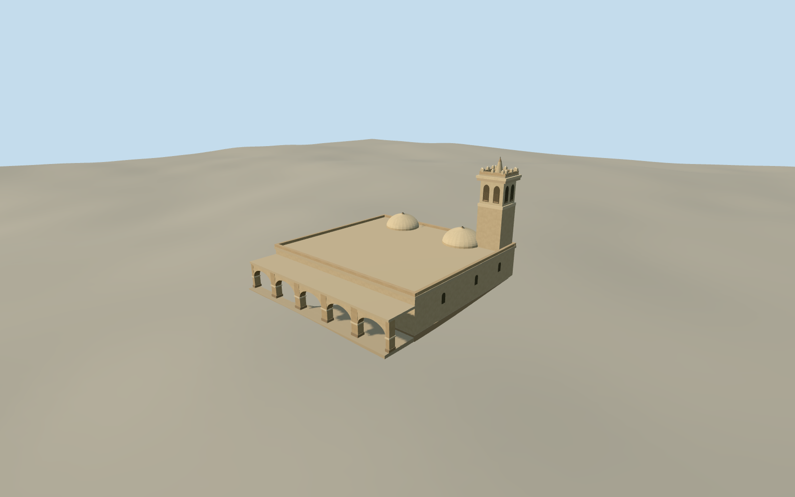

# Sidi Okba Mosque

Historic Sidi Okba mosque with its low plastered prayer hall, paired shallow domes, open entry arcade and square two-tier minaret.

Authoring state: **review-in-qa.json**. Current completion evidence is in [qa.json](qa.json) and the [completion ledger](../../../../qualla-structures/batches/qualla-003.PROGRESS.md).

- [Sidi Okba Mosque](https://qualla.com/sidi-okba-mosque/)

The historic walls are reconstructed from the measured hall size. Their position within the Overture compound and vertical heights, roof detail, render tint and exact opening locations are approximate.

The model covers the surviving historic hall, minaret, exterior tomb dome and short court. The much larger modern complex and surrounding buildings are separate structures.

Build: `node content/worldgen/source/places/sn/snh/sidi_okba_mosque/models/generate-sidi-okba-mosque.mjs`. Add `--check` to verify exact regeneration. 3490 triangles; 5 materials; no embedded photographs.
