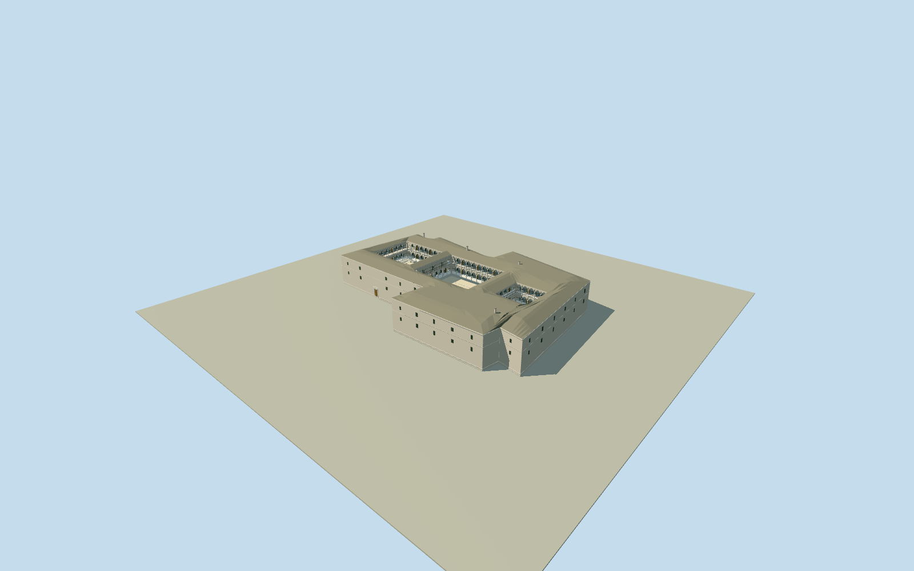

# Ahmed Bey Palace

Complete intrinsic Constantine palace within original named irregular boundary, three genuinely open measured principal courts/raised marble galleries/two levels of pointed arcades/straight-octagonal-spiral shafts/wood ties/balustrades and centralKiosque, original blue-cream-ochre tilebands/representativeunletteredmuralpanels/cedardoor-grillebays; graycurvedtilehiproofsurfaces/plainhighouterwalls/modestcurvedmarblegate and marblebasins. Courtyard sizes/baycounts text-measured, registration/grade/roofsections explicitlyestimated. No adjacentmosque/siteplaza/naturalground/trees/exhibits/people or copiedphototexture.

Authoring state: **review-in-qa.json**. Current completion evidence is in [qa.json](qa.json) and the [completion ledger](../../../../qualla-structures/batches/qualla-002.PROGRESS.md).

- [Ahmed Bey Palace](https://qualla.com/ahmed-bey-palace/)

Original named palaceway312325317/historiccastle/PalaisduBey identifies the actual irregular palace boundary, not a solidroof. Its unchanged12vertex perimeter defines the bounded exterior envelope; adjacent mosque699368575and unrelated nearbybuildingways remain separate. Three actual principal court voids,20x18m8by7orange garden,20x25mlarge garden and12mpavedcourt, their sequence separatedbytheKiosque, two-level pointed arcades/raised marble galleries, and mostly plain high exterior are explicitly documented in original1867Feraudtext. Court sizes/baycontrols are textual measurements; their localcentres/axes/galleryoffsets within the native boundary are architectural estimates, NOT native surveyed courtyard rings or a measured present-day plan. Complete intrinsic architecture has real court and arcade openings; whole named boundary is never filled by one roof.

Two native published Qualla originals only: ND217gallery photograph verified to pinned Commons nativeSHA1and primary RijksmuseumRP-F-F01088-AF/200344370namedcreatorÉtienneNeurdein/publisherJ.Kühn/1880-90date/explicitPublicdomain; Waran18creatorCC0native2023photo used only for blue/cream/ochrearchitectural tile color. Costumes/mannequins/exhibits/people/furnishings not modeled. Unknown engravedcourtyard/blogCC0/otherlicensedphotos not used. No external image, generatedbitmap or copiedphotographictexture.

Original1867Feraud text-only measurements checked on native PDF/title and printedpp65/74/87:20x18m/8by7orangegallery,20x25m/10longfacearcades and12mpavedcourt; twolevels,2.5mmaxshafts,varied15-25cmdiameters,raisedsurface,centralKiosque/triplecolonnade/plainhighwalls/graycurvedtile. Courtyard centres/shortface repeats/roofplanes/pavilion footprint and room census inside the unchanged native boundary are inferred, not an archaeological or present-day measured survey. Historical5609m²site description includes a broader scope than native3771m²boundary; no unrelated parcels added.

Complete exposed intrinsic forms include realcourt/arcadeopenings, variedstraight/octagonal/spiralmarblecolumns,balustrades/woodties/beams,cedar/grillebays,tilewainscot/originalunletteredmuralinterpretations and two gardenbasins/smallcourtvasque. Representative exterior repeats; 260historic/266storytotalcolumncensus includes rooms/dependencies and is not claimed exact. Hidden interiors/ceilings in rooms/exhibits, natural vegetation/soil/plaza/mosque/neighbors excluded.

Estimated interiorgalleryplateau3.8m/upper7.6m,roofeave11.4m/hiprises13.2m and lowfoundation-.4mare not surveyed elevations. Intrinsic enclosedcisterncover/courtdecks remain1.15mbelowgallery; they are construction inside the palace, not a surrounding terrain slab. Bookrecords raisedgalleries/cisterns and roughly15mfrontprofile; exact concealedsections,currentconservation/groundcontact remain unverified.

Independent180mcurrentTerrariumfield frozenbeforegeometry, not flattened/fitted. Nativeanchor is actualpalaceenvelopecentre; originalstorypoint lies on the externalapproach. Fixedsouthwestentrancedatum remainsapproximate; flatstageY-.58showsstructure ratherthan certifying hillsidefit. Arches/columns/balustrades/roofdetail simplifywithdistance while allthreecourtvoids persist.

Build: `node packages/worldgen/scripts/generate-authored-places.mjs --ids=ahmed_bey_palace`. Add `--check` to verify exact regeneration. 62591 triangles; 6 materials; no embedded photographs.
