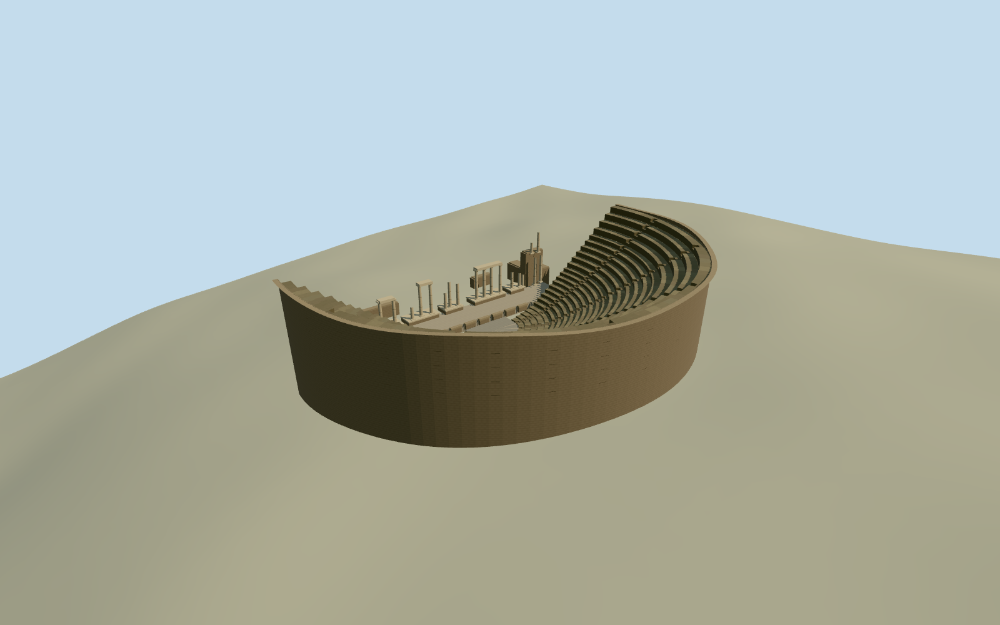

# Roman Theatre of Dougga

Standing Roman theatre with a limestone seating bowl, stepped aisles, small orchestra and partial stage colonnade.

Authoring state: **review-in-qa.json**. Current completion evidence is in [qa.json](qa.json) and the [completion ledger](../../../../qualla-structures/batches/qualla-004.PROGRESS.md).

- [Roman Theatre of Dougga](https://qualla.com/roman-theatre-of-dougga/)

The standing and restored theatre is represented as a ruin. Stone fractures, angles and individual column remnants are approximated using the cleared view and published dimensions.

The associated archaeological precinct and inaccessible spaces below the stands are outside scope.

Build: `node content/worldgen/source/places/sn/snq/roman_theatre_of_dougga/models/generate-roman-theatre-of-dougga.mjs`. Add `--check` to verify exact regeneration. 12066 triangles; 4 materials; no embedded photographs.
