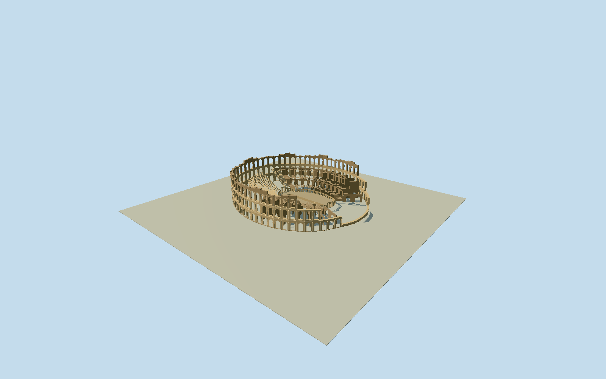

# Amphitheatre of El Jem

Whole surviving free-standing El Jem amphitheatre ruin: original mapped complete outer perimeter and offset native arena, surviving three-tier hollow stone arcades with engaged columns/entablatures and broken crowns, lower exposed radial support vaults/terraces, partial tiered cavea, arena podium/axial entrances and visible central hypogeum opening. No ideal complete ancient reconstruction, roof, detached museum, urban buildings, precinct/site slab, vehicles/people/cables or natural terrain. Retain complete original28vertex outer base and27vertex arena-podium curve; do not silently recenter/replace with ideal concentric ellipses. Three genuine open arcade storeys, engaged halfcolumns, projecting horizontal entablatures, ragged upper crowning, lower eastern interrupted ruinedreturn instead of a pristine complete high cylinder. Actual circular vaulted voussoirs/reveals, open gallery beyond and exposed radial arched infrastructure in ruined sectors. Keep open arena with intrinsic floor/visible central narrowhypogeum trench, broad axial access and incomplete seating/terrace sectors. Hidden exact sector azimuth/repair census/individual bay widths are photo estimates, actual base registration retained. Freeze independent400m field at fixed southdatum before geometry; do not fit/reacquire/flatten it. Stage geometry independently if compositeDEMoutliers/monumentreturns make contact uncertifiable.

Authoring state: **review-in-qa.json**. Current completion evidence is in [qa.json](qa.json) and the [completion ledger](../../../../qualla-structures/batches/qualla-002.PROGRESS.md).

- [Amphitheatre of El Jem](https://qualla.com/amphitheatre-of-el-jem/)

Exact named OSMrelation2894555/Q2914326, full original28vertex outerway218657180 and27vertex arenahole975418627. Fixed+Xeast/+Zsouth, anchor at original outer coordinatebounds center. Native arena offset and all mapped vertices preserved as plan evidence, not recentered to an ideal concentric ellipse or stretched to nominal UNESCO148x122m. Polygon nodes are coarse structural/arena controls, not surveyed exterior bay spacing. Facade heights/ruined sector boundaries/intermediate gallery and seating profiles are bounded photographic interpretation; operator36mheight/64bays and arena64x39m provide nominal census/section checks. Native detailed base controls take precedence over nominal extents.

Whole surviving stone amphitheatre with genuine open arcades/arena and incomplete cavea; no ideal ancient roof, pristine full high cylinder or full restored seating. Detailed64bay cadence, skyline8/district18 simplified larger openings are deliberate distance approximations. Original28vertex outerbase and27vertex arenalip retained in allLODs; intermediate gallery/podium/seat partitions are photographic estimates.

Four exact ownPD/CC0native originals by Noomen9, Newworldltd and Ridiculopathy individually inspected/nativeSHA1matched. Qualla-first16publishedfamilies reviewed; older Falbeprint/currency/attribution-license contemporaryphotos excluded. No copied photo/agencyimage/generatedbitmap/mesh used.

Ruined eastern sector azimuth/step heights, individual arch/column/capital census, restoration/erosion contours and hidden vaults are bounded medium-fi interpretations from cleared ground photographs. Operator36mheight/64baycount/nominal147.9x122.2outer and64x39arena corroborate broadscale; exact native footprints are not stretched/recentered to these published ideal dimensions.

Central visible hypogeum trench and two simple crossings are bounded exterior excavation cues, not a navigable complete underground survey. Natural ground, precinct/roads/buildings/vegetation/people/vehicles/cables and detached museum excluded. Intrinsic arena floor and stone footing bands do not include a whole-site base.

Independent400m129x129terrain field acquired at fixed south approach before geometry, original values and source tile bytes retained. CompositeDEMmay include monument/urbanreturns or outliers; no terrain flattening/fitting or surveyed datum claim. Portable/shared/context use separate flat review stage; actual street-level/threshold/arena-floor contact and compatible host attachment unverified; geographic preview/replaceFootprint=false.

Build: `node packages/worldgen/scripts/generate-authored-places.mjs --ids=amphitheatre_of_el_jem`. Add `--check` to verify exact regeneration. 29701 triangles; 4 materials; no embedded photographs.
