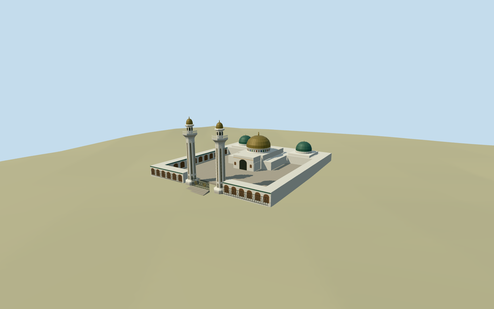

# Bourguiba Mausoleum

The Bourguiba Mausoleum in Monastir, its ribbed gold dome and two green cupolas framed by white marble minarets and ornamental gate.

Authoring state: **review-in-qa.json**. Current completion evidence is in [qa.json](qa.json) and the [completion ledger](../../../../qualla-structures/batches/qualla-003.PROGRESS.md).

- [Bourguiba Mausoleum](https://qualla.com/bourguiba-mausoleum/)

The surveyed outlines and approach control horizontal location. The 25 m tower height is the published dimension. Main and side roof heights, cupola positions within the complex, deep rear elevations and the courtyard arcades are estimated.

The available exterior photograph looks along the approach. Fine gate lettering and decoration are expressed in simplified geometric forms. The surrounding cemetery is outside the model boundary.

Official regional elevation data support broad grades. Individual steps and local paving levels are estimated.

Build: `node content/worldgen/source/places/sn/snr/bourguiba_mausoleum/models/generate-bourguiba-mausoleum.mjs`. Add `--check` to verify exact regeneration. 12602 triangles; 6 materials; no embedded photographs.
