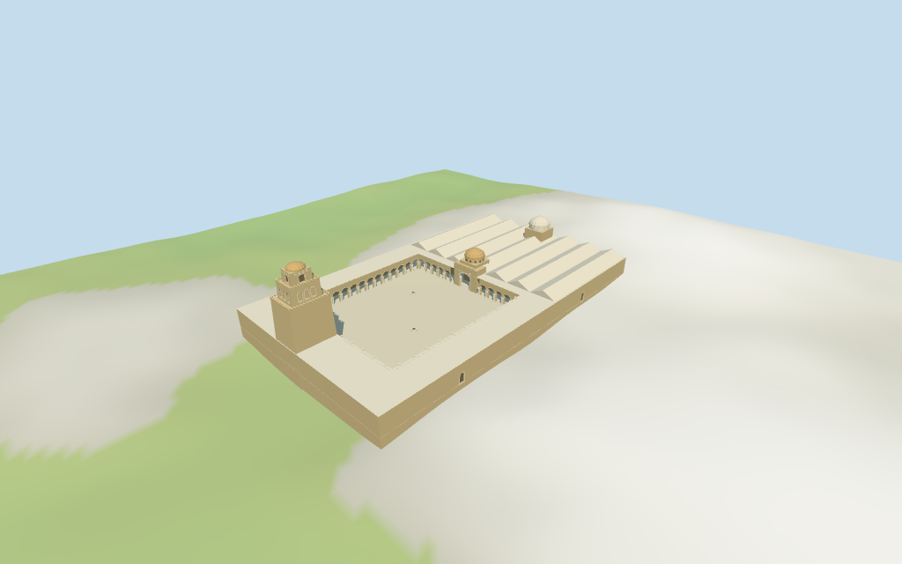

# Great Mosque of Kairouan

Individual medium-fi Great Mosque of Kairouan:three-stage square minaret/ribbed top,large pale open court,low horseshoe arcades with selected paired columns,larger prayer portal/stepped drum/ribbed ochre dome and separate pale mihrab dome over the deep prayer range. Current mapped whole,court and minaret remain fixed. Five existing shared256² graphs,seven merged groups,four authored browser levels. Fine inscriptions,carved/spolia details,precise parapet motifs,unseen roofs/rooms,current finish and exact access/terrain joins omitted or unverified.

## Evidence and reconstruction

Published dimensions and reconstructed details are separated in spec.json. Primary references:

- [Reference](https://commons.wikimedia.org/wiki/File:Great_Mosque_of_Kairouan_Minaret.jpg)
- [Reference](https://commons.wikimedia.org/wiki/File:Courtyard_of_the_Great_Mosque_of_Kairouan.jpg)

Five existing shared256² sandstone,limestone,lime plaster,plain wood and cast bronze graphs;seven merged groups with metric UVs/linear tints. Warm stone court ranges,pale column/paving tints,ochre ribbed entrance/minaret domes and pale rear dome. No embedded images,baked lighting/weathering or copied calligraphy.

## Model and axes

21,631 triangles; 64,893 vertices; 7 material groups; 2,600,076 bytes. Native bounds: -63.514, -3.244, -36.912 to 63.717, 34.221, 36.881. Source hash: `sha256:71d2c8f9d8a7899542d84c2edb7f1a097d62543af3fae8afe84577c753beaaad`.

{"x":"retained longest whole axis,approximately southeast;deep prayer range at+X,minaret in-X range","y":"up","z":"retained perpendicular axis;no global rescale"}

Standard viewer DEM datum 65.801678 m. Working floor 2.721 m is maximum bilinear whole-footprint sample at2 m spacing plus0.25 m;not surveyed paving. Relative footprint DEM -2.98..2.47 m. Raw DEM retained without cutout/flattening;footings adapt beneath it and cross Y=0. Exact entrance/terrace/threshold/court/terrain joins and walking remain unverified.

## Reproduce

Run `node packages/worldgen/scripts/generate-additional-landmarks.mjs --ids=great_mosque_of_kairouan` (or add `--check`). The generator preserves manually edited masters by checking their baseline hashes. Import through the standard authored-model workflow with optimization disabled; then capture all QA cameras, including shared-surface views.

## Pending work

- Retained exact relation/1369784 / Q1255269 matches current whole 52776559503032 (3*2^44+1369784) and the named Great Mosque of Kairouan POI on that encoded relation. Original anchor [10.103954139,35.681603084] and heading -1.024882613773 rad remain unchanged. Current whole has five outer/five court points; separate four-point minaret 35185275952167 occupies the northwestern range. Earlier six-point outer/six-point court plan is retained separately. Deep prayer range lies at +X, minaret at -X; source pictures guide the prayer portal and minaret court-facing fronts. No horizontal rescale or forced centred tower. Exact doorway and surrounding approach joins remain unverified.
- Current minaret control has height 31.5 m and layer 1; preserve its full ground-to-finial envelope. Whole control has no height/min_height. Retained facts have no height statements and unqualified 85 m width / 125 m length statements; do not rescale the roughly127.2 x73.7 m current outline. Working gallery roof6.8 m, arches4.8 m, portal crest9.2 m/front dome15.6 m, rear mihrab dome17.4 m, and estimated low prayer-roof ridges9.3 m are picture-based estimates. Estimated minaret stages20.2/25.5/29.5 m, ribbed cap31.2 m and finial31.5 m partition the mapped height. Untagged heights/roof forms/column cadence and facing are approximate within about2 m/4 degrees. Unseen roofs,interiors and exact access are unverified.
- Standard viewer DEM datum 65.801678 m. Working floor 2.721 m is maximum bilinear whole-footprint sample at2 m spacing plus0.25 m;not surveyed paving. Relative footprint DEM -2.98..2.47 m. Raw DEM retained without cutout/flattening;footings adapt beneath it and cross Y=0. Exact entrance/terrace/threshold/court/terrain joins and walking remain unverified.
- Two inspected pictures guide the tapered three-stage square minaret,vertical shaft windows,blind/upper fields,parapet crest and ribbed cap;horseshoe court arcades on selected paired columns;larger prayer portal/stepped drum/ochre ribbed dome and pale rear dome. Main roof/gables and low court well mouths are visualization estimates;small distant ancillary cap is omitted. Skyline retains the low roof ridges,coarsens arcade cadence/domes and omits crest/columns/recesses;district adds coarse fields/crest;near adds selected paired columns/arch bands/ribs. Gallery bays close on masonry backs,portal on wood doors,and minaret fields close on shallow backing;no navigable interiors. Fine carvings/inscriptions,exact spolia/cadence/rib/merlon profiles,current finish,unseen roofs/rooms/stairs and precise threshold/terrain joins,walking,engineering and physical-device performance unverified.

This bundle follows the medium-fi standard. Medium-fi appearance and geographic fit are reviewed separately. Hash-bound visual acceptance is recorded separately after capture inspection.

## Additional geographic data

©OpenStreetMap contributors;Protomaps;Mapzen/USGS terrain tiles.
