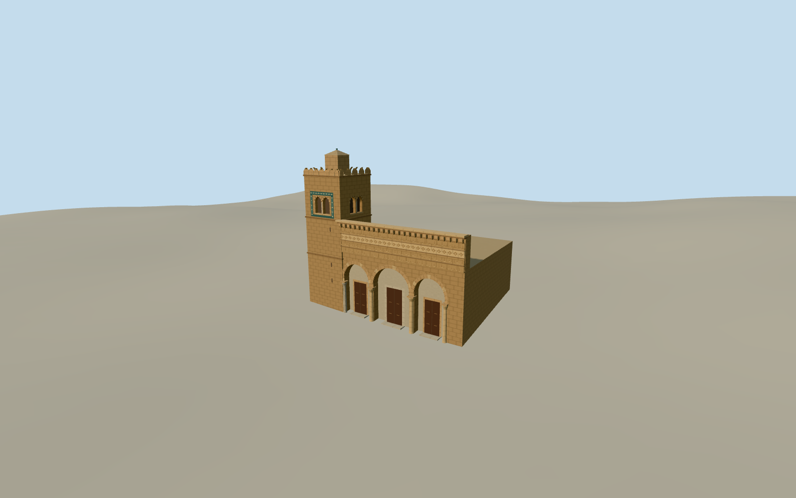

# Mosque of the Three Doors

The Mosque of the Three Doors in Kairouan with three horseshoe portals, the carved west façade, and its tiled and crenellated northwest minaret.

Authoring state: **review-in-qa.json**. Current completion evidence is in [qa.json](qa.json) and the [completion ledger](../../../../qualla-structures/batches/qualla-003.PROGRESS.md).

- [Mosque of the Three Doors](https://qualla.com/mosque-of-the-three-doors/)

The original upload was published on 7 May 2007 and has no recorded capture date. The model represents the exterior as documented by that image.

Published wall dimensions and the adjacent mapped street establish an approximate envelope and placement. Exact setback, roof surfaces, façade height and grade contact are estimates.

The exterior should preserve the four frieze registers and their relief without inventing legible inscriptions.

Build: `node content/worldgen/source/places/sn/snr/mosque_of_the_three_doors/models/generate-mosque-of-the-three-doors.mjs`. Add `--check` to verify exact regeneration. 3669 triangles; 6 materials; no embedded photographs.
