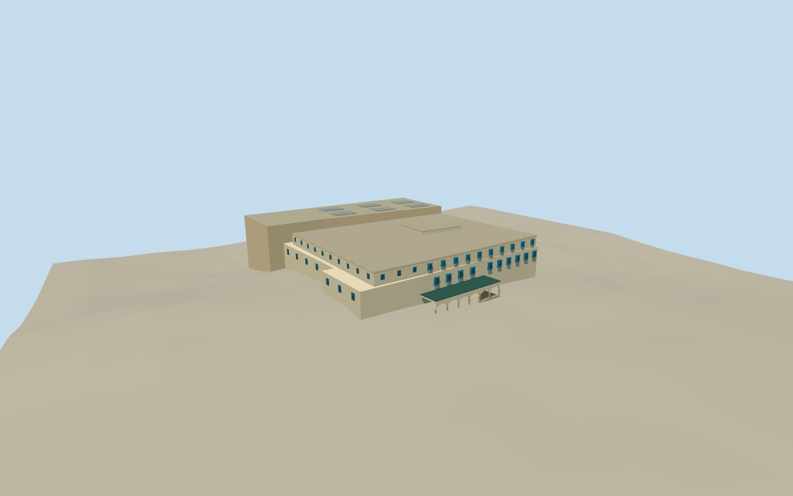

# Bardo National Museum (Tunis)

Bardo National Museum in Tunis with the white historic palace and blue projecting bays, open garden arcade and attached contemporary wing.

Authoring state: **review-in-qa.json**. Current completion evidence is in [qa.json](qa.json) and the [completion ledger](../../../../qualla-structures/batches/qualla-003.PROGRESS.md).

- [Bardo National Museum](https://qualla.com/bardo-national-museum-tunis/)

The overall mapped envelope is controlling. The exact old and new boundary, roof heights, courtyard and skylight placement, porch dimensions, rear elevations and foundation levels are estimated.

The contemporary exterior is represented using the mapped geometry and written building descriptions. No contemporary extension imagery was used.

Only the museum exterior is represented. The adjacent Assembly, Bey’s Mosque, sculpture, inscriptions, public art, landscape and interiors are outside the modeled scope.

Build: `node content/worldgen/source/places/sn/snx/bardo_national_museum_tunis/models/generate-bardo-national-museum-tunis.mjs`. Add `--check` to verify exact regeneration. 5888 triangles; 6 materials; no embedded photographs.
