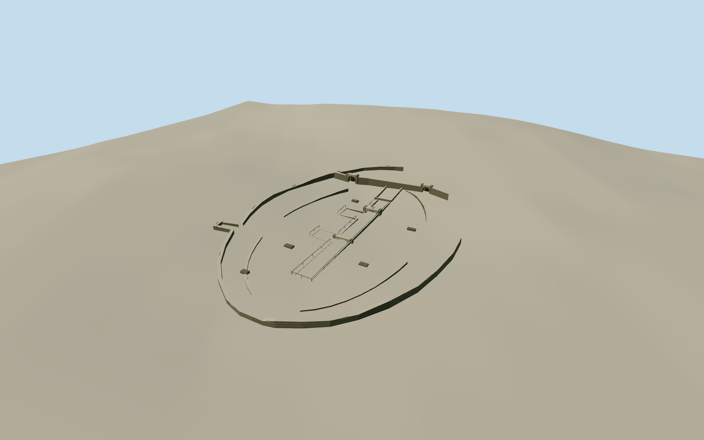

# Carthage Amphitheatre

The excavated amphitheatre at Carthage in 2017, with its low arena walls, exposed underground passages, surviving arches and protective railings.

Authoring state: **review-in-qa.json**. Current completion evidence is in [qa.json](qa.json) and the [completion ledger](../../../../qualla-structures/batches/qualla-003.PROGRESS.md).

- [Carthage Amphitheatre](https://qualla.com/carthage-amphitheatre/)

The model represents the surviving excavated amphitheatre and modern site fittings seen in April 2017. The vanished Roman upper tiers are outside this dated scope.

The named archaeological outline, retaining wall and mapped ruins constrain the surviving structures. The heritage institute gives the arena dimensions. Wall breaks and original masonry courses are simplified.

The original Terrarium grid remains intact. A narrow modeled opening exposes the photographed passages in the viewer. The excavated floor depth and paving datum are estimates.

Build: `node content/worldgen/source/places/sn/snx/carthage_amphitheatre/models/generate-carthage-amphitheatre.mjs`. Add `--check` to verify exact regeneration. 2345 triangles; 5 materials; no embedded photographs.
