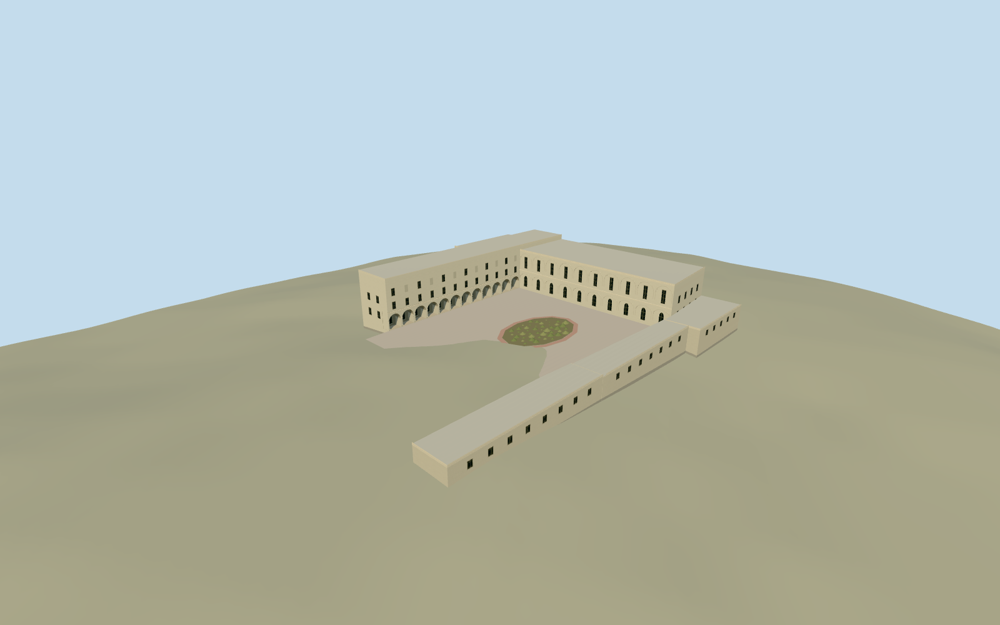

# Carthage National Museum

Carthage National Museum in the former White Fathers seminary above Byrsa, with white arcades and a planted cloister court.

Authoring state: **review-in-qa.json**. Current completion evidence is in [qa.json](qa.json) and the [completion ledger](../../../../qualla-structures/batches/qualla-003.PROGRESS.md).

- [Carthage National Museum](https://qualla.com/carthage-national-museum/)

The scene depicts the documented historic seminary buildings before any new competition interventions. Hidden exterior openings, roof parapets, internal court grading and the annex eaves are estimates.

The adjacent cathedral, archaeological ruins, excavated artifacts, modern equipment and future museum fit-out are outside the modeled footprint.

Build: `node content/worldgen/source/places/sn/snx/carthage_national_museum/models/generate-carthage-national-museum.mjs`. Add `--check` to verify exact regeneration. 5927 triangles; 6 materials; no embedded photographs.
