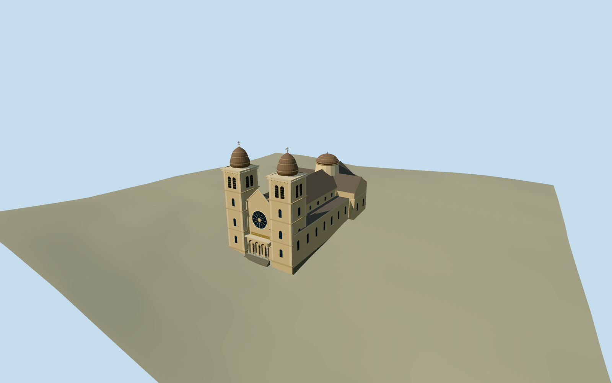

# Cathedral of Saint Vincent de Paul, Tunis

Tunis cathedral with its patterned limestone façade, triple columned porch, rose window, twin tiara-shaped bell towers, crossing dome and rounded apse.

Authoring state: **review-in-qa.json**. Current completion evidence is in [qa.json](qa.json) and the [completion ledger](../../../../qualla-structures/batches/qualla-003.PROGRESS.md).

- [Cathedral of Saint Vincent de Paul](https://qualla.com/cathedral-of-saint-vincent-de-paul/)

The main footprint follows the current mapped perimeter. Tower, roof, dome and side-aisle heights, individual stone ornaments and some façade details are approximate.

The façade includes geometric interpretations of the stained glass and mosaic. The model excludes interiors, adjacent buildings and individual carved figures.

Build: `node content/worldgen/source/places/sn/snx/cathedral_of_saint_vincent_de_paul/models/generate-cathedral-of-saint-vincent-de-paul.mjs`. Add `--check` to verify exact regeneration. 8690 triangles; 7 materials; no embedded photographs.
