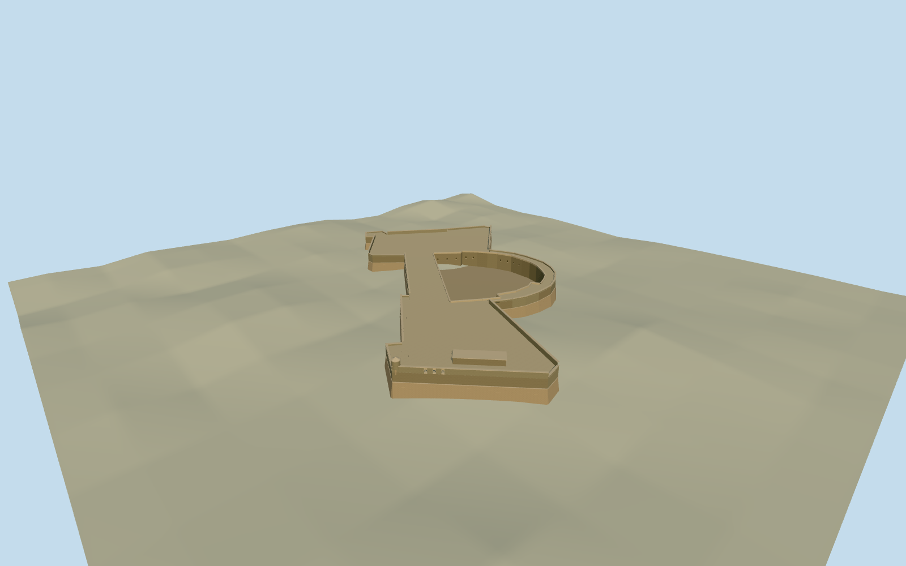

# Fort de la Goulette

The standing Karaka fort with continuous splayed limestone walls, irregular bastioned wings, arched openings and the curved open court.

Authoring state: **review-in-qa.json**. Current completion evidence is in [qa.json](qa.json) and the [completion ledger](../../../../qualla-structures/batches/qualla-004.PROGRESS.md).

- [Fort de la Goulette](https://qualla.com/fort-de-la-goulette/)

Wall heights, blind-side fenestration, current stone finish and individual terrace levels are approximated.

The model includes the exterior, open inner courtyard and recessed entrances. It omits adjacent landing-stage structures and interiors behind the masonry.

Build: `node content/worldgen/source/places/sn/snx/fort_de_la_goulette/models/generate-fort-de-la-goulette.mjs`. Add `--check` to verify exact regeneration. 3954 triangles; 5 materials; no embedded photographs.
