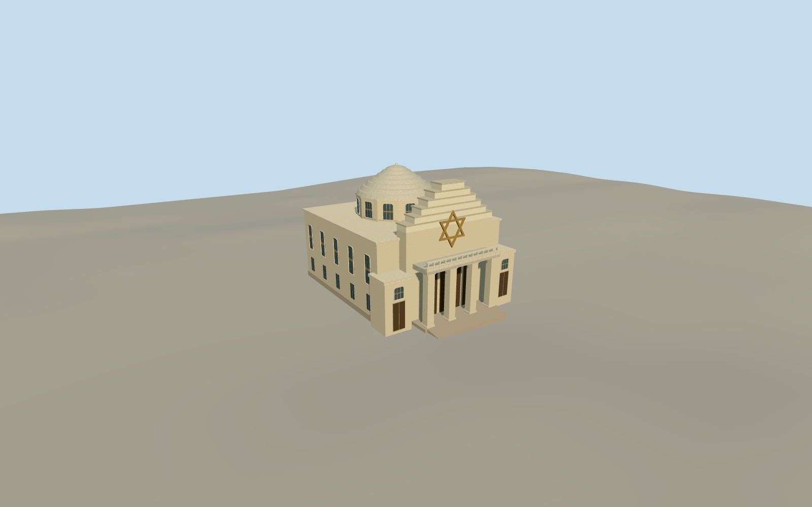

# Grand Synagogue of Tunis

Victor Valensi’s Art Deco synagogue on Avenue de la Liberté in Tunis, with a stepped facade and dome, twelve angular drum windows, two low entry pavilions and a prominent Magen David.

Authoring state: **review-in-qa.json**. Current completion evidence is in [qa.json](qa.json) and the [completion ledger](../../../../qualla-structures/batches/qualla-003.PROGRESS.md).

- [Grand Synagogue of Tunis](https://qualla.com/grand-synagogue-of-tunis/)

The model represents the standing Art Deco exterior. Native mapping fixes the site rather than the individual facade and roof dimensions, which are interpreted from written studies.

The separate entry pavilions, porch, twelve-window drum, tiled levels, and front Magen David are retained. Decorative lettering, fine mouldings, and interior furnishings are omitted.

The original terrain references the avenue approach. Site and facade setbacks, height, materials, and window dimensions are estimates.

Build: `node content/worldgen/source/places/sn/snx/grand_synagogue_of_tunis/models/generate-grand-synagogue-of-tunis.mjs`. Add `--check` to verify exact regeneration. 3738 triangles; 6 materials; no embedded photographs.
