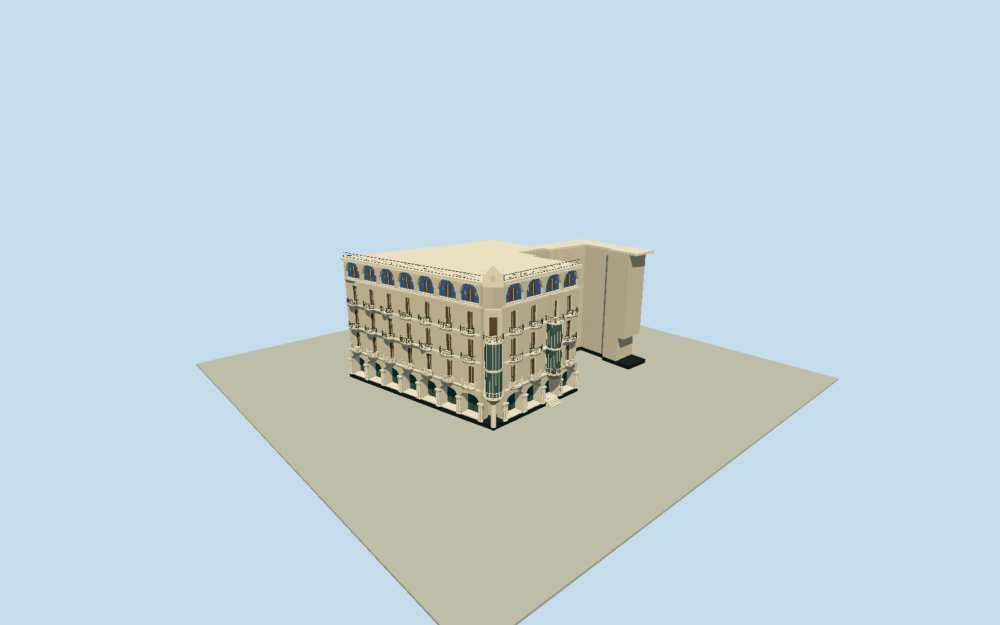

# Gran Hotel, Palma

Whole1903Modernista Gran Hotel/nowCaixaForum Palma: complete native36control concave envelope and hidden rear wings/lightwell gaps, cream masonry/roof terrace, actual deep segmental ground glazing and four-step closed entry/paired round columns/dark plinth, projected stacked curved glazed oriels/round balconies, shuttered upper recesses/curved stone and metal balcony rails, blue-white original upper ornamental panels/corner crown/parapet/roof railing and intrinsic globe lamps. Visible south/Weyler and west façades follow native street context; projections/ornament/hidden elevations estimated from cleared published photos. No neighboring buildings/streets/trees/people/cafe furnishings/interiors/gallery artwork/logos/poster/text copies.

Authoring state: **review-in-qa.json**. Current completion evidence is in [qa.json](qa.json) and the [completion ledger](../../../../qualla-structures/batches/qualla-002.PROGRESS.md).

- [Gran Hotel (Palma)](https://qualla.com/gran-hotel-palma/)

Actual mapped building73043459/Q3780261 namedGran Hotel CaixaForum/aliasCaixaFòrum; not genericPalma museum/neighboring terrace/property. Whole closed37point source ring(36uniquecontrols), all36native outline controls retained; oriel/balcony projection plans and depths are photographic estimates, not separate surveyed native outlines. Common exact native bbox-midpoint anchor/+Xeast/+Zsouth/heading0; article point not reused as placement. Floors/sections selected only after independent field freeze. Native named street geometry locates Plaça d’en Weyler south of building; south and west façades are the selected visible street elevations.

All source floor/section/geometry decisions follow the original independent400m129x12916641sample field/two rawtile freeze. Floor0 uses fixed SW19.7745m provider-relative datum, not a surveyed street/threshold. Original photographic estimates: five exterior levels including ground/three main upper floors/short attic; ground5.65m/upper floors6.2,10.5,14.8m/attic19.1m/main terrace22.5m/corner crown25.2m. Ground glass/paired columns/actual closed entry recess and four .19m risers reach .76m threshold; upper window reveals .44m, ground bays1.8m/entry2.16m. Ground core set back2.4m, upper .85m before real façade openings, never filled across recesses. Southwest curved oriel and second south façade glazed projection/curved balconies are original photo-based plans/radii/offsets, not surveyed projections. All36native whole-building ring controls retained at plinth/cornice; native concavities/lightwell gaps preserved. Hidden rear/terrace details/party walls/exact ornament/window/balcony census/currentfinish are bounded estimates. No source terrain fit/flatten/reacquisition or later raising to hide ground contact; placement remains preview/replacementfalse/unresolved grade.

Four exact published Qualla creatorPD/CC0 originals individually inspected/nativeSHA1 matched:2010Selcommons own/PD-self entry and2019Antekbojar own/CC0 whole corner/near/oblique frontage. Assumed-authorGranhotel.JPG/unrelatedPalma/Miro/artworks/maps/protected or doubtful sources unselected. No supplemental imagery, copied pixels/generated photo textures, article/media/rightsmetadata repair/reclassification. Original blue-white ornament/rails/crown simplify public architectural motifs; gallery posters/artworks/brand marks/interiors omitted. Exact hidden rear/terrace/party-wall profiles/bay and ornament census/currentfinish are bounded estimates. Distant levels simplify windows/rails/columns/census while retaining whole native envelope and both projected curved bays.

Independent400m129x12916641sample original field/two rawtiles/fixed SW19.7745m provider datum frozen before floors/sections/geometry. No fitting/flattening/reacquisition or subsequent raising to hide source contact. All geographic placement preview/replaceFootprint=false; exact grade/entry thresholds unresolved. Flat isolated ground and synthetic neighbors are review fixtures.

Build: `node content/worldgen/source/places/sp/sp1/gran_hotel_palma/models/generate-gran-hotel-palma.mjs`. Add `--check` to verify exact regeneration. 61108 triangles; 6 materials; no embedded photographs.
