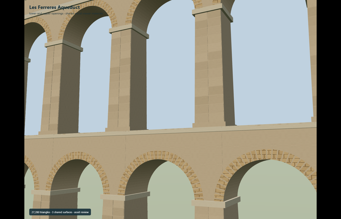
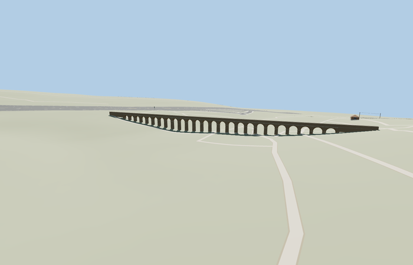

# Les Ferreres Aqueduct

Reviewed2026-10-27. **Source exterior reviewed; native placement incomplete and disabled.**

Inspected59 current frames:11 portable,10 shared-material asset views,23 medium-fi and15 native diagnostic views. Complete25 upper/11 lower true arch holes, tapered/rusticated piers, projecting imposts, radial ring stones, cornices, end walls and a continuous open dry channel are present. Fixed missing inter-arch spandrels in the same pass and added76 corresponding face probes per GLB. Whole-model turntables are thin; dedicated two-tier, arch, pier and channel views provide useful detail. Outer support bases float in flat authoring context because they require hills; this is not native-fit approval.

Three existing shared256px sandstone/raw sandstone/raw limestone graphs, metric UVs and linear vertex tints. No embedded/private images, downloaded mesh or copied photograph pixels. District uses two graphs; street/closeup use three; graphs are read once and model resources dispose. Shared captures are asset-review mode, not geographic placement evidence.

| Level | Triangles | Bytes | Draws |
| --- | ---: | ---: | ---: |
| skyline | 942 | 61136 | 1 |
| district | 3744 | 247208 | 2 |
| street | 6768 | 453156 | 3 |
| closeup | 19552 | 1381492 | 3 |

Source master 27280 triangles / 2294000 bytes. Runtime triangles 942 / 3744 / 6768 / 19552, bytes 61136 / 247208 / 453156 / 1381492, draws 1 / 2 / 3 / 3. Initial skyline plus district 308344 bytes. Actual triangle budgets pass; physical-device timings are unmeasured.

Named standard PMTiles channel35184459381762 and monument POI17594328805153 establish the approximate signed plan. Anchor[1.2438972294330597,41.14592823887574], heading1.9642307890327135: +X north-northwest, +Z east-northeast. The mapped242.225m channel includes end walls and remains separate from older217m/249m extent figures. Both standard z14 and z15 terrain smooth the valley to roughly45–56m; fitting the upper channel to its ends buries the lower arcade. Below-ground diagnostic cameras expose it but cannot establish an acceptable exterior placement. The canonical geographic entry stays draft/disabled, with no ground modification, road replacement or readiness claim.

All67 roads and one resident building remain, and failure/unload preserve terrain and water. No native road join or terrain correction is claimed.

## Remaining work

Resolve a faithful native valley/hillside fit without burying the lower arcade, floating the outer piers or inventing ramps. Do not repeat the completed source review unless source geometry or material bindings change.

## Reconstruction limits

- 25 upper and11 lower real arches,5.9m nominal openings/7.95m pitch,27m maximum height. Photo-led tapered piers, impost bands, ring stones, rusticated faces and open channel. Hill/support profiles and exact masonry dimensions remain approximate. Named242.225m mapped channel includes end walls; retained separately from older217m catalog and249m photo-caption figures.
- Standard Mapzen z14 and z15 ground smooths the valley: roughly45–56m along the channel. Fitting upper end walls to those banks buries much of the lower arcade. Geographic entry must remain a disabled draft until a faithful generic terrain-fit method is available. No fabricated staircase, stretched piers or changed surrounding ground.
- Full two-tier medium-fi exterior and open dry channel; exact stone damage, original waterproof lining, inscriptions, vegetation and hillside reconstruction are not claimed. Geometry is original and analytic, with no downloaded mesh or photograph texture.
- Existing shared256px stone_sandstone_raw, stone_sandstone and stone_limestone_raw graphs, metric UVs and linear tints. No private or embedded images. Four runtime levels retain all36 open arch holes; distant arches are deliberately polygonal.
- Source support bases/hill profile and tier dimensions are photo-led approximations. The27m height is the source maximum above its lowest reconstructed foot, not a claimed27m exposed height in coarse native terrain. Geographic readiness is withheld; physical laptop/phone timing is unmeasured.
