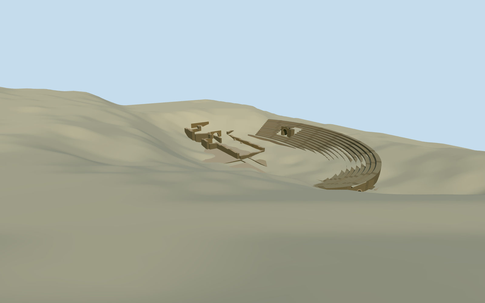

# Tarragona Amphitheatre

The surviving seaward-facing Roman amphitheatre of Tarraco with elliptical seating, vaulted approaches and medieval church ruins in the arena.

Authoring state: **review-in-qa.json**. Current completion evidence is in [qa.json](qa.json) and the [completion ledger](../../../../qualla-structures/batches/qualla-004.PROGRESS.md).

- [Tarragona Amphitheatre](https://qualla.com/tarragona-amphitheatre/)

The present visible ruin is modeled. The building remains measured and interpreted at the scale of the surviving complex, with individual broken stones, stair breaks and excavated channel depths represented approximately.

The modern site paths, handrails, structural conservation barriers and nearby buildings are outside this model except for the main walking levels needed to read the ruin.

Build: `node content/worldgen/source/places/sp/sp2/tarragona_amphitheatre/models/generate-tarragona-amphitheatre.mjs`. Add `--check` to verify exact regeneration. 6058 triangles; 5 materials; no embedded photographs.
