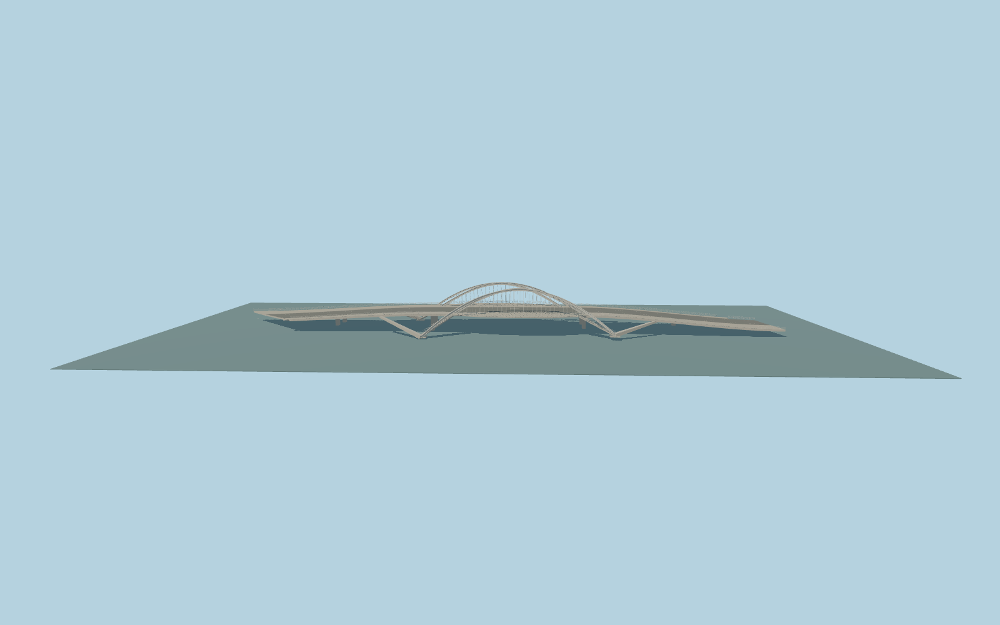

# Bac de Roda Bridge

Complete individual Bac de Roda Bridge: full mapped road/approaches, staggered pairs of upright and inclined white steel ribs, vertical and diagonal hanger rods, open paired-rib braces, I-section ribs and shoes, bowed outer walks, four broad stair descents/landings, open handrails, deck slab/crossgirders, shaped open underdeck supports and simple road markings. Current tunnels and lower road remain native; no old visible railway is invented.

Rebuild: `node packages/worldgen/scripts/generate-bac-de-roda-bridge.mjs`;append `--check` for exact source bytes. Select import/LOD/placement with `--ids=bac_de_roda_bridge`. Detailed source and four browser tiers are separate ignored GLB outputs.

Fixed19m model datum, photo-guided central roadway near27m with ten-metre upright arch rise and longer inclined outer ribs descending to standard-field stair feet. Long end approaches descend toward23.4/22m. Literal support/stair samples fit the unmodified standard viewer field; these are approximate visualization controls, not surveyed structural elevations.

Three ordinary photos and current PMTiles guide this original medium-fi exterior. Rib curves, I sections, hanger count/anchors, braces, stair widths/tread counts, railings and structural supports are photo approximations; concealed engineering/interiors and readable graffiti/signs are excluded. The225m full retained envelope includes long approaches and four stair wings; the much smaller architectural core is modeled at its own plan stations. Old photos show open railway ground, but current map routes are tunnels; their hidden tracks are not added visibly. No copied photo pixels, downloaded meshes, vehicles or unique textures. Current native terrain/contact limitations and physical-device timing remain explicit.

Original geometry:repository license. Map:© OpenStreetMap contributors,ODbL-1.0;Protomaps. Standard terrain:terrain-grid.json. Ordinary pictures stay local and are not redistributed or used as textures. Current acceptance:qa.json.
