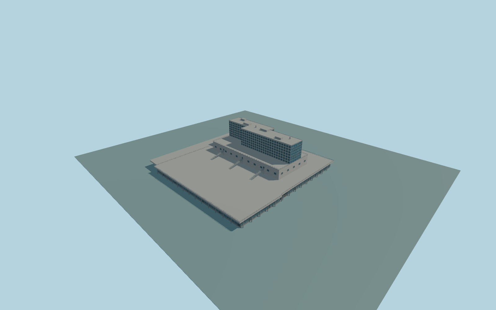

# Barcelona Sants railway station

Complete Barcelona Sants permanent passenger-station and attached hotel exterior: broad low glazed concourse, deep parking-roof fascia and perimeter rails, supported open eastern canopy, full rectangular upper podium with exterior stairs and terraces, connected stepped upper hotel with seven window rows and blue glazed end, and roof services. Keep the independent Nobu hotel, all other surrounding buildings, roads, public squares, subway infrastructure and rails native. No cars, logos, rooftop lettering, public artwork, temporary construction or navigable interior.

Rebuild: `node packages/worldgen/scripts/generate-barcelona-sants-railway-station.mjs`;append `--check` for exact source bytes. Select import/LOD/placement with `--ids=barcelona_sants_railway_station`. Detailed source and four browser tiers are separate ignored GLB outputs.

Complete Barcelona Sants permanent passenger-station and attached hotel exterior: broad low glazed concourse, deep parking-roof fascia and perimeter rails, supported open eastern canopy, full rectangular upper podium with exterior stairs and terraces, connected stepped upper hotel with seven window rows and blue glazed end, and roof services. Keep the independent Nobu hotel, all other surrounding buildings, roads, public squares, subway infrastructure and rails native. No cars, logos, rooftop lettering, public artwork, temporary construction or navigable interior.

Retain native concourse5m, podium20m and upper hotel41m as map facts. Photograph-proportioned source uses concourse roof8.5m with two-level entrances, podium20m and hotel41m; services rise to43m. The source concourse is taller than the nominal native roof; no attempt to silently rewrite the map height. One unchanged standard host sample outside the northwestern concourse edge,local[-80,-40], 39.614246666666666m supplies one common datum. Level occupied floor+.65m and structural foundation/support feet-6.3m;no per-part host offsets or artificial surrounding plaza. The standard field falls3-4m toward the southeastern open canopy; exact urban ground contact must be inspected,not assumed.

Two adequate ordinary exterior pictures inspected; the overview predates present forecourt works. Permanent station/hotel proportions and glazing character are observed. Hidden sides, mirrored-end assignment, precise window inventory, exterior stair landings and services are original medium-fi approximations. Original medium-fi permanent exterior only; no copied brands,lettering,public sculpture,cars,temporary construction,independent hotels or navigable interiors. The large mirrored end uses the existing shared window-grid surface rather than a private photograph or reflection image. Exact station thresholds,roof parking access and hidden service inventory remain approximate. Physical-device timings and numerical LOD errors remain unmeasured.

Six existing shared256px panel-concrete,granite,membrane,painted-metal,window-grid andstorefront graphs;six groups maximum. Metric UVs,linear colors,no private or embedded images. Skyline retains the entire concourse,open edge roof,podium,stepped hotel and roof services. District adds repeated glazing,deck rails and three supported stairs. Street adds actual window recesses,entrance framing and detailed cladding. Close-up adds complete hotel window inventory,individual curtain-wall frames,rail posts,stair treads and vents. Master separately refines cladding joints.

Original geometry:repository license. Map:© OpenStreetMap contributors,ODbL-1.0;Protomaps. Standard terrain:terrain-grid.json. Ordinary pictures stay local and are not redistributed or used as textures. Current acceptance:qa.json.
