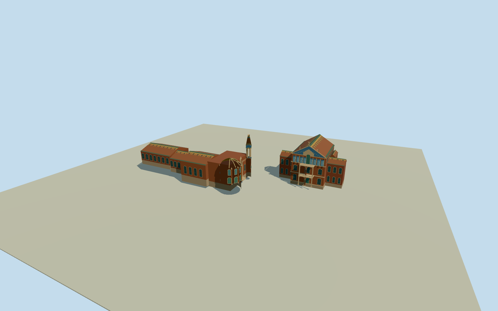

# Hospital de Sant Pau Pavilions

Two pavilions at Barcelona’s Hospital de Sant Pau with red-brick façades, carved limestone, multicolored tiles and green glazing. The Operations Pavilion has a sculpted gable and arcaded entrance. The Carme Pavilion has a domed rotunda and an open-sided tiled water tower.

Authoring state: **review-in-qa.json**. Current completion evidence is in [qa.json](qa.json) and the [completion ledger](../../../../qualla-structures/batches/qualla-003.PROGRESS.md).

- [Hospital de Sant Pau](https://qualla.com/hospital-de-sant-pau/)

The model includes the restored Operations and Carme pavilions. The administrative building, other wards, landscaping and the underground galleries are outside its scope.

The exact photographs govern the principal elevations, roof finishes and ornament. Heights, backs of the buildings, roof subdivisions, figural sculptures and inscriptions are simplified or estimated.

The original public DEM establishes relative ground level. Foundation depths compensate for the approximated grades without modifying the elevation source.

Build: `node content/worldgen/source/places/sp/sp3/hospital_de_sant_pau/models/generate-hospital-de-sant-pau.mjs`. Add `--check` to verify exact regeneration. 8392 triangles; 5 materials; no embedded photographs.
