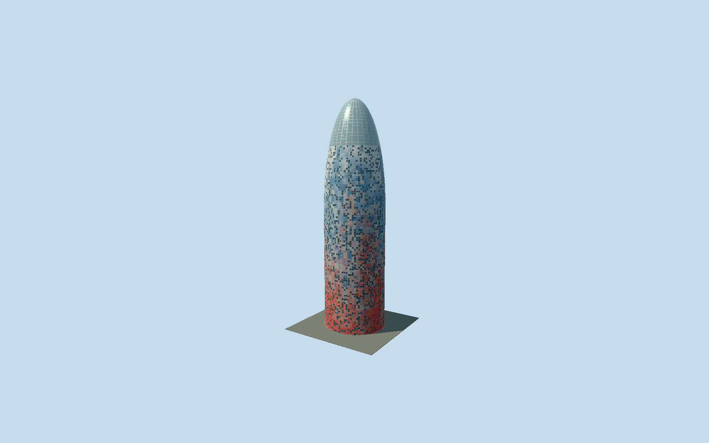

# Torre Glòries

Barcelona oval geyser silhouette with irregular red-to-blue pixels, daylight glass veil, fine near louvres and a pale framed dome.

## Evidence and reconstruction

Published dimensions and reconstructed details are separated in spec.json. Primary references:

- [Reference](https://www.jeannouvel.com/en/projects/tour-agbar/)
- [Reference](https://www.prepaintedmetal.eu/en/collection/torre-agbar)
- [Reference](https://www.pedelta.com/structural-review-of-the-dome-of-agbar-tower-p-45-en)
- [Reference](https://www.openstreetmap.org/way/44213122)

No third-party geometry, photograph or bitmap texture is embedded. Shared surface graphs come from the central library; vertex tints carry model colors. Glazing uses PBR materials; transparent surfaces are declared per model.

## Model and axes

49,662 triangles; 148,876 vertices; 4 material groups; 5,958,320 bytes. Native bounds: -20.045, 0.000, -18.529 to 20.045, 144.400, 18.529. Source hash: `sha256:5de47f5859d6d792c9e421a6e14f0ef145d251a0be60e82800562802b4d2d786`.

{"up":"+Y","longitudinal":"+X east/slightly north","front":"+Z south/slightly west; no surveyed entrance phase","origin":"Exact-QID ground-contact ellipse frame"}

The geographic proposal uses exact-QID OpenStreetMap evidence. Map-derived orientation and estimated architectural details require real-site visual review; preview eligibility is distinct from geographic/fidelity approval. Map attribution: © OpenStreetMap contributors, ODbL-1.0.

## Reproduce

Run `node packages/worldgen/scripts/generate-signature-towers.mjs --ids=N0173` (or add `--check`). The generator preserves manually edited masters by checking their baseline hashes. Import through the standard authored-model workflow with optimization disabled; then capture all QA cameras, including shared-surface views.

## Pending work

- Original 142044-triangle/16046604-byte master remains exactly reproducible from the unchanged global recipe, including 4,500 original reconstructed window cells and alpha louvres. Reviewed source/browser levels preserve the oval lower shaft, continuous rounded crown, irregular warm-red to cool-blue pixel composition and pale glazed dome with meridian/parallel framing. Opaque combined skin averages the visual contribution of the layered glass instead of submitting a second full transparent facade. Near levels retain tilted pale louvre strips and representative window pixels; distant levels average window coverage and remove small slats. Source dimensions and ellipse use map evidence. Crown profile with vertical-to-curved transition at 76.4 m, colored shell ending115 m, 25 tint families, pixel/windows/slat phase, oculus size and member pitches remain reconstruction, not surveyed fabrication dimensions. Supplier gives 25 colors versus current operator 26; supplier gives 144.4 m while rounded summaries give 144 m and original architect program 142 m. Pedelta webpage dome 32 m radius 35 m is inconsistent with mapped tower width; its radius is not used. Two shared 256px concrete/painted-metal graphs, opaque palette glazing, no embedded images or copied facade photo. The source master preserves 4,500 cells; reduced browser derivatives deliberately aggregate them and do not claim an exact opening count or schedule. Night LED show, observation interiors, external pavilion, underground auditorium, exact doorway and terrain slope excluded. Physical phone/laptop and dense-city timing remain unmeasured.

This bundle follows the medium-fi standard. Medium-fi appearance and geographic fit are reviewed separately. Hash-bound visual acceptance is recorded separately after capture inspection.
