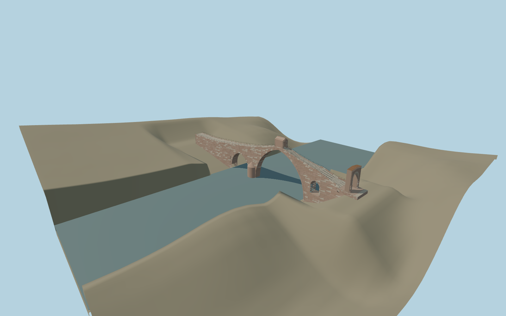

# Pont del Diable, Martorell

Compact Pont del Diable: open unequal arches, pointed/rounded cutwaters, graded stair walk, actual shelter passage, surviving Roman gateway and representative copper crown. Detailed master independently preserved.

## Evidence

- [Primary reference](https://patrimonicultural.diba.cat/element/pont-del-diable-0)
- [Primary reference](https://patrimonicultural.diba.cat/element/arc-roma-dacces-al-pont)
- [Primary reference](https://calaix.gencat.cat/bitstream/handle/10687/23978/qmem7104.pdf?isAllowed=y&sequence=194)
- [Primary reference](https://www.icac.cat/wp-content/uploads/2011/01/2012-Alvarez-Stone.pdf)
- [Primary reference](https://martorelldigital.cat/inaugurada-la-restauracio-de-larc-roma-del-pont-del-diable-de-martorell/)
- [Primary reference](https://www.icgc.cat/ca/Geoinformacio-i-mapes/Geoinformacio-en-linia-Geoserveis/WMS-i-WCS-Elevacions/WMS-Elevacions-territorial)
- [Primary reference](https://www.icgc.cat/ca/LICGC/Informacio-publica/Transparencia/Reutilitzacio-de-la-informacio)

Published dimensions and reconstruction assumptions are separated in spec.json. Source photos were consulted; no photos or third-party geometry are embedded. Map plan attribution: © OpenStreetMap contributors, ODbL-1.0.

## Source

54116 triangles; 6496876 bytes; 4 material groups. SHA256: sha256:daae1b1614f4ceb5e8801ac2bdc3ce472d0aeadca0529019a9b48ed5e09c717b.

Shared surfaces (stone_sandstone_raw, stone_limestone_raw, metal_painted, metal_copper) are loaded through the central library; any transparent materials use local PBR parameters. Axis and provisional vertical datum are in spec.json.

Regenerate with node packages/worldgen/scripts/generate-researched-bridges.mjs --ids=pont_del_diable; append --check to verify. Import and capture through the standard structure-catalog scripts. Geometry validation does not substitute for current-frame visual review.

## Reconstruction limits

- One inspected oblique picture establishes the unequal pointed arches, red/pale stone, humpback stair walk, roofed summit shelter and surviving Roman gateway. Existing authored profile and span controls are retained. Standard viewer PMTiles places the east-directed crossing at the Llobregat route;125.0414m mapped path and nominal130m are separate definitions. Native -1m lateral adjustment retained. West approach PMTiles56.9653m versus native14.91m gives approximate origin42.0553m, close to retainedICGC41.9m. East-bank PMTiles34.8258m conflicts with the original authored gateway threshold; approximate local preview contacts retain that source profile rather than certifying a new datum. Bounded opening removes bridge imprint. Exact bank joins, water stage, stone courses and crown restoration appearance remain limited;2007picture does not verify2026copper cap.
- Four canonical shared graphs reused. Lower tiers merge steps, masonry and voussoirs; closeup retains larger colored stone impressions. Gateway remains ruined without conjectural capitals. Original detailed reconstruction preserved. Physical-device timings unmeasured.
- Cutwater uses a continuous tapered body rather than separated course volumes. East small-arch camera raised above the coarse fixture bank.
