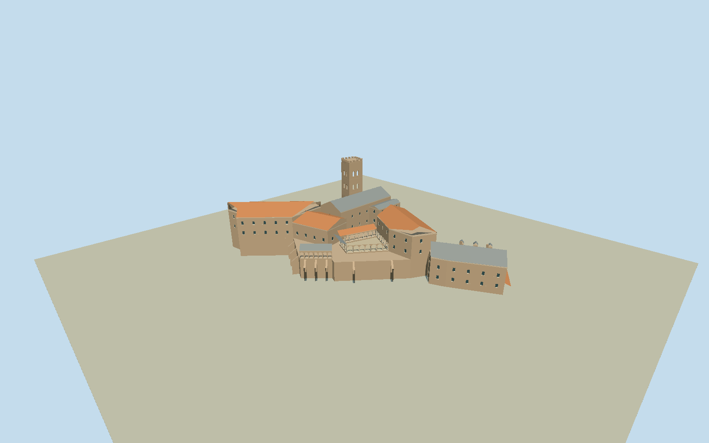

# Abbey of Saint-Martin-du-Canigou

Complete surviving abbey: two-level Romanesque church/three choir apses and Gauderique chapel apse, projecting square crenellated Lombard bell tower, trapezoidal open cloister and galleries, connected red-tiled monastic west/east wings, intrinsic cliff-supporting walls/buttresses/stairs, attached foreground slate annex with3dormers/chimneys/low tile lean-to. Preserve native26outer/4court/8annex vertices and real courtyard void. Separate public refuge/toilets/outlying huts/mountain/cliffs/trees/trails/general plaza/temporary awnings/visitors/interiors excluded. Brown/buff rubble stone and pale carved arch trim, red clay tile monastic roofs versus gray slate church/cloister/annex. Real open arches/windows/portal and genuine court void; do not flatten cliff-site terraces or invent mountain backdrop. Hidden fine details/levels estimates documented.

Authoring state: **review-in-qa.json**. Current completion evidence is in [qa.json](qa.json) and the [completion ledger](../../../../qualla-structures/batches/qualla-002.PROGRESS.md).

- [Abbey of Saint-Martin-du-Canigou](https://qualla.com/abbey-of-saint-martin-du-canigou/)

Named native abbey relation2501713/Q287751:outer16907289326points/inner1860379794point cloister void, plus physically attached annex1690728948points sharing main boundary. Source data.gouv.fr heritage outline is a coarse building control, not a precise architectural roof survey. FixedQualla anchor[2.4008,42.52814444], heading1.3684257688944645 along native church wall20to19 before terrain/geometry; +Xtoward choir/NNE and+Zcourt/ESE. Published own PD upper-church sketch supports~27mby10m church,3choirapses+Gauderiqueapse,tower/portal/court stair relation; modern CC0 wholephoto supports whole restored compound. Native apse side is coarsely straight: curved apse geometry deliberately interprets clear plan, original vertices retained as controls. Heights/roof divisions/crypt floor/court terrace/buttress depths and hidden facades are approximate architectural estimates independent of terrain.

Complete surviving restored compound:church3choirapses+Gauderiqueapse/two church levels, crenellated tower/paired upper openings, trapezoidal courtyard with open galleries/paired shafts, red-tiled monastic wings, intrinsic supporting buttresses/stairs and attached slate annex3dormers/chimneys. Small capital/stone carving/hidden rear fenestration and exact bay counts simplified or estimated. Native plan is a building-envelope proxy; curved apses/individual roof parts interpret the clear own PD plan/2019CC0 overview. No invented complete1009appearance.

Published Qualla own-drawn upper-church PD plan inspected/exact nativeSHA1matched; primary source explicitlyselbstgezeichnet/JochenJahnke PD-user-de. Supplemental2019Chris06 selfCC0 whole-abbey original inspected/nativeSHA1matched. Original published CC0 landscape andSaint-Martin-le-Vieux captions excluded; attributed/free-use/historical-ruin views not adopted. No media metadata/categories/articlebody/policy changes, protected photo textures or generated bitmaps.

Two-level church crypt/court floor6.5m, upper10.5m, towercrenels28.3m/relative22m above court, monastic eaves14.1m, lower annexfloor0/slateridge11.8m are photo/plan architectural estimates, not surveyed levels or fitted terrain. Actual host cliff burial/abutment/grades unverified. General mountain/cliff background/trails/trees/refuge/independent huts/temporary awnings/visitors/interiors excluded.

Independent256m129-square2mfield/all16641samples/2originalTerrariumtiles/PNG frozen before geometry unchanged; provider datum1047.6265m/sourcepixel3.52062m/absolute920.5115–1094.4993m not survey accuracy. No flattening/fitting/reacquisition; flat review fixtures separate from actual hillside. Ordinary geographic preview, replacement disabled.

Build: `node packages/worldgen/scripts/generate-authored-places.mjs --ids=abbey_of_saint_martin_du_canigou`. Add `--check` to verify exact regeneration. 9368 triangles; 6 materials; no embedded photographs.
