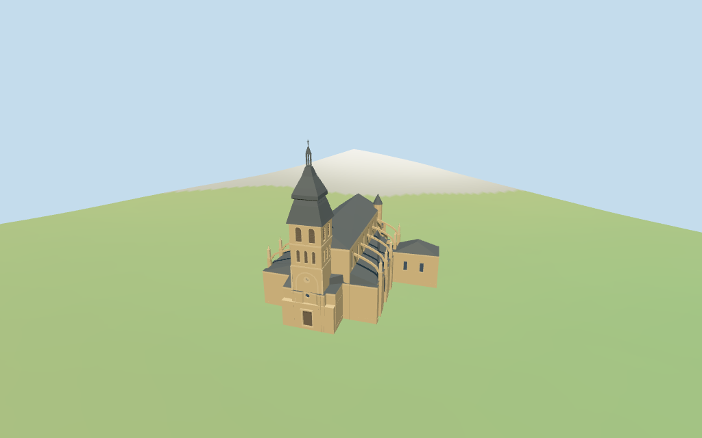

# sarlat_cathedral — Sarlat Cathedral review

Reviewed 2026-10-16 against current source/runtime bytes. Accepted for the stated medium-fi exterior and approximate horizontal placement. All heights, detailed component plans and exact host-ground contact remain estimated.

## Built result

Inspected all 11 final portable/source-terrain views, including the 1024×640 summary. The individual exterior retains the oblique high nave/polygonal choir, irregular lower chapel envelope, attached south range, round conical stair turret, flying buttresses, rectangular tower-porch portal, small clock/oculus, triple middle lights, paired louvered belfry lights and two-stage slate bulb roof with an open little lantern. Raised the choir-window sill clear of the low roof, recessed louver slats and added the missing south-range window rhythm. Fine figures and tracery are simplified.

Individual medium-fi exterior guided by four actually inspected exterior pictures and standard viewer PMTiles/DEM. The retained exact identity is way/376197270 and Q2942447, current whole 35184748286102 and same-ID cathedral POI. Four whole/roof/small-projection controls retain 130 raw points/properties, plus earlier whole/tags. All heights and detailed component divisions are estimates. Fine sculpture, tracery, inscriptions, interiors/bells, concealed roof joins, current finish, engineering and exact terrace/threshold/base contact are simplified, excluded or unverified. The dark paired belfry openings are louver-backed; only the small upper lantern is open. Stair slits are shallow surface marks. No bespoke surveys or redistributed reference photos.

## Shared materials and browser levels

Inspected all 11 final shared/geographic views. Five existing shared 256-square ashlar, sandstone, slate, wood and painted-metal graphs serve six groups including local blue-grey glass. Metric UVs, linear tints and flat architectural normals; no embedded images, facade photographs, baked lighting or bespoke textures. Shared graphs read once and unload leaves zero live model geometries. Geographic review uses flat terrain; portable review retains the standard viewer DEM.

| Level | Triangles | Bytes | Draws |
| --- | ---: | ---: | ---: |
| skyline | 581 | 58,080 | 1 |
| district | 3,041 | 306,100 | 6 |
| street | 7,812 | 748,420 | 6 |
| closeup | 8,957 | 867,324 | 6 |

Initial skyline plus district geometry: **364,180 bytes**. Source master: **1,078,564 bytes / 8,957 triangles**. Imported master: **1,078,000 bytes**. Downloads exclude graph definitions/runtime texture generation. Five shared 256² graphs, six groups and zero embedded images. Separate POSITION/NORMAL streams and equal CPU/GPU reservations.

Inspected all 27 final medium-fi views: Economy/High, noon/late, street/block/skyline, texture-free silhouette, six details, four matched whole levels and four transitions. Skyline 581 triangles retains the oblique church, lower chapel/south-range envelope, stair turret, porch tower, layered bulb and open lantern. District 3041 adds shared surfaces, clerestory/choir recesses, triple/paired tower lights, blind arches, clock and flying buttresses. Street 7812 adds chapel/range windows, mullions, recessed slats and buttress finials; close-up/master 8957 retain sparse portal sculpture abstractions. Cotswold cottages are synthetic style fixtures, not Sarlat streets. Physical phone/laptop timing remains pending.

## Geographic fit and estimates

Anchor **[1.217166997, 44.888809157]**, heading **−0.322408167209 rad**, approximately 3° facing uncertainty. No horizontal rescale. The actual mapped roof runs obliquely inside this native frame: positive longitudinal direction toward the northeast choir and negative toward the southwest porch tower.

Retained exact way/376197270 and Q2942447 identify Cathédrale Saint-Sacerdos. Current standard viewer PMTiles whole 35184748286102 and roof part 35185096439581 plus two small unlabeled touching north projections provide 130 raw outline points. The small projections are interpreted as exterior buttress feet, not independently identified buildings. Preserve the original anchor and heading -0.322408167209 rad. The high nave follows its oblique mapped roof within this native frame: longitudinal positive toward the northeast choir, negative toward the southwest tower-porch. Do not rotate the nave to native X or relocate it to the older reference POI. Separate neighboring town houses and the Lanterne des Morts remain host content.

No height, level or roof-height tags and no independent dimension facts. All heights are picture estimates above floor 0.5 m: low aisles and radiating chapels 10.5 m eaves / 13.5 m upper joins; high nave and polygonal choir 21 m eaves / 26 m ridge. Tower square body 30 m, flared lower slate cap 36.2 m, pinched upper bulb 44.3 m, open lantern 47.5 m, little cap 49.6 m and weather vane 51 m. Stair turret 23 m wall / 26.7 m cone. Internal component divisions, openings, flying buttresses, roof profiles, clock and simplified sculpture are estimates rather than measured architectural plans.

The raw whole controls the irregular low envelope; the mapped roof part controls the high nave/choir. Detailed lower roof partitions, chapel windows, porch/tower stages, buttress positions and round stair turret are picture estimates. Two small unlabeled map projections touching the north wall are interpreted as buttress feet and included explicitly. This is not an independently surveyed part classification.

Standard viewer DEM datum 148.174833 m; selected raw perimeter -0.82 to 1.31 m. Floor 0.5 m; adaptive footings cross Y=0 and extend below retained samples. No terrain cutout or flattening. Exact parvis, steps, east terrace, door/base joins, absolute altitude and walking remain unverified.

The standard viewer DEM has datum **148.174833 m** and selected whole perimeter **−0.82 to +1.31 m** relative to it. Estimated floor 0.5 m; footings cross Y=0 and extend below retained samples. No terrain flattening, cutout or road replacement. The photographic east terrace/steps and exact host-ground/door/base joins, altitude and walking remain unverified. Five nearby host buildings and three open regions are preserved by 72 actual viewer-footprint checks. Geographic renders use flat terrain; portable renders use the standard DEM.

## Verification

**49 final frames inspected**: 11 portable/source-terrain, 11 shared/geographic and 27 medium-fi. **346 geometry probes**, **72 actual viewer-footprint checks** and six Khronos validations with zero errors/warnings/images. Current source/import/LOD/input/capture/shared material/recipe/source inventory bindings, targeted byte reproduction, scene validation and 30-tick simulation pass.

Source: `sha256:7969653a3eb8f566c9b0de0f8a1970d7681b9879b54fb7e32ba3fbc981a4ab7d`

Runtime: `sha256:0a68f14479a3da5e70910697e46e4834a04e27dde7e2fc44ad389c317f31e7c7`

Model input: `sha256:72d09fb74ce29156eff8ca4c1b3ec2fba756d390f4c0cd5a1655198dee3b062d`

Simulation: `sha256:3005aadbef1c849ac5b20a733b6a425b6f864660110e0649b61cc968dd55730d`

Commands: targeted generate/import/LOD/register `--ids=sarlat_cathedral`; generate `--check`; portable reflections/antialias/fitted shadows; shared reflections/adaptive clipping/bounded placement; medium-fi reflections; scene validate and 30-tick simulation. Bulk captures remain ignored. Next routine full source checkpoint: **new_cathedral_linz–st_stephans_cathedral_passau**.

## Inspected picture references

[Jebulon — 2011-08-05](https://commons.wikimedia.org/wiki/File:Clocher_saint-Sacerdos_Sarlat.jpg). CC0-1.0. Inspected narrow-street tower view: golden ashlar square body with blind round arches, triple middle lights, paired tall louvered belfry lights, flared square slate roof, pinched upper bulb and little open lantern/weather vane. Foreground houses conceal the porch and nave.

[Thesupermat — 2012-04-16](https://commons.wikimedia.org/wiki/File:Sarlat_-_Ancienne_cath%C3%A9drale_Saint-Sacerdos_-_PA00082916_-_011.jpg). CC-BY-SA-3.0. Inspected broader square/street view: the same layered stone tower, dark blue-grey roof and open lantern behind foreground houses. This is not a full nave view and supplies no exact dimensions.

[Xfigpower — 2013-04-27](https://commons.wikimedia.org/wiki/File:Cath%C3%A9drale_Saint-Sacerdos_de_Sarlat_-_Vue_du_Chevet.JPG). CC-BY-SA-3.0. Inspected enlarged choir view: high polygonal golden-stone choir with tall pointed stained-glass windows; lower radiating chapels with shallow dark tile/slate roofs and pointed lights; flying buttress arches and sparse finials; corner round stair turret with small conical roof/slits. Slate nave roof and bulb tower behind. Terrain and hidden roof joins are partly occluded.

[MOSSOT — 2003-07-14](https://commons.wikimedia.org/wiki/File:Sarlat-la-Can%C3%A9da_-_Cath%C3%A9drale_Saint-Sacerdos_-_Clocher-porche_-4.jpg). CC-BY-SA-4.0. Inspected tower-porch base: deep rectangular timber portal with pale jambs and projecting lintel, small round oculus, large blind round-arch body and small white clock dial partway up the blank front stage. Corner figure niches and side pointed window are simplified. Upper roof is cropped.

## Limits

All heights, hidden joins and detailed profiles are estimates. Fine sculpture, faithful tracery, inscriptions, interiors/bells, engineering, exact terrace/threshold/base contact, current finish and physical device timing are simplified, excluded or unverified. Paired belfry panels are louver-backed; only the small top lantern is open. Stair slits are shallow surface marks. Nearby town buildings remain host content; Cotswold cottages in medium-fi views are synthetic fixtures. This review accepts the stated exterior and approximate horizontal scope; the 1,000-candidate project remains incomplete.
