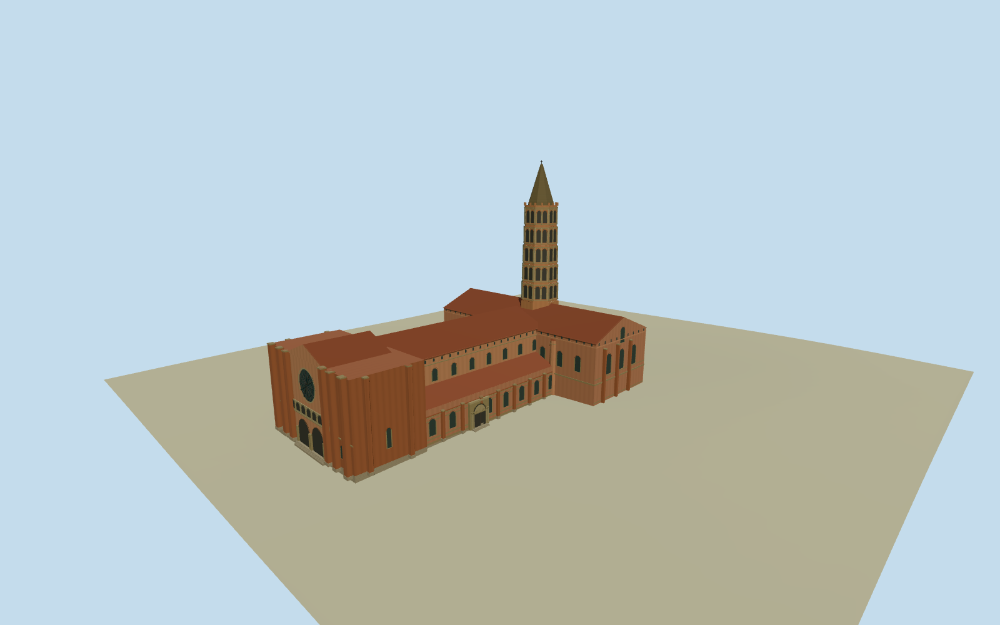

# Basilica of Saint-Sernin, Toulouse

The Romanesque Basilica of Saint-Sernin in Toulouse, with a five-tier octagonal bell tower, tiled aisles, stone portals and layered eastern chapels.

Authoring state: **review-in-qa.json**. Current completion evidence is in [qa.json](qa.json) and the [completion ledger](../../../../qualla-structures/batches/qualla-004.PROGRESS.md).

- [Basilica of Saint-Sernin, Toulouse](https://qualla.com/basilica-of-saint-sernin-toulouse/)

The outline and tower height follow the map and municipal record. The detailed sculpture and carved stone bands are stylistic interpretations; individual roof eaves and podium steps are estimated where sources disagree.

Build: `node content/worldgen/source/places/sp/spc/basilica_of_saint_sernin_toulouse/models/generate-basilica-of-saint-sernin-toulouse.mjs`. Add `--check` to verify exact regeneration. 18668 triangles; 7 materials; no embedded photographs.
