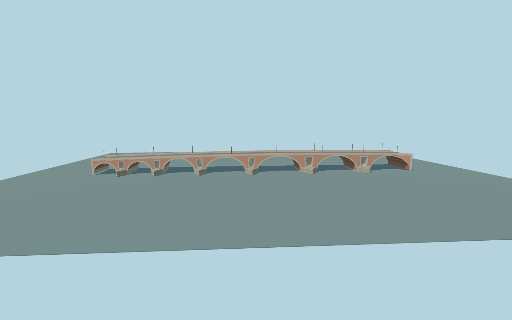

# Pont-Neuf

Pont-Neuf in Toulouse: seven unequal open masonry arches, six cutwater piers with through shield-like flood openings, warm brick spandrels and vaults, radial pale stone arch rings and relief-hole frames, stepped pier bases, continuous capped parapets, road/cycle/outer-walk surfaces, sixteen curved lamp standards with open scrolls and fourteen plain navigation diamonds.

Rebuild: `node packages/worldgen/scripts/generate-pont-neuf.mjs`;append `--check` for exact source bytes. Select import/LOD/placement with `--ids=pont_neuf`. Detailed source and four browser tiers are separate ignored GLB outputs.

Fixed 134 m model datum, approximate end decks near143.5/145.5 m and gentle146.1 m central crown. Standard review water samples 134.638 m. Arch profile, relief opening, steelwork and submerged foundation dimensions are picture-guided exterior approximations; elevations are standard-viewer fitting controls, not a survey.

Original medium-fi exterior inferred from two ordinary photos and retained map geometry. Brickwork, carving, lamp profiles and count, buried foundation sections, deck crown and transport surface allocation are approximations. No copied photo pixels, downloaded meshes, interiors, readable labels, vehicles or temporary flood debris. Independent riverbanks and buildings remain native. Physical laptop and phone timing measurements remain pending.

Original geometry:repository license. Map:© OpenStreetMap contributors,ODbL-1.0;Protomaps. Standard terrain:terrain-grid.json. Ordinary pictures stay local and are not redistributed or used as textures. Current acceptance:qa.json.
