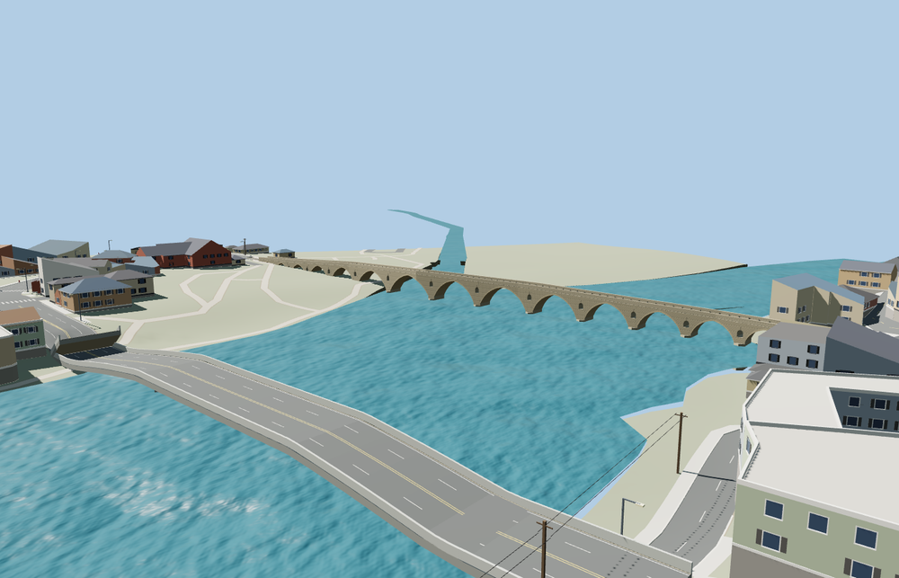

# Pont Vieux of Béziers

**Viewer readiness passed for the full pedestrian crossing.**

Complete curved pedestrian crossing: fifteen unequal open stone arches, fourteen small through-pier relief openings, tapered cutwaters, low stone parapets/coping, warm center paving with darker edge strips and repeated rounded low stone edge guards. Retain the actual longitudinal bends and independent riverbank routes.

Source:17,646 triangles. Skyline/district/street/close-up:958 /2,518 /9,158 /16,566. Initial skyline plus district:226,624 bytes; close-up:1,132,756 bytes. Three shared material graphs, four merged bindings and no embedded images. Six clean GLBs;34 inspected images:10 portable and24 native.

All four tiers pass18 bridge-end join-width checks within0.15m. Eight approach probes use an explicit0.35m tolerance; one8m-inland point differs0.3045m from the stored profile on the native paved terrain mesh. The original lower-bank route remains unchanged and unprofiled. Three width-distributed clearance probes have no obstruction; minimum headroom is3.452m across tiers. All140 neighboring buildings, independent roads, original terrain and ten native river features remain. Every tier unloads model/support geometry; failed loads retain the original fallback.

Picture-proportioned medium-fi exterior. Retained239.543m bent pedestrian centerline and reported241.5m overall length remain separate. The5.22m line envelope is curvature, not a surveyed deck width;5.2m exterior width, fifteen unequal bay proportions, ogival profiles, small relief openings, support/guard details and absolute heights are visualization approximations. Only ordinary pictures, current PMTiles and unchanged standard terrain were used. The existing ashlar graph approximates smaller paving setts; small repair straps share a dark stone finish. All18 width-distributed bridge joins fit within0.15m. Eight inland approach probes remain continuous; one8m-inland probe differs0.3045m from the stored centerline profile because of the native paved terrain mesh approximation, within the explicit0.35m approach tolerance. No terrain/water flattening or removal of unrelated routes/buildings. These are visual fit checks, not engineering or restoration certification. Physical laptop/phone timings remain unmeasured.

Rebuild: `node packages/worldgen/scripts/generate-pont-vieux-beziers.mjs --check`. Use `--ids=pont_vieux_of_beziers` with the normal targeted import, LOD, placement and readiness scripts. The source generator is registered in asset-build.json. Bulk captures remain local. No Git mutation or upload.
