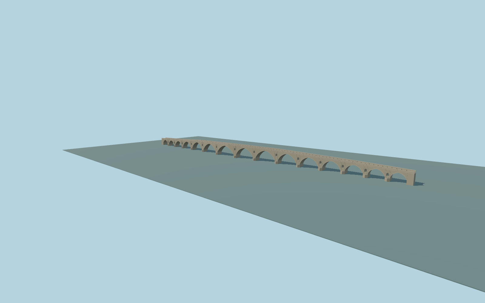

# Pont Vieux of Béziers

Complete curved pedestrian crossing: fifteen unequal open stone arches, fourteen small through-pier relief openings, tapered cutwaters, low stone parapets/coping, warm center paving with darker edge strips and repeated rounded low stone edge guards. Retain the actual longitudinal bends and independent riverbank routes.

Rebuild: `node packages/worldgen/scripts/generate-pont-vieux-beziers.mjs`;append `--check` for exact source bytes. Select import/LOD/placement with `--ids=pont_vieux_of_beziers`. Detailed source and four browser tiers are separate ignored GLB outputs.

Original medium-fi exterior from three ordinary public photographs, retained Q3396781/way38138518 centerline, current PMTiles and unchanged standard Terrarium terrain. Unequal bay spacing, ogival profiles, minor relief openings, stone guards and hidden foundations are picture-proportioned, not surveyed. The retained239.543m centerline extent and reported241.5m length remain separate controls. The5.22m retained line envelope describes its bends, not a measured physical deck width; the5.2m exterior width is an ordinary-photo visualization control.

Approximate deck grades adapt the actual native terrain; current native bank/river/approach fit and current Molen image review remain pending. No copied photo pixels, downloaded meshes, custom terrain/water flattening or readable inscriptions. Concealed construction and small repair details are simplified. Physical laptop/phone performance is unmeasured.

Original geometry:repository license. Map:© OpenStreetMap contributors,ODbL-1.0;Protomaps. Standard terrain:terrain-grid.json. Ordinary pictures stay local and are not redistributed or used as textures. Current acceptance:qa.json.
