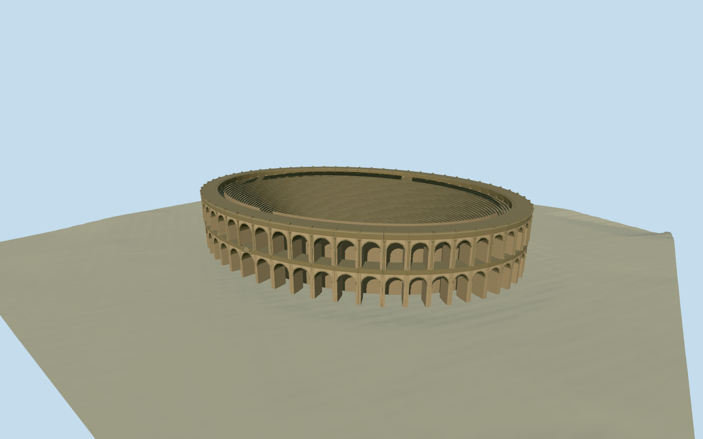

# Arena of Nîmes

The surviving Roman limestone amphitheatre, with two complete round-headed arcades encircling its tiered bowl and sand arena.

Authoring state: **review-in-qa.json**. Current completion evidence is in [qa.json](qa.json) and the [completion ledger](../../../../qualla-structures/batches/qualla-004.PROGRESS.md).

- [Arena of Nimes](https://qualla.com/arena-of-nimes/)

Individual Roman repairs, reliefs and restored stone profiles are simplified. The interior circulation beyond the open outer bays and the detailed subterranean complex are outside the exterior model.

Seating row placement and heights are interpreted between documented section sizes. Modern temporary event fixtures and crowds are omitted.

Build: `node content/worldgen/source/places/sp/spg/arena_of_nimes/models/generate-arena-of-nimes.mjs`. Add `--check` to verify exact regeneration. 35263 triangles; 4 materials; no embedded photographs.
