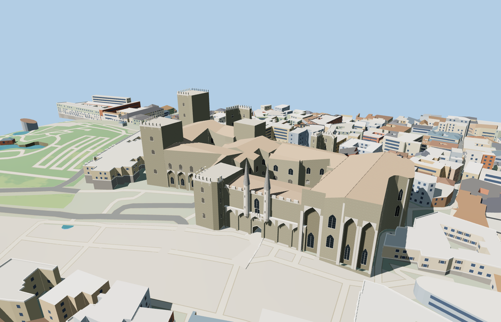

# Palais des Papes

The Old and New Palace ranges rise over the Avignon square. The west façade has blind arcades, square keeps, tall southern chapel recesses and the twin spired Champeaux turrets. The open Court of Honour, cloister and eastern gardens follow the mapped precinct.

The 11,191-triangle source rebuilds byte for byte. Skyline, district, street and close-up use 943, 2,291, 5,992, 11,147 triangles. Skyline and district total 271,680 bytes. Six GLBs validated and 36 current views were inspected.

All four tiers pass the court, keep, turret, approach, open portal and wall-contact probes. The west-front blind arches are visible from the square. The approach and passage meet without a deck step. The viewer retains 591 independent building records and 203 transportation records. Failed loading restores the mapped palace footprint.

The palace perimeter and four open spaces come from PMTiles. The west portal, roof heights, turret profiles and interior passage slope are reconstructed from exterior photographs and standard viewer terrain. The modeled passage links the plaza and Court of Honour as a visualization. Architectural detail, court planting and masonry decoration are approximate. Rooms and below-ground routes are outside the model.

Rebuild with `node packages/worldgen/scripts/generate-palais-des-papes.mjs`. Append `--check` to compare exact bytes. Use `--ids=palais_des_papes` for targeted import, LOD, placement and readiness.
