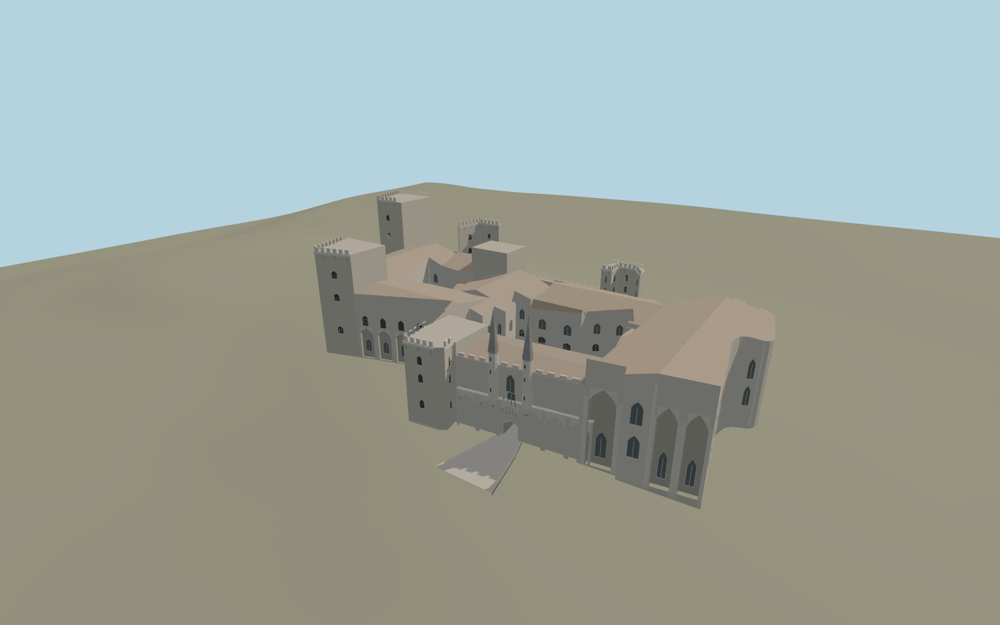

# Palais des Papes

The Old and New Palace ranges rise over the Avignon square. The west façade has blind arcades, square keeps, tall southern chapel recesses and the twin spired Champeaux turrets. The open Court of Honour, cloister and eastern gardens follow the mapped precinct.

Run `node packages/worldgen/scripts/generate-palais-des-papes.mjs` to rebuild the source master. Append `--check` to compare the exact bytes. Use `--ids=palais_des_papes` for targeted import, LOD generation and placement.

The palace perimeter and four open spaces come from PMTiles. The west portal, roof heights, turret profiles and interior passage slope are reconstructed from exterior photographs and standard viewer terrain.

The modeled passage links the plaza and Court of Honour as a visualization. Architectural detail, court planting and masonry decoration are approximate. Rooms and below-ground routes are outside the model.

Original geometry follows the repository license. Map data is © OpenStreetMap contributors under ODbL-1.0 via Protomaps. Terrain samples are described in terrain-grid.json. Ordinary pictures stay local and are not redistributed or used as textures. Current acceptance is recorded in qa.json.
