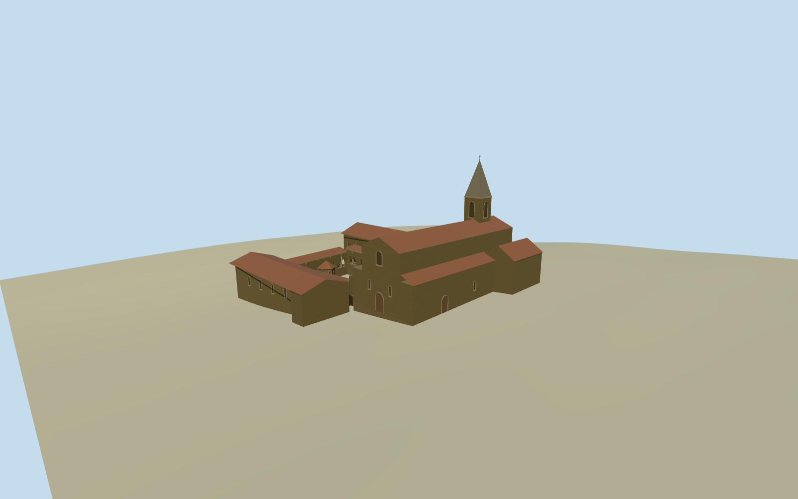

# Thoronet Abbey

Thoronet Abbey in Provence, with its limestone church and stone spire, single-storey paired cloister arcade, and attached dormitory wing.

Authoring state: **review-in-qa.json**. Current completion evidence is in [qa.json](qa.json) and the [completion ledger](../../../../qualla-structures/batches/qualla-004.PROGRESS.md).

- [Thoronet Abbey](https://qualla.com/thoronet-abbey/)

The preserved church, cloister and attached chapter-house and dormitory ranges. Detached ruins and other parts of the estate are outside scope.

Fine roof and arcade dimensions are estimated from photographs and the official descriptions.

Build: `node content/worldgen/source/places/sp/sps/thoronet_abbey/models/generate-thoronet-abbey.mjs`. Add `--check` to verify exact regeneration. 7069 triangles; 6 materials; no embedded photographs.
