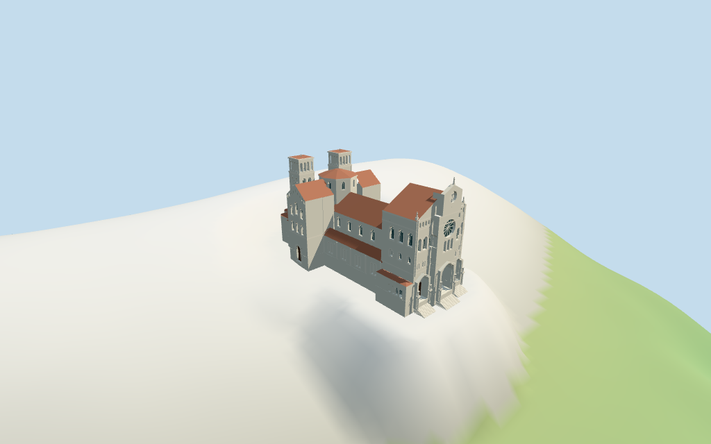

# cathedral_of_our_lady_immaculate — Cathedral of Our Lady Immaculate review

Reviewed 2026-10-15 against current source/runtime bytes. **Accepted for medium-fi exterior and approximate horizontal placement. Host-DEM contact remains pending.** The estimated source plaza is a diagnostic fixture and is not applied to runtime terrain. All heights and internal partitions remain picture estimates.

## Built result

Inspected all 11 current portable/source-terrain frames. The individual Monaco Cathedral exterior has a pale coursed Romanesque front with three deep round porches, rectangular wood portals beneath pale arched tympana, visible paired two-stage stone columns and connected capitals. The twelve-spoke wheel rose, three central lights, flanking window tiers, shallow blind arcades, raised central gable, abstract relief and supported roof figures join a red-tiled nave and aisles. Gabled transepts, high rounded apse, scalloped lower ambulatory and broad rounded east chapel lead to paired flat-capped rear belfries and an octagonal crossing lantern. A rounded front corner chapel/stair and small gray-roof polygonal turret distinguish the side. Corrected blocked district porches, hidden/disconnected porch supports, floating figures, blind arcades crossing gable edges, pilasters crossing aisle windows and entry stairs. Small street-tier fields are deliberately flat; closeup/master add their recesses. Fine carving, hidden rear details and all vertical dimensions remain estimates.

Medium-fi exterior from three actually inspected Commons pictures (2021 front, 2021 west transept and 2015 front oblique) plus standard viewer PMTiles/DEM. No bespoke surveys/plans were researched or reference pictures redistributed. The three-porch front, paired columns/stone tympana/timber portals, wheel rose, tiled roof family, gabled transepts, rounded rear/side forms, open paired belfries and octagonal lantern are individually authored. Heights, internal divisions and hidden roof/rear details are estimates. Fine carving/heraldry, statue identity, tracery, inscriptions, full interiors and exact paving/thresholds remain simplified or excluded. The source plaza fixture does not prove runtime terrain contact. Physical-device measurements remain pending.

## Shared materials and placement

Inspected all 11 current shared/geographic frames. Four existing cached 256-square graphs—coursed limestone, continuous limestone, flat tile and plain wood—serve six groups at street/closeup/master, five at district and one at skyline. Metric UVs, linear pale-stone/red-tile/wood tints and flat architectural normals preserve shared style. Glass and small stone accents use local PBR colors. No embedded images, unique facade maps or baked shadows. Each graph reads once, unloading disposes geometry and zero model geometries remain live. Close views show the deep porches, two-stage supports, timber portals/stone tympana, wheel rose, side openings and actual clear belfry arches. Top placement retains the mapped whole, four neighbors and front plaza. Flat geographic diagnostic ground does not establish contact with the host DEM.

Retained exact-QID OSM way/362871296 (Q667450) matches current main 35184734960128. Anchor [7.422658929,43.730341513]. All 71 current raw vertices/tags reproduce rigidly without rescale; original multilingual metadata and the earlier 109-vertex control remain intact. The signed long nave-wall edge corrects the earlier minimum-rectangle heading 1.389590982208rad by 6.887668 degrees to 1.5098034602171353rad: native -X is the southern three-porch front, +X the northern scalloped apse, -Z the west transept and +Z the broad east chapel. No independent components or map height/min_height/measured-height facts are supplied. Every internal partition, tower/lantern/turret position and modeled height is an explicit picture estimate. All 36 current viewer footprint checks cover the whole and retain four neighboring buildings plus front plaza across six outputs. Standard viewer DEM datum is 58.459324m, display floor 1.5m, and raw whole perimeter -16.53..9.98m. That roughly 26.5m slope crosses the building. Source preview uses an estimated Y=0.4m plaza only within the footprint plus 8m, blending over a further 16m. Raw samples remain retained; this preview grade is not applied to host terrain. Y=0 was reviewed only as the DEM anchor coordinate convention and foundations cross that plane. Runtime front skirt exposure/rear base clipping, exact street/door joins, absolute altitude and walking contact remain unverified. Exterior and approximate horizontal placement are accepted; host-DEM contact remains pending. No global flattening or road replacement.

Inspected all 27 current Earth-lighting frames: Economy/High, noon/late, three distances, texture-free silhouette, six details, four matched whole LODs and four transitions. Skyline retains individual pale front/three-porch silhouette, red roofs, rounded rear/side forms, paired tower caps and octagonal lantern at 654 triangles; small glazing and true openings are omitted. District adds shared surfaces, actual porch recesses and open belfries with flat small fields at 3856 triangles. Street adds major recessed glazing/portals, rose spokes, columns and cornices at 12673 triangles; closeup/master add small recesses, blind arcades, abstract relief/figures and finer frames at 42641 triangles. All matched whole LODs include the full envelope and 38m model-space tip. Detail crops exclude other portions intentionally. Synthetic cottages and diagnostic ground are fixtures. Physical phone/laptop motion and timing remain pending.

## Browser budgets

| Level | Triangles | Bytes | Draws |
| --- | ---: | ---: | ---: |
| skyline | 654 | 62476 | 1 |
| district | 3856 | 304796 | 5 |
| street | 12673 | 998384 | 6 |
| closeup | 42641 | 3747992 | 6 |

Initial skyline plus district: **367272 bytes** of geometry. Master: **5120572 bytes / 42641 triangles**. Four existing shared 256-square graphs; zero embedded images. Bytes exclude graph definitions/texture generation. Split POSITION/NORMAL streams have equal CPU/GPU totals. Physical-device timing pending.

## Verification

- Targeted byte reproduction and current source/import/LOD/input/report bindings; source/recipe inventory/schema match.
- Six Khronos validations: zero errors, warnings or images. Four browser budgets pass.
- All 71 current raw vertices/tags, retained exact identity/multilingual control, explicit estimates and standard DEM match.
- **1952 imported geometry probes** and **36 current viewer footprint checks** pass.
- Shared graph read-once/unload and hash-bound geographic/medium-fi reviews pass.
- Scene validation and 30-tick simulation: sha256:eadaf14c5b6852911e33de8a71be2d59b4e1d6ce046231dd4f6ea267c5523291.
- Inspected **49 final current frames**: 11 portable/source-terrain, 11 shared/placement and 27 medium-fi. Cameras/paths/hashes retained; bulk captures ignored.

Source hash: sha256:7b6c0a029638f1310409c99d1c9ec77fd87abc0007ad869d875acaa7a4d4aeb5. Runtime hash: sha256:5f2b7f83d72ed4d8b8af9d299ab30ffe1ae9b7821a5d26da4d10cd6b226fb6bc. Input hash: sha256:7108e75cd8489c0e8f7614807396e407ba1dcc11e25eaae6d24d070d7d2b4cda.

Commands: targeted generate/import/LOD/register-landmark-previews --ids=cathedral_of_our_lady_immaculate; generate-additional-landmarks.mjs --ids=cathedral_of_our_lady_immaculate --check; capture-structure-models.mjs --ids=cathedral_of_our_lady_immaculate --reflections --antialias --fit-shadows; capture-landmark-library.mjs --ids=cathedral_of_our_lady_immaculate --reflections --adaptive-clipping --bounded-placement; capture-medium-fi.mjs --ids=cathedral_of_our_lady_immaculate --reflections; molen validate; molen sim run --ticks 30 --hash. Next routine full source checkpoint: dubrovnik_cathedral–armenian_cathedral_of_the_holy_cross.

## Limits

- Retained exact-QID OSM way362871296/Q667450 matches current main35184734960128. Current71-vertex whole differs from earlier109-vertex retained control;no independent components or map height/min_height/measured-height facts are supplied. All current raw vertices/tags reproduce rigidly without rescale. Signed long nave edge corrects older minimum-rectangle heading1.389590982208rad by6.887668degrees to1.5098034602171353rad: native-X south front versus+X northern scalloped apse. Original multilingual identity/control remain verbatim. Internal Boolean front/nave/aisles/transepts/choir/apse/chapel partitions and tower/lantern/turret positions are picture estimates. Heights are estimated:front wall26.5m/gabled crown32.5m,raised central crown34.5m/abstract tip36.5m;nave18/24m,aisles10.5/13m,transepts24/28.5m,choir/apse18/24m,ambulatory10.5/13m,broad east-side chapel15.2/18.5m. Rear paired square towers have lower paired arched fields24..28m and four open upper arches30..34.5m,flat red caps35m/tip36m;central octagonal lantern24..29m/shallow tiled cap31m. Rounded front corner/stair8.5m and small gray polygonal turret11.5/14m. Three deep round front porches/wood doors,rose/three lights,round gallery/side window rhythm and relief/finials are simplified. No survey/engineering accuracy claimed.
- Standard viewer DEM datum58.459324m;display floor1.5m,raw whole perimeter-16.53..9.98m. About26.5m slope crosses the building;raw samples remain retained. Source review uses an explicitly estimated local0.4m plaza grade within the footprint plus8m and a16m blend beyond it;this diagnostic fixture is not applied to host terrain. Runtime terrain-contact remains anchored to the coarse DEM;front skirt exposure/rear base clipping,exact street/door joins,absolute altitude and walking are unverified. Footings extend below raw samples. No global flattening or road replacement.
- Medium-fi exterior from three inspected2015/2021 front and west-transept pictures plus standard viewer PMTiles/DEM only. All heights/internal partitions,opposite/hidden rear/roof/tower details and minor chapel functions are estimates. Wheel rose/tracery,abstract relief/figures,porch carving,roof decoration,full interiors and exact paving/street thresholds are simplified or excluded. Physical phone/laptop timings pending.
- Source preview includes a bounded estimated plaza grade to show the exterior on noisy coarse coastal terrain;it does not alter host DEM. Runtime front skirt exposure/rear clipping and exact terrain/door contact remain unverified.
- Skyline retains three-porch front silhouette,red roofs,rounded rear/side forms,paired low tower caps and octagonal lantern;small windows/recesses omitted. District adds shared surfaces,flat glazing/doors,actual porch recesses/open belfries. Street adds major recessed body glazing/deep portals,flat small fields,rose spokes and columns/cornices;closeup/master add the small recesses,shallow blind arcades,abstract relief/figures and finer frames. Synthetic cottages are fixtures.

Readiness accepts the reviewed exterior and approximate horizontal placement scope. **Host-DEM terrain contact is unverified.** The full 1000-candidate goal remains incomplete.
