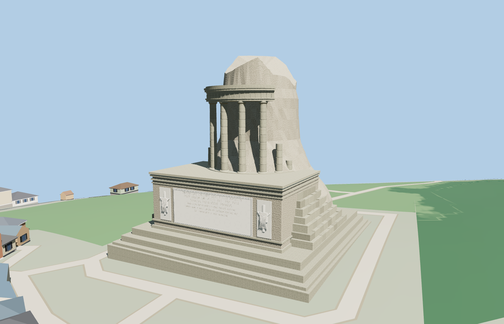

# Tropaeum Alpium

The square foundation, weathered Roman rubble, restored west inscription with flanking trophies, four full columns, broken shafts, curved entablature and uneven tower crown distinguish the present ruin.

The 30,756-triangle source rebuilds byte for byte. Skyline, district, street and close-up use 824, 3,362, 14,060, 27,216 triangles. The first two tiers total 321,348 bytes. Six GLBs validated and 36 current views were inspected.

All four tiers pass inscription, column, open bay and foundation probes. The uneven crown reaches 35 m above the podium datum. The viewer retains 201 independent building records and 46 mapped transportation parts. Failed loading retains the original mapped footprint.

The plan follows the mapped footprint and standard elevation tiles. Relative heights of surviving masonry, the broken upper rim and the relief figures are approximated from photographs. The model depicts the standing ruin with its restored inscription and surviving columns. Nearby park paths and terrain use the viewer’s native data. Physical-device timings are unmeasured.

Rebuild with `node packages/worldgen/scripts/generate-tropaeum-alpium.mjs`. Append `--check` to compare exact bytes. Use `--ids=tropaeum_alpium` for targeted import, LOD, placement and readiness.
