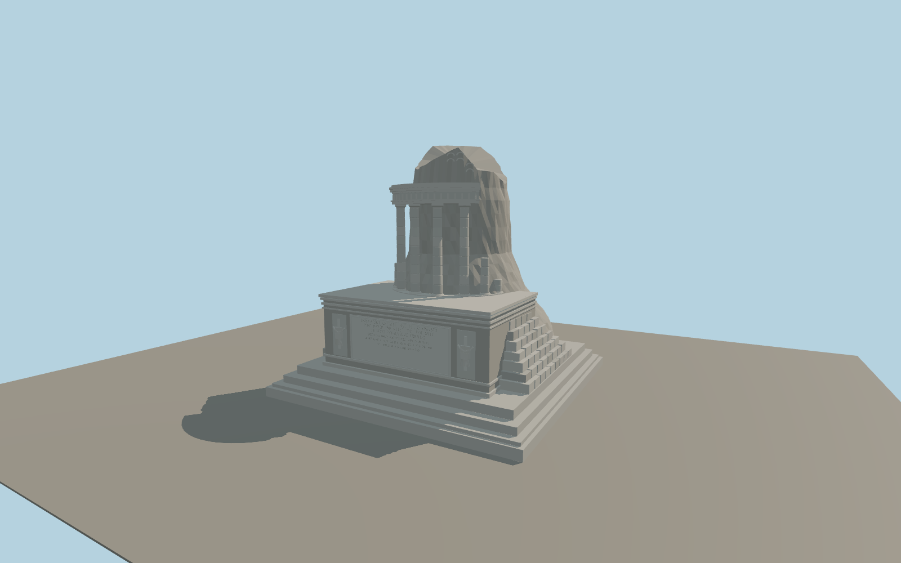

# Tropaeum Alpium

The square foundation, weathered Roman rubble, restored west inscription with flanking trophies, four full columns, broken shafts, curved entablature and uneven tower crown distinguish the present ruin.

Run `node packages/worldgen/scripts/generate-tropaeum-alpium.mjs` to rebuild the source master. Append `--check` to compare the exact bytes. Use `--ids=tropaeum_alpium` for targeted import, LOD generation and placement.

The plan follows the mapped footprint and standard elevation tiles. Relative heights of surviving masonry, the broken upper rim and the relief figures are approximated from photographs.

The model depicts the standing ruin with its restored inscription and surviving columns. Nearby park paths and terrain use the viewer’s native data.

Original geometry follows the repository license. Map data is © OpenStreetMap contributors under ODbL-1.0 via Protomaps. Terrain samples are described in terrain-grid.json. Ordinary pictures stay local and are not redistributed or used as textures. Current acceptance is recorded in qa.json.
