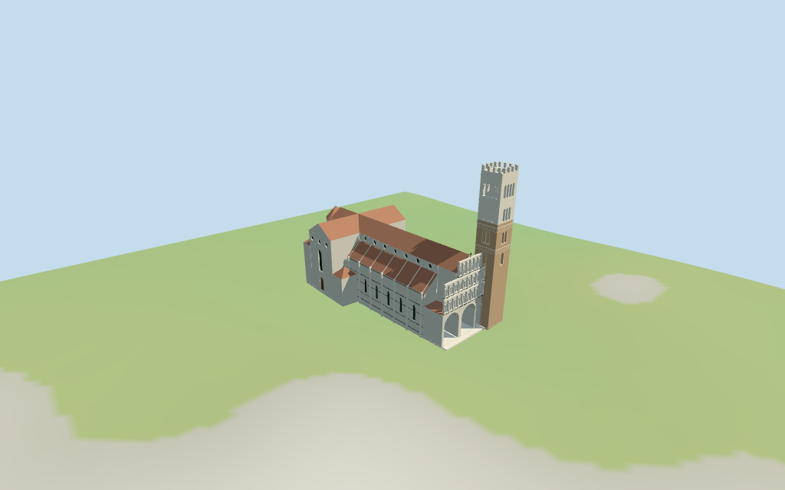

# Lucca Cathedral

Individual Lucca Cathedral: asymmetric Romanesque marble west front with two large and one smaller deep portico arches, three arcaded tiers including a narrower upper gallery; long tiled nave/clerestory and lean-to aisles, cross transept, projecting chapels and rounded eastern apse. Tall southwest tan-brick/pale-marble campanile with graduated single/pair/triple/quadruple belfry arches and crenellations. Recessed portals, circular clerestory windows, blind side arcade ribs, cornices and sparse geometric stone inlays. Five existing shared ashlar/limestone/tile/brick/wood graphs, linear tints, metric UVs, flat normals and four budgeted browser levels. Current whole/component footprints and standard DEM. Exact marble carving/statues/inscriptions/mosaic, interior rooms, hidden roof joints and surveyed plaza/thresholds are approximate or excluded.

## Evidence and reconstruction

Published dimensions and reconstructed details are separated in spec.json. Primary references:

- [Reference](https://commons.wikimedia.org/wiki/File:Lucca_Cattedrale_di_San_Martino_Esterno_Facciata_%26_Campanile_4.jpg)
- [Reference](https://commons.wikimedia.org/wiki/File:Lucca_Chiesa_dei_Santi_Giovanni_e_Reparata_Campanile_Vista_su_la_Cattedrale_di_San_Martino_4.jpg)
- [Reference](https://commons.wikimedia.org/wiki/File:Lucca_Cattedrale_di_San_Martino_Campanile_Vista_su_la_Cattedrale_2.jpg)

Five existing cached256-square ashlar, limestone, tile, brick and plain wood graphs. Linear ivory/tan/terracotta tints, metric UVs and flat architectural normals. Glazing, shaded gallery backing and sparse stone inlays use geometric PBR colors. No embedded images or bespoke facade maps.

## Model and axes

25,603 triangles; 76,809 vertices; 7 material groups; 3,076,412 bytes. Native bounds: -50.565, -0.295, -24.010 to 50.316, 71.500, 24.000. Source hash: `sha256:3f40beaf937d4b7caa162339f437af4dfec541f56d8c01cf2f9cea726cdf19a4`.

{"x":"east from west portico toward transept and rounded apse","y":"up","z":"south toward southwest campanile and south aisle"}

Standard viewer DEM datum 18.798031m; display offset2.5m, mapped perimeter terrain 0.08..2.31m. Footings extend below coarse viewer terrain; portico threshold is0.3m above model floor with short local steps. Exact Piazza San Martino grading, portal thresholds and walking remain unverified. No global flattening or road replacement.

## Reproduce

Run `node packages/worldgen/scripts/generate-additional-landmarks.mjs --ids=lucca_cathedral` (or add `--check`). The generator preserves manually edited masters by checking their baseline hashes. Import through the standard authored-model workflow with optimization disabled; then capture all QA cameras, including shared-surface views.

## Pending work

- Retained exact-QID OSM way180366824/Q1282278 matches current main35184552455656. All22 raw main vertices and11 component plans/tags remain exact after rigid rotation with no rescale. Current mapped campanile35185841751561 has69m height; other height/min_height tags are absent. The western portico, southwest tower, long eastward nave/cross transept and east rounded apse sign the retained axis. Nave/transept roof partitions are picture estimates within the mapped envelope. Approximate levels: portico14.5m, full-width marble galleries15..21.5m and22..28m, narrower central gallery28.5..35m; nave/transept eaves30m/ridges36m; aisle walls19.8m/lean-to joins26.5m; eastern side chapels22m/hips26m; projecting north/south side chapels13m/hips17m; apse30m/faceted roof35.8m. Campanile brick lower shaft0..47m, pale upper47..67m, open belfry tiers with one/two/three/four arches, crenellations67..69m. Recessed tier galleries, arch/column rhythm, clerestory circles, side blind arcades, portals and trim are picture approximations. No survey or engineering accuracy claimed.
- Standard viewer DEM datum 18.798031m; display offset2.5m, mapped perimeter terrain 0.08..2.31m. Footings extend below coarse viewer terrain; portico threshold is0.3m above model floor with short local steps. Exact Piazza San Martino grading, portal thresholds and walking remain unverified. No global flattening or road replacement.
- Medium-fi exterior from three inspected2023 pictures and standard viewer PMTiles/DEM only. Exact carved columns, figures, marble mosaic, inscriptions, interior rooms/bells, hidden roof joins and surveyed plaza/thresholds remain approximate or excluded. Most heights are picture estimates;69m campanile is mapped. Physical phone/laptop timing pending.
- Skyline retains mapped massing/tower/stepped front and red cross roof. District adds shared textures, flat gallery/belfry bays and tower merlons. Street adds real gallery recesses, deep portico and doors, hollow belfry openings and recessed glazing. Closeup/master add capitals, nested surrounds and side blind arcades. Synthetic cottages are a review fixture.

This bundle follows the medium-fi standard. Medium-fi appearance and geographic fit are reviewed separately. Hash-bound visual acceptance is recorded separately after capture inspection.

## Additional geographic data

©OpenStreetMap contributors; Protomaps; Mapzen/USGS terrain tiles.
