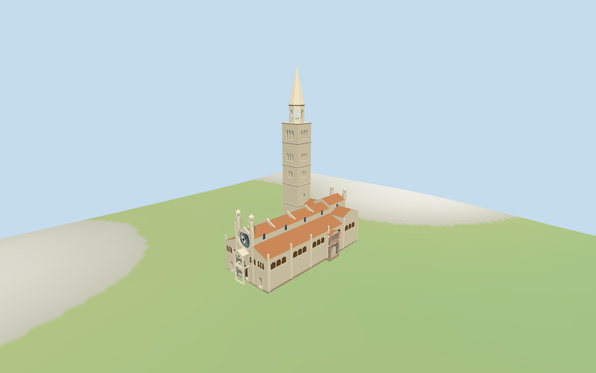

# Modena Cathedral

Modena Cathedral/Ghirlandina: recessed spoke rose,stepped west gables/three-arch gallery bays,pilasters,two-tier west porch,pink southern Porta Regia,three conical eastern apses,four roof turrets,red-tiled raised nave/aisles and tall tiered square/octagonal belfry/stone spire.

## Evidence and reconstruction

Published dimensions and reconstructed details are separated in spec.json. Primary references:

- [Reference](https://www.comune.modena.it/novita/notizie/2025/modena-capitale-del-volontariato-2026-1)
- [Reference](https://patrimoniomondiale.modena.it/en/visit/monumental-complex/cathedral/)
- [Reference](https://patrimoniomondiale.modena.it/en/visit/monumental-complex/cathedral/exteriors/portals/directors-door/)

Four existing256-square raw/weathered limestone,ceramic tile and wood graphs across seven roles; selected pink architectural trim shares limestone through linear vertex tints. Metric UVs,flat glass,no embedded images.

## Model and axes

24,852 triangles; 74,556 vertices; 6 material groups; 2,986,052 bytes. Native bounds: -36.400, -0.556, -28.388 to 33.207, 85.800, 14.280. Source hash: `sha256:ab338cf7a6d5ca5d8414861465f275eab6001a317c6347713e85b2d04083b8fc`.

{"x":"east along nave toward triple apses","y":"up","z":"south toward Porta Regia/Piazza Grande"}

StandardDEM datum43.367101m; estimated floor0.8m clears footprint peak0.499m and perimeter-0.21..0.50m. Terrain-following foundations; exact piazza/step/tower thresholds and all eave/gallery/roof-stage roles approximate. No independent survey or certified walking.

## Reproduce

Run `node packages/worldgen/scripts/generate-additional-landmarks.mjs --ids=modena_cathedral` (or add `--check`). The generator preserves manually edited masters by checking their baseline hashes. Import through the standard authored-model workflow with optimization disabled; then capture all QA cameras, including shared-surface views.

## Pending work

- Current map constrains21m long nave,22.4m raised choir/cross-roof strips,16.1m aisles,18.3m eastern side ranges,16.2/12.4m apses,12.6m south porch,28.4m west/26.1m east turrets and47.5/57/85m tower stages. Eaves,inner belfry and octagonal/spire transition heights,porch/gallery/opening sizes and sculpture are picture-led interpretations; no independent measured heights or certified dimensions.
- StandardDEM datum43.367101m; estimated floor0.8m clears footprint peak0.499m and perimeter-0.21..0.50m. Terrain-following foundations; exact piazza/step/tower thresholds and all eave/gallery/roof-stage roles approximate. No independent survey or certified walking.
- Selected gallery bays are shallow pane/arch/column representations rather than fully excavated interiors. Rose spokes,porches,roof turrets,pink trim and connecting arch are approximate. Exact lions,sculpture/reliefs,full interiors,adjacent town/square and certified walking excluded. Physical phone/laptop timings pending.
- Skyline omits portals/gallery/porch details and uses solid tower masses/mean-tinted roofs. District adds textures,rose/recessed closed portals,actual porch/connecting arches and simplified flat belfry/grouped bays. Street adds actual square/octagonal belfry cuts,selected gallery columns/pilasters,roof bands and turret openings. Closeup refines arch segmentation,rose spokes and columns. Detail/profile changes remain visible.

This bundle follows the medium-fi standard. Medium-fi appearance and geographic fit are reviewed separately. Hash-bound visual acceptance is recorded separately after capture inspection.

## Additional geographic data

©OpenStreetMap contributors; Protomaps; Mapzen/USGS terrain tiles.
