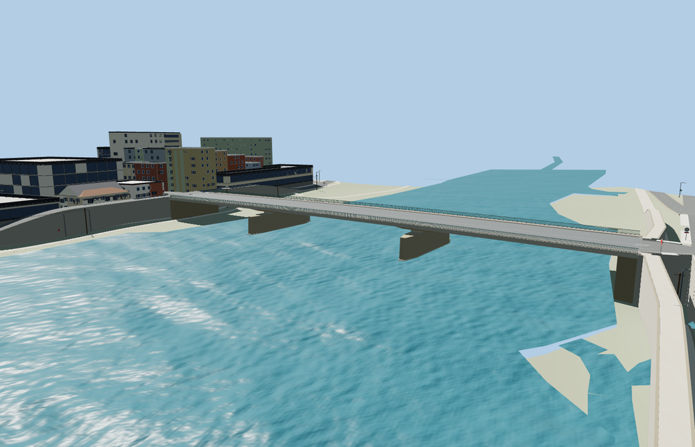

# Ponte Amerigo Vespucci

Complete three-span Arno crossing with a shallow haunched concrete deck, paired skewed masonry piers, cutwaters, abutments, raised sidewalks, and open green railings.

The source master has 23,576 triangles. The skyline, district, street, and close-up tiers have 518, 2,066, 7,088, 18,824 triangles. The first two tiers total 193,032 bytes. The close-up tier is 1,460,192 bytes. Six GLBs passed validation and 34 current views were inspected.

All four tiers pass 48 join probes within 0.15 m and 18 bank approach probes with a maximum difference of 0.006 m. Three checks on the original lower route show at least 7.108 m of clearance and zero obstructions. All 90 buildings and the native road, water, and terrain inputs were retained. Model unload and failed-load fallback both passed.

The 163.187 m mapped envelope locates the crossing and the four projecting pier noses. The reported 22.5 m width sets the main deck. Photos guide the shallow concrete haunches, masonry dressing, and green railings. The coarse Terrarium grid undersamples the elevated quay roads and yields steep approach support faces. Deck grades, pier foundations, the southwest sidewalk flare, and the northeast lane plate are visual fit decisions. Physical device performance remains unmeasured.

Rebuild with `node packages/worldgen/scripts/generate-ponte-amerigo-vespucci.mjs --check`. Use `--ids=ponte_amerigo_vespucci` for targeted import, LOD, placement, and readiness. The generator is registered in asset-build.json.
