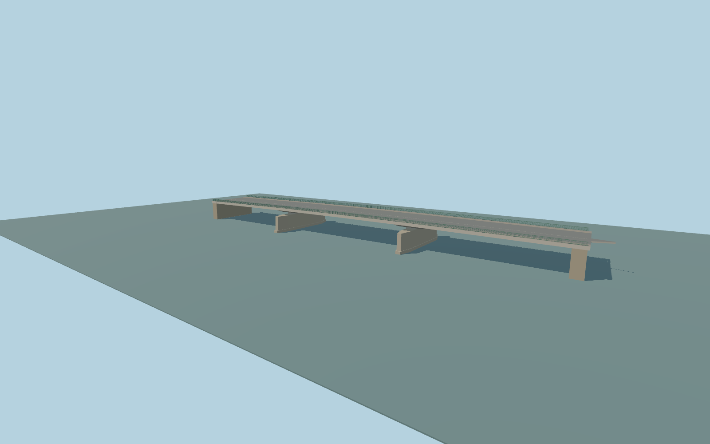

# Ponte Amerigo Vespucci

Complete three-span Arno crossing with a shallow haunched concrete deck, paired skewed masonry piers, cutwaters, abutments, raised sidewalks, and open green railings.

Rebuild: `node packages/worldgen/scripts/generate-ponte-amerigo-vespucci.mjs`;append `--check` for exact source bytes. Select import/LOD/placement with `--ids=ponte_amerigo_vespucci`. Detailed source and four browser tiers are separate ignored GLB outputs.

The two pier axes and skewed landings follow the attributed map footprint. Photographs guide deck depth, the cutwater profiles, and the railing pattern.

The coarse global elevation grid undersamples the raised quay roads. The road replacement profile joins the authored deck to the mapped street approaches. Pier foundations and exact absolute elevations are visual approximations. Short landing lips, a southwest sidewalk flare, and a tapered northeast median plate bridge the visible joins to the mapped approaches. The crossing models its permanent exterior.

Original geometry:repository license. Map:© OpenStreetMap contributors,ODbL-1.0;Protomaps. Standard terrain:terrain-grid.json. Ordinary pictures stay local and are not redistributed or used as textures. Current acceptance:qa.json.
