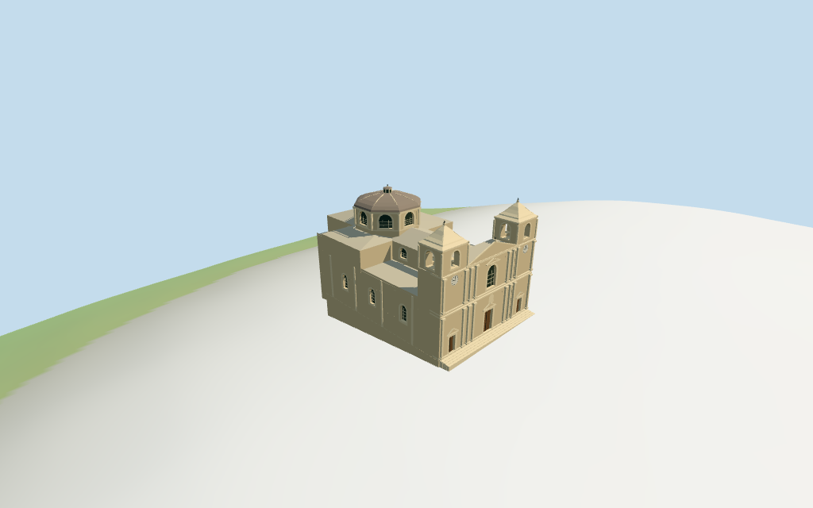

# N0375 — St. Paul's Cathedral, Mdina review

Reviewed2026-10-15 against current source/runtime bytes. Accepted for the medium-fi exterior and approximate geographic/terrain scope.

## Built result

Inspected all11 current portable/source-terrain frames. Individual warm Maltese limestone Baroque cathedral: symmetrical two-storey west facade with paired pilasters/capitals, three recessed wood-backed portals, large upper arched window, triangular central pediment and paired clock/bell towers. Towers have open belfry tiers, curved-profile stone spires and30m crosses. Rear octagonal drum has large arched gridded glazing, layered cornices, low weathered metal dome/stone ribs and small lantern/cross at30m. Lower flat-roof aisles and low central nave/transept roofs preserve the signed whole envelope. Removed tower/front/base overlaps and gave pediments solid thickness so they remain visible from behind. Front steps sit above the coarse plaza edge; rear walls expose taller foundations where standard DEM drops beneath the plateau. Exact ornamental scrolls/carving/clock numerals and hidden roof/rear details remain approximate.

Medium-fi exterior from three inspected Commons2005 west front,2024 dome/drum and2021 rear photographs plus standard viewer PMTiles/DEM. No bespoke survey/plan research or redistributed reference photos. Paired clock/bell towers, curved stone spires, central pediment/pilasters/three portals, windowed octagonal drum, low metal dome/ribs and lantern are individually authored. Fine carving/heraldry/inscriptions, sculptural spire scrolls, full clock numerals, bells/interiors, hidden rear windows/roof joins and surveyed plaza/plateau/thresholds remain approximate or excluded. Mapped20/30m controls retained; internal levels are estimates. Small lantern windows remain flat fields. Physical device timings pending.

## Shared materials and placement

Inspected all11 current shared/geographic frames. Five existing cached256-square ashlar, limestone, granite, standing-seam metal and plain wood graphs serve seven merged groups. Linear warm stone/pale trim/muted metal tints, metric UVs and flat architectural normals. Clocks and dark glazing use geometric PBR colors. No embedded images or bespoke facade textures. Each graph reads once; unload disposes geometry and leaves zero live model geometries. Top placement matches raw whole plan with twin towers west and large dome east. The detailed dome uses an estimated octagonal shell inside the mapped circular control. Detail crops deliberately omit other portions; whole views show the complete cathedral and all30m tips. Flat diagnostic ground does not verify real plaza or rear plateau grading.

Exact-QID OSM way27044968/Q1630170 matches current main35184399133800. Anchor[14.404111382,35.886427018], heading0.180503202087rad signs the twin-tower west front versus larger eastern dome. Four raw controls reproduce rigidly without rescale: main6vertices, circular dome19 and two towers4each. Current PMTiles main20m/dome30m/towers30m are complete component heights, not offsets stacked on top of main. Full tags/absent min_height retained, including retained main source:height=estimated. Internal height subdivisions, octagonal dome shape/phase and roof partitions are picture estimates. Base/front/aisle partitions subtract tower footprints to avoid duplicate walls. All48 actual viewer footprint checks cover four selected controls and preserve three nearby buildings plus west approach across six outputs. Standard viewer DEM datum193.391278m, floor4.1m, perimeter-4.71..3.85m. West threshold0.3m above floor and short local steps; walls extend below coarse terrain. DEM slopes beneath the rear plateau may expose tall foundations. Exact plaza/retaining walls/threshold grading, absolute altitude and walking remain unverified. No global flattening or road replacement.

Inspected all27 current Earth-lighting frames: Economy/High, noon/late, three distances, silhouette, six detail crops, four matched whole-model LODs and four transitions. Skyline keeps twin curved tower caps, central pediment, broad octagonal drum/low dome/lantern and low nave/aisles. District adds shared textures, clocks, flat glazing and trim. Street adds actual recessed glazing/portals, hollow belfry arches, dome ribs and pilasters. Closeup/master refine capitals, nested surrounds, clock marks and window bars. Whole LOD views include the full mapped envelope and30m tower/dome tips. Synthetic cottages and coarse review terrain are fixtures; physical phone/laptop timing and surveyed ground joins remain pending.

## Browser budgets

| Level | Triangles | Bytes | Draws |
| --- | ---: | ---: | ---: |
| skyline | 639 | 67116 | 1 |
| district | 1784 | 174200 | 7 |
| street | 5650 | 519064 | 7 |
| closeup | 8042 | 735748 | 7 |

Initial skyline plus district: **241316bytes** of geometry. Master: **969156bytes / 8042triangles**. Five cached shared256-square graphs; zero embedded images. Bytes exclude graph definitions/texture generation. Split POSITION/NORMAL streams with equal CPU/GPU totals. Physical device timing pending.

## Verification

- Targeted byte reproduction and current source/import/LOD/input/report bindings; source/recipe inventory/schema match.
- Six Khronos validations: zero errors/warnings/images. All four browser budgets pass.
- Four raw map controls, full tags, mapped20/30m heights, signed frame, derived partitions and standard DEM match.
- **546 actual geometry probes** and **48 current viewer footprint checks** pass.
- Shared graph read-once/unload and hash-bound geographic/medium-fi reviews pass.
- Scene validation and30-tick simulation: sha256:f83867e266c46cb3fe63bd01feca4c7d3b9d01fb0620416a666e0c668ba894a3.
- Inspected **49 current frames**:11portable,11shared/placement,27medium-fi. Cameras/paths/hashes retained; bulk images ignored.

Source hash:sha256:69b42b636b5c1d4416de49f4a80fa1f96e3ba848ad32b8b86412453443846f7d. Runtime hash:sha256:9332a46b342aabde959c93e1ce0eac2622ae08e300012be3002617a2327989b6. Input hash:sha256:f83531f6f12a27e3f651905fc6d93b9681e01a956da2cb032cad015f762875d1.

Commands: targeted generate/import/LOD/register-landmark-previews --ids=N0375; generate-additional-landmarks.mjs --ids=N0375 --check; capture-next-1000-models.mjs --ids=N0375 --reflections --antialias --fit-shadows; capture-landmark-library.mjs --ids=N0375 --reflections --adaptive-clipping --bounded-placement; capture-medium-fi.mjs --ids=n0375_st_paul_s_cathedral_mdina --reflections; molen validate; molen sim run --ticks30 --hash. Routine full source checkpoint covers N0360–N0379.

## Limits

- Retained exact-QID OSM way27044968/Q1630170 matches current main35184399133800. All6 raw whole vertices and current dome19/tower4+4 component vertices and full tags remain exact after rigid rotation with no rescale. Main20m and dome/towers30m heights are PMTiles controls for complete components, not offsets added on top of the main height. West twin-tower facade versus eastward nave/dome signs the retained axis. Main body: estimated low aisle walls12m/parapet13.2m, central nave and transept walls17.8m with low roof20m; full west screen20m/central pediment23.3m/finial24.3m. Towers: lower clock shaft20m, open bell tier20..25.2m, hood25.2..26.3m, curved stone spire26.3..29m/cross30m. Dome: estimated octagonal drum18..25m, low faceted metal canopy25..27.9m, lantern27.8..29.4m/cross30m. Drum center[6.614,-0.708]m/radius9.1m is derived from mapped circular control; octagonal shape/phase and roof partitions are picture estimates. Portals, clocks, window rhythm, stone pilasters/capitals and scrolls are approximate. No survey or engineering accuracy claimed.
- Standard viewer DEM datum 193.391278m; display floor4.1m, whole perimeter terrain -4.71..3.85m. West threshold0.3m above model floor with short local steps; walls extend down to coarse standard terrain. DEM slopes under the rear plateau/adjacent buildings are coarse and may expose tall foundations; no bespoke terrain correction is claimed. Exact cathedral plaza/retaining-wall grading, threshold joins, absolute altitude and walking remain unverified. No global flattening or road replacement.
- Medium-fi exterior from inspected2005 facade,2024 dome/drum and2021 rear plus standard viewer PMTiles/DEM only. Exact carving/heraldry/inscriptions, full clock numerals, statues, sculptural spire scrolls, bells/interiors, hidden rear windows/roof joins and surveyed plaza/thresholds remain approximate or excluded. Physical phone/laptop timings pending.
- Skyline keeps paired curved stone tower spires, central pediment, octagonal drum/dome/lantern and low nave/aisle forms. District adds shared surfaces, clock faces, flat glazing/belfry bays and selected trim. Street adds actual recesses/open belfries, capitals/pilasters, larger mullions and dome ribs. Closeup/master refine surrounds, window bars, spire ribs and clock marks. Small lantern windows remain flat fields. Synthetic cottages are a review fixture.

Readiness accepts this exterior scope. The1,000-candidate goal remains incomplete.
