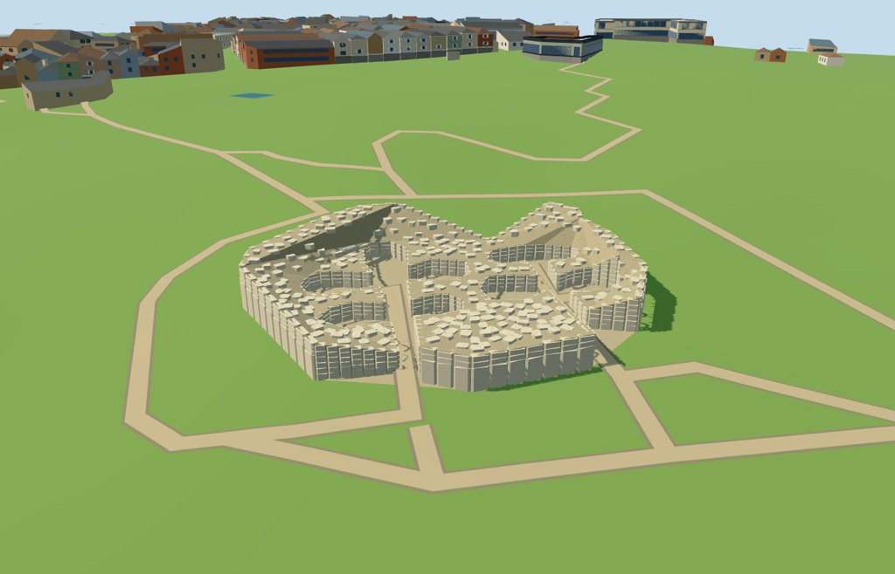

# N0494 — Ġgantija

Reviewed 2026-10-18. Accepted for the specific medium-fi ruins exterior and approximate normal-map/DEM fit.

## Exterior and shared materials

The mapped 75-vertex wall mass preserves both roofless apsidal temple groups, southeast entrances and shared curving perimeter. Large lower orthostats, upper stone courses and coarse rubble define the near model. Chamber openings remain clear. Heights, individual stones, rubble distribution and soil colour are picture-guided estimates; exact stone inventories, original roofs, visitors, modern walkway engineering and hidden interiors are omitted.

Two common 256-square dry-stone and limestone-grain graphs use metric UVs and linear pale-stone tints. Earthen ground is an explicit constant. Three near draws, no embedded images or unique atlas. Each graph loads once and eviction frees all model geometry. Master: 29,249 triangles / 3,512,252 bytes.

## Browser levels

| Level | Triangles | Bytes | Draws |
| --- | ---: | ---: | ---: |
| skyline | 429 | 48288 | 1 |
| district | 919 | 93836 | 3 |
| street | 10175 | 968684 | 3 |
| closeup | 29249 | 2942664 | 3 |

Initial skyline plus district geometry: **142,124 bytes**, plus the shared graphs. Skyline retains both open chamber groups; district adds large outer stones, street adds more courses and sparse rubble, and closeup restores the full stylized stone treatment. Separate GPU attribute streams avoid duplicate uploads.

Inspected all 27 medium-fi views: procedural neighbors at three distances, noon and late afternoon, Economy/High, untextured silhouette, detail views and level transitions. A source-only 64 m preview crop keeps synthetic neighbors visible; actual-site data remains unchanged. The shared flat stage at Y=-5 exposes foundations and is not ground-contact evidence. Physical-device and dense-city measurements remain pending.

## Geographic integration

The approximately 43 × 45 m actual temple footprint is used, rather than the larger archaeological park boundary. All 75 control vertices retain raw east/south coordinates. Wall feet follow the unchanged 161-square / 6 m DEM with 45 cm foundations; the small compound surface follows original terrain triangles at 8 cm clearance. No ground or water excavation is requested.

Full-site loading replaces the temple record and preserves 456 independent tile buildings exactly. All 2,730.8886 square metres of native water remain unchanged. Failure retains all 457 buildings. A synthetic 24 m partial-residency test retains original terrain under and around clipped model pieces; eviction frees every model geometry. The empty-semantic partial fixture verifies clipping and lifecycle only; temporary cut faces are not permanent archaeological geometry. Neighboring facades and path surfaces are generic context.

## Source and checks

Two registered recipes and retained map/reference/terrain inputs reconstruct the master and four browser levels. Six Khronos checks have zero errors or warnings. All 192 chamber/wall probes, 75 map-coordinate checks and 900 compound-surface samples pass. Inspected 49 current official and 24 actual-site/failure/partial frames. Selected generator/import/placement checks, strict medium-fi, scene validate/sim30 and formatting pass. Source checking verifies 920 logical bundles and 664 indexed structure recipes. All previous 500 ready candidates remain ready.

The shared-review fixture now uses a 128 m stage for small bounded structures; point placements and larger structures keep the existing 256 m minimum. The capture passes the original locality and full-geometry assertions. No engine-wide build or dependency audit was run for this model; the full source milestone remains the preceding 500-model batch.

Source: sha256:a5fdf635fd85edc0dffbacb916a5bb7adea4fe3c2c49c590535d137a6b646327

Runtime: sha256:32a585233223aa2df39a9c320bfae0d97e3aec8f59c18df43a1f13526c73f5fa

Input: sha256:43d474b27c922220d2f4964589f9d6c6be6d717f9f4e6bb4b414d859503c177a

## Rebuild and picture reference

Run generate-additional-landmarks.mjs, import-next-1000-models.mjs and generate-landmark-lods.mjs with --ids=N0494. Portable capture uses --antialias --fit-shadows --reflections; shared capture uses --adaptive-clipping --reflections --bounded-placement; medium-fi capture uses --ids=n0494_ggantija --reflections. Bulk captures remain ignored.

https://commons.wikimedia.org/wiki/File:Ggantija_Temple_on_Gozo.jpg
