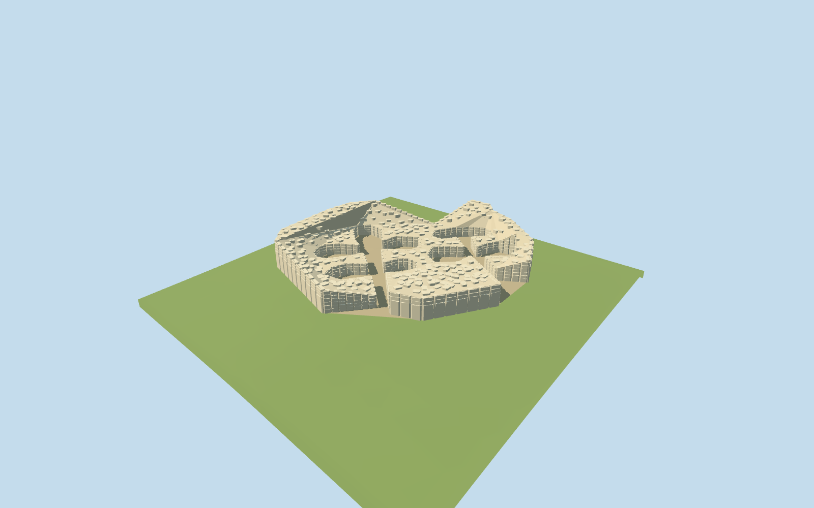

# Ġgantija

Two specific roofless apsidal temple groups with open entrances,shared curved megalithic perimeter and surviving internal wall masses. The75-point normal-map outline supplies the actual walls and open chambers;the larger archaeological park is not authored as a building.

## Evidence and reconstruction

Published dimensions and reconstructed details are separated in spec.json. Primary references:

- [Reference](https://commons.wikimedia.org/wiki/File:Ggantija_Temple_on_Gozo.jpg)

Two shared 256-square limestone/dry-stone graphs, metric UVs and linear tints; an explicit earthen-ground constant follows the original grid. No embedded images or unique atlas. Two registered recipes reconstruct the master and four browser levels.

## Model and axes

29,249 triangles; 87,747 vertices; 3 material groups; 3,512,252 bytes. Native bounds: -25.547, -1.517, -30.632 to 17.867, 7.865, 15.222. Source hash: `sha256:a5fdf635fd85edc0dffbacb916a5bb7adea4fe3c2c49c590535d137a6b646327`.

{"x":"east","y":"up","z":"south"}

Retain the unchanged normal161-square/6m Mapzen-USGS grid. NativeY0 is the126.847m center reference. Fit wall feet to their local standard terrain heights,with shallow foundations,instead of flattening the hillside or opening the ground. Detailed surveyed floor levels remain unknown. A small opaque earthen compound surface follows clipped triangles from the original grid at8cm clearance. Wall foundations extend45cm below their local samples. No terrain excavation or ground cutout is requested.

## Reproduce

Run `node packages/worldgen/scripts/generate-additional-landmarks.mjs --ids=N0494` (or add `--check`). The generator preserves manually edited masters by checking their baseline hashes. Import through the standard authored-model workflow with optimization disabled; then capture all QA cameras, including shared-surface views.

## Pending work

- Two specific roofless apsidal temple groups with open entrances,shared curved megalithic perimeter and surviving internal wall masses. The75-point normal-map outline supplies the actual walls and open chambers;the larger archaeological park is not authored as a building.
- Retained Q216862/way29546608 identifies the archaeological site. The standard PMTiles actual temple building35184714819646 supplies a75-vertex wall-mass outline with both apsidal chamber groups and southeast entrance corridors,about43×45m. The independent site boundary is about94×89m and is not the model footprint.
- One ordinary2020 aerial exterior picture shows pale irregular limestone blocks,high back perimeter and lower open chamber walls. The displayed article gives a6m maximum wall height. Individual wall heights,stone grouping and surviving portal tops are visualization estimates,not a surveyed reconstruction. Large orthostats occupy the lower outer wall faces; smaller upper courses and interior stone groups are estimates guided by that picture. The mapped wall mass,open chambers and entrance gaps remain unchanged.
- Retain the unchanged normal161-square/6m Mapzen-USGS grid. NativeY0 is the126.847m center reference. Fit wall feet to their local standard terrain heights,with shallow foundations,instead of flattening the hillside or opening the ground. Detailed surveyed floor levels remain unknown. A small opaque earthen compound surface follows clipped triangles from the original grid at8cm clearance. Wall foundations extend45cm below their local samples. No terrain excavation or ground cutout is requested.
- Large stone positions, surviving wall heights, individual portal stones, smaller rubble and soil colour are visualization estimates. The original park outline is not used as the temple footprint. Complete roofs, exact stone inventories, visitors, modern walkway engineering and hidden interiors are omitted.

This bundle follows the medium-fi standard. Medium-fi appearance and geographic fit are reviewed separately. Hash-bound visual acceptance is recorded separately after capture inspection.

## Additional geographic data

©OpenStreetMap contributors; Protomaps; Mapzen/USGS terrain.
