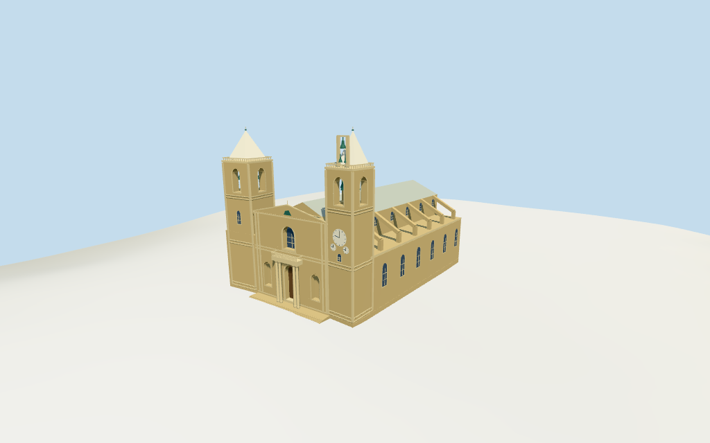

# st_johns_co_cathedral — St. John's Co-Cathedral review

Reviewed 2026-10-14 against current source/runtime bytes. Accepted for the recorded medium-fi exterior and approximate geographic scope.

## Built result

Inspected all 11 final portable/source-terrain views. The individual exterior has twin limestone towers with pale pyramidal roofs, open belfries and green hanging bells, an exposed upper-right bell frame, three clock fields on the right tower, a column-supported projecting balcony above one recessed closed wooden portal, blind niches, central gable, pale metal nave roof, repeated sloping buttresses and lower side/rear masonry. Corrected the detached entrance landing and two glazing panels behind irregular mapped masonry. All entrance column feet now meet the landing; side/rear panes meet the actual wall boundary. Bells, clocks and relief fields are selected geometric approximations.

Individual medium-fi exterior from two useful inspected elevated/front pictures and standard viewer PMTiles/DEM. There are no mapped part heights. Estimated stages above the floor are 14.5..15.1m lower aisle roofs,22.5..27m nave,24m central facade/27m gable,27.5..36.7m belfries,37.6m parapets,45.3m pyramids,46.2m finials and 44.2m upper-right bell frame. Plan subdivision, portal/balcony, openings, clocks, bells and roof profiles are picture-led. Exact inscriptions, carved coats of arms, sculptures, clock/calendar text, full interiors, adjoining museum/city blocks, the background dome of another building and certified walking are excluded. Physical phone/laptop timings pending.

## Shared materials and placement

Inspected all 11 final shared-material/geographic views. Five existing 256-square graphs provide weathered limestone, raw limestone, standing-seam metal, lime plaster and wood. Roofs and green bells share metal with linear tints; pyramids and clock fields share plaster. UVs are metric, glass is flat blue-gray and skyline materials use mean tints. Each graph reads once. Unloading leaves zero live model geometries and restores ground. The geographic top view checks the signed mapped plan on flat terrain; portable views show the retained coarse DEM. Ground colors are diagnostic.

Retained exact-QID way23352829 and three current PMTiles controls preserve the approximately 65.5x44.2m parent and two front tower parts. Native-X faces the southwest front, native+X the northeast rear and native+Z the southeast/right-clock side, at heading 0.670065348526rad. All raw transforms match without rescaling. The broad north mapped part contains lower masonry, so its reconstructed 9.5x9.3m upper tower is picture-led. The generic levels-derived 17m parent is not the overall height. Standard DEM datum 55.671413m and estimated 2.4m floor clear sampled footprint peak 1.969m. Actual viewer coverage checks across all six outputs retain the cathedral while leaving north/clock-side neighboring buildings and the open front square uncovered. Exact thresholds, plaza contact and walking fit remain approximate; no road replacement.

Inspected all 27 final Earth-lighting views: Economy/High, noon/late, three distances, silhouette, six details, four matched whole-model levels and four transitions. Skyline retains the twin pyramids, stepped towers, gable/nave roof, side buttress rhythm and upper-right bell frame. District adds shared textures, selected windows, three clock fields, balcony/portal and bell silhouettes. Street opens belfries and the balcony rail and adds recessed openings; closeup refines profiles, suspended bells and details. The four matched whole-model cameras retain the full model; closer detail/street views crop intentionally. Detail changes remain visible. Italian-palazzo neighbors are synthetic context, not local mapped buildings.

## Browser budgets

| Level | Triangles | Bytes | Draws |
| --- | ---: | ---: | ---: |
| skyline | 941 | 82648 | 1 |
| district | 3589 | 322956 | 7 |
| street | 7219 | 667824 | 7 |
| closeup | 9285 | 869404 | 7 |

Skyline plus district: **405604 bytes** of geometry. Source master: **1118492 bytes / 9285 triangles**. Five shared graphs cached separately; no embedded images. Initial geometry excludes graph definitions/texture generation. Separate POSITION/NORMAL streams have equal CPU/GPU buffer totals. Physical device timings pending.

## Verification

- Exact targeted source reproduction with --ids=st_johns_co_cathedral --check; current source/import/derivative/review hashes match.
- Six GLBs pass Khronos with zero errors, warnings or embedded images. All four browser levels meet triangle/draw/download budgets.
- All three raw map controls, retained exact-QID outline, signed frame and standard DEM match. Generic 17m parent is explicitly excluded from overall height.
- **248 imported probes** pass: staged roofs and buttresses, belfry floors/roofs/clear apertures, suspended bell support, closed recessed portal, balcony gaps, niche/window recesses, landing and four entrance column bases. Side/rear pane probes sample clear of mullions.
- **24 current viewer footprint checks** cover the cathedral and leave north/clock-side neighbors and the front square uncovered across source, import and four LODs. Subdividing broad rotated faces prevents false triangle-box coverage at the viewer's signed yaw.
- Five graphs read once; unloading disposes model geometry and restores ground.
- Source inventory/schema, map-frame and medium-fi readiness bindings pass.
- Scene validation and 30-tick simulation pass: sha256:59e44836c85a53c4fa9c846660e7f9c78c5e00b743e07adfbd8bbd8b3e8fdbae.
- Inspected **49 current frames**: 11 portable,11 shared/placement,27 medium-fi. Reports retain cameras,paths and hashes; bulk views remain local/ignored.

Source hash: sha256:67ab8efcb13304c0f2e4cf212ce6e43fd539b1eb0522a81230536d4830552b17. Runtime hash: sha256:89de4fed3371cfc41ffe813732ffed3149c3d8e96723bcef974212f52bc4a00f. Input hash: sha256:54d2a8d20ca983d21a918545bd1e3d87f18e58df62042e7f849a99d9ee895ba6.

Commands: targeted generate/import/LOD; capture-structure-models.mjs --ids=st_johns_co_cathedral --reflections --antialias --fit-shadows; capture-landmark-library.mjs --ids=st_johns_co_cathedral --reflections --adaptive-clipping --bounded-placement; capture-medium-fi.mjs --ids=st_johns_co_cathedral --reflections; molen validate; molen sim run --ticks 30 --hash. No repository-wide engine suite/audit or full source rebuild repeated; next routine source checkpoint follows transfiguration_cathedral.

## Limits

- The approximately66x44m current parent and two front building-part plans control horizontal placement. The north part includes a broad lower mass;its upper tower is a photo-led9.5x9.3m reconstruction within that control. The south tower retains its raw plan. No part heights exist. The current17m parent is a generic levels-derived value and is not used as the overall cathedral height. Photo-led estimates are14.5..15.1m low aisles,22.5..27m nave,24m central front/27m gable,27.5..36.7m belfries,37.6m parapets,45.3m pale pyramid tips and46.2m finials. Right upper bell frame reaches44.2m. Openings,balcony,clocks,buttresses and all vertical stages remain approximate;no independently measured heights.
- Standard DEM datum 55.671413m;estimated floor 2.4m clears sampled footprint peak 1.969m and perimeter 0.33..1.93m. Foundation follows coarse terrain. Exact plaza/portal thresholds remain approximate;no independent survey or certified walking.
- Individual medium-fi exterior from two inspected useful pictures and standard PMTiles/DEM. Bell profiles,roof balustrades,clock/calendar fields,balcony/niches,gable relief and side/rear details are selected approximations. North upper belfry plan is inferred within the larger mapped base. Exact inscriptions/sculpture,full interiors,adjacent museum/city blocks,background dome and certified walking excluded. Physical phone/laptop timings pending.
- Skyline preserves twin pale pyramid towers,upper-right exposed bell frame,central balcony/door/upper arch,gable,nave roof and coarse buttress rhythm. District adds shared graphs,recessed closed portal/upper glass,selected columns/rails,three clock fields and flat belfry/bell marks. Street opens actual belfries with suspended green bells and recesses blind niches;closeup refines arches,bells,rails and clock ticks. Detail changes remain visible.

Readiness accepts this exterior scope. The 1,000-candidate goal remains incomplete.
