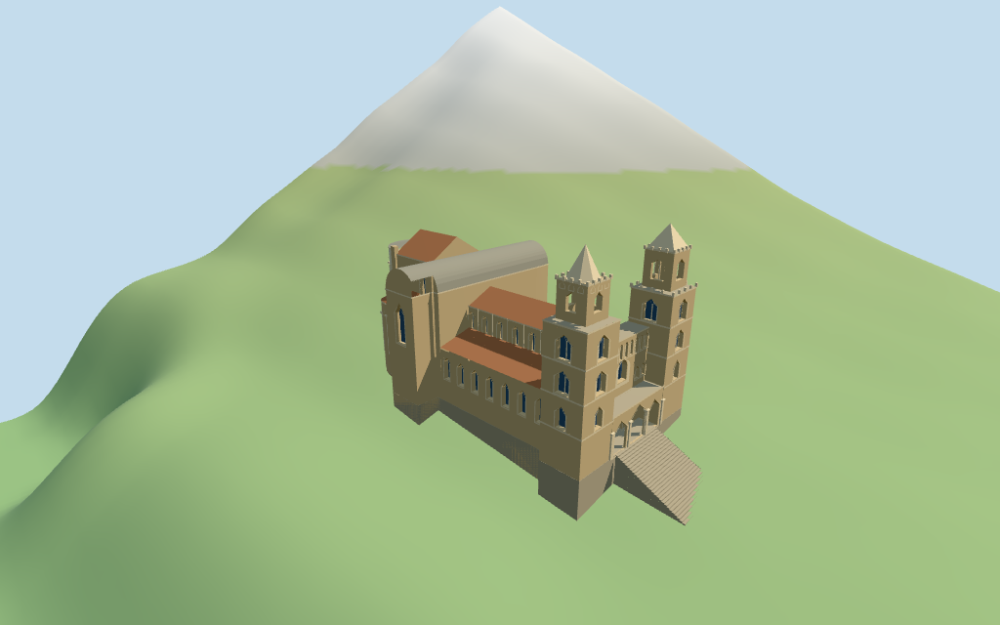

# cefalu_cathedral — Cefalù Cathedral review

Reviewed 2026-10-14 against current source/runtime bytes. Accepted for this medium-fi exterior and approximate geographic/terrain scope.

## Built result

Inspected all 11 current portable/source-terrain frames. Individually authored unequal-crowned twin west towers, smaller open belfry stages, pale octagonal north cone and broader south pyramid, pointed single/paired tower windows, crenels and cornices. The west front has two blind arcade tiers and a central round-headed window, three open pointed porch arches, closed wood entry and broad stairs. Raised red-tiled nave/lower aisles meet the gray transverse barrel crossing, high choir, tall pale central round apse and two lower tile-capped apses with colonnettes/blind arcade crowns. Corrected misplaced apse windows, the south crown center, overly steep nave roof, missing porch frames/paired-window mullions, two low tower windows hidden by attached aisles and a flat skyline stair block. Tower tops, apse curves and all architectural subdivisions are picture estimates.

Medium-fi exterior from three inspected 2017 front/east and 1997 elevated pictures plus standard viewer PMTiles/DEM. All heights, including 44m tower tops, wall/eave/roof/stage subdivisions, curves, windows, blind arcades, colonnettes, crowns and stairs are estimates. Later restoration/roof changes were not independently checked. The separate northern cloister and adjoining urban ranges remain host buildings. Exact statues, ironwork, lettering, mosaics, full interiors and certified walking are excluded. Terrain thresholds and physical laptop/phone timings remain pending.

## Shared materials and placement

Inspected all 11 current shared-material/geographic frames. Five existing 256-square raw-limestone, lime-plaster, ceramic-tile, granite and plain-wood graphs serve eight slots. Warm stone/pale trim, uniform pale central apse, terracotta roofs and stone foundations/steps use linear tints and metric UVs; glazing and gray vault are flat PBR colors. Skyline uses graph mean colors. No embedded images, baked shading, weathering or bespoke facade textures. Graphs read once; unload disposes geometry, leaves zero live model geometries and restores ground. Flat geographic views are diagnostic: they bury most of the descending stair flight and do not show actual hillside contact.

Retained exact-QID way 425988640/Q1354756 matches current PMTiles main feature 35184798077472. Its single unscaled 24-vertex outline has no architectural height tags. Anchor [14.023596886,38.039841968], heading -0.126022523437rad; west towers/porch, east apses and separate north cloister sign the frame. Recorded tower, facade, nave, crossing, choir, lower-roof and apse-projection partitions reproduce raw-outline clipping; curved apse walls are explicit fitted estimates. All 36 actual viewer footprint checks cover the main cathedral while preserving the separate north cloister, three urban neighbors and front plaza across six outputs. Standard DEM datum 33.867381m, estimated floor 0.5m and raw perimeter terrain -8.43..11.00m are retained. Terrain-following lower foundations and estimated descending stairs give coarse contact. The Rocca hill can conceal lower east/south foundations; exact door/street thresholds, cut/fill and absolute altitude remain unverified. No road replacement.

Inspected all 27 current Earth-lighting frames: Economy/High at noon/late, three distances, silhouette, six detail crops, four matched whole-model LODs and four transitions. Whole-model views retain both towers/crowns, nave, crossing, apses and entrance. Skyline keeps major masses, open four-post belfries, unequal caps and inclined entry; district adds flat fenestration/blind fields, shared textures and actual porch/belfry arches; street opens recesses and adds columns/mullions/cornices/steps; closeup/master refine curves and crown/arcade detail. A reusable review-camera yaw of -165 degrees keeps standard views outside the steep Rocca terrain. The retained terrain is not flattened. Height-based hill colors and Swedish-cottage neighbors outside the review tile are synthetic diagnostics, not local geology/snow or mapped town content.

## Browser budgets

| Level | Triangles | Bytes | Draws |
| --- | ---: | ---: | ---: |
| skyline | 442 | 48028 | 1 |
| district | 1957 | 178644 | 8 |
| street | 8867 | 768304 | 8 |
| closeup | 10777 | 909096 | 8 |

Initial skyline plus district: **226672 bytes** of geometry. Master: **1297828 bytes / 10777 triangles**. Five separately cached shared graphs; zero embedded images. Initial geometry excludes graph definitions/texture generation. POSITION/NORMAL streams are separate with equal CPU/GPU totals. Physical device timings pending.

## Verification

- Targeted byte reproduction: generate-additional-landmarks.mjs --ids=cefalu_cathedral --check. Source/import/LOD/input/review hashes match.
- Six GLBs pass Khronos with zero errors, warnings or embedded images; four browser budgets pass.
- Current raw map control, retained exact-way identity, signed frame and standard DEM match; recorded body/roof clipping reproduces. All heights remain explicitly estimated.
- **1,250 imported geometry probes** and **36 actual viewer footprint checks** pass; graph read-once/unload pass.
- Source inventory/schema, recipe index and hash-bound geographic/medium-fi reviews pass.
- Scene validation and 30-tick simulation pass: sha256:f825716732c8e85842bcab16ae9a33ddbbf94a4637f58966b3c30e99154dcf97.
- Inspected **49 current frames**: 11 portable, 11 shared/placement, 27 medium-fi. Reports retain paths/cameras/hashes; bulk images remain local and ignored.

Source hash:sha256:fc27b4e5ec435364c4baa2a337e12589a2be6aa481f537c66b9d9e756e82d87c. Runtime hash:sha256:57fedd0d2c3c610d9eeaac05a9d5accdabaace8b21da73112ca47384470f63eb. Input hash:sha256:080795a23c41681ef5c231b11d2c42a7fa07b40ed5a23ed12e29a4128a5d499d.

Commands: targeted generate/import/LOD; capture-structure-models.mjs --ids=cefalu_cathedral --reflections --antialias --fit-shadows; capture-landmark-library.mjs --ids=cefalu_cathedral --reflections --adaptive-clipping --bounded-placement; capture-medium-fi.mjs --ids=cefalu_cathedral --reflections; molen validate; molen sim run --ticks 30 --hash. Full source checkpoint followsN0359.

## Limits

- Retained exact-QID way 425988640 matches current main numeric feature35184798077472. One current unscaled outline controls the cathedral, twin west tower corners, transept wings and three coarse eastern apse projections. Current map has no architectural height tags; 44m tower tops, nave/aisle/vault/choir/apse heights and all body partitions are picture-led estimates. Fitted half-ellipse apse walls retain each recorded coarse projection extent; raw main footprint remains in the foundation/source frame.
- Standard DEM datum 33.867381m; estimated architectural floor0.5m relative to this datum, rather than lifting the full cathedral above the coarse rear/Rocca hill. Raw main perimeter spans -8.43..11.00m. Lower wall foundations follow terrain; the front stair flight is an estimated transition. Coarse DEM can conceal lower eastern/southern foundation surfaces. Exact thresholds, terrain cut/fill, absolute altitude and certified walking unverified; no independent survey or terrain flattening.
- Medium-fi exterior from2017 front/east and1997 elevated pictures plus standard viewer PMTiles/DEM only. All heights,wall/eave/roof/stage partitions,apse curves,windows/columns/cornices,biforia and steps are estimates. Later restoration/roof-state changes not independently verified. Separate northern cloister and urban buildings remain host content. Exact statues,gate ironwork,inscriptions,mosaics,full interiors and certified walking excluded. Physical device timings and exact terrain thresholds pending.
- Skyline retains major masses,coarse unequal crowns,open four-post upper belfries,barrel/three apse silhouettes and inclined front entry. District adds shared graphs,flat windows/closed door/blind fields and actual open porch/upper belfries. Street opens facade/apse/window recesses and adds columns,cornices,mullions,crenels and steps. Closeup/master refine curve facets,blind arcades and crown detail. Curvature,openings,ornament and step profiles change visibly. Synthetic Swedish-cottage neighbors are not local map buildings.

Readiness accepts this exterior scope. The 1,000-candidate goal remains incomplete.
