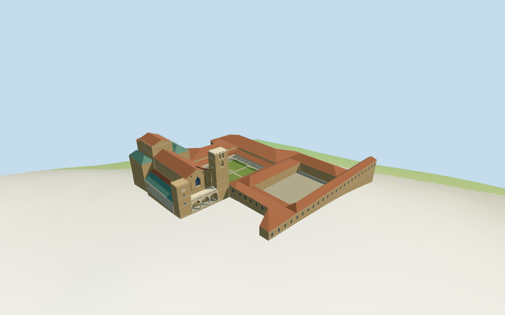

# N0349 — Cattedrale di Monreale review

Reviewed 2026-10-14 against current source/runtime bytes. Accepted for the recorded medium-fi exterior and approximate geographic scope.

## Built result

Inspected all 11 final portable/source-terrain views. Individual unequal west towers with short clock/crenellation tower and tall open single/paired belfry, three-arch pale front portico/balustrade and closed recessed portal, selected patterned upper front/tall window, terracotta nave, green north-gallery/transept roofs, high eastern sanctuary, three rounded decorated apses, open cloister/paired columns/garden and two mapped surrounding monastery ranges are present. Both courts have paving and remain open above it. Corrected inward-facing apse decorations and widened their detail camera. Surrounding ranges retain approximate massing/tiled roofs/selected windows.

Individual medium-fi cathedral/cloister exterior from two useful inspected elevated-front/apse pictures and standard viewer PMTiles/DEM. None of the five current controls has height values. Estimated stages above the main floor are 15m lower aisles,24/29m nave,33/37m sanctuary,25/39m unequal towers with 39.5m top,29m central/20.5m side apses plus low conical roofs,6.2/8.4m cloister and 10..14m secondary ranges. Three apse subdivisions,portals/arches,clock,capitals,selected interlaced bands/medallions,garden and secondary roofs/windows are reconstructed approximations. Exact bronze panels,carvings/inlay,full interiors,individual monastery rooms and certified walking are excluded. Physical phone/laptop timings pending.

## Shared materials and placement

Inspected all 11 final shared-material/geographic views. Four existing 256-square graphs provide raw sandstone, raw limestone, ceramic tile and wood. Red/green roofs share tile; warm/dark wall/inlay and pale columns/paving use linear tints of shared stone. Glass and garden are flat colors, UVs metric and skyline materials use mean tints. Each graph reads once. Unloading releases all model geometries and restores ground. Flat placement checks the signed plan; source terrain views complement coarse DEM contact. Ground colors are diagnostic.

Retained exact-QID way82665029 and five current PMTiles controls preserve the approximately 95.9x45.6m cathedral,cloister roof/court and two overlapping monastery parents. The full approximately 156x173m complex is centered at [13.29222539302813,38.081419154829405] with heading 0.316678067272rad. Original cathedral anchor [13.292324009,38.082044584] and its outline/centering calculation are retained;the 70.16m identity offset is within the 80m matcher radius. Global positions and scale are retained. Native-X faces the unequal towers/front portico,native+X the three eastern apses,native+Z the cloister. Raw current transforms match. Secondary ranges exactly equal the union of the monastery parents minus cathedral/cloister outer footprints. Standard DEM datum 310.438308m,main floor 3.1m and second court paving 4.7m are estimated contact levels;sampled main/other court peaks are 2.677/4.272m. All 54 actual mask checks retain modeled parents/paving and leave two nearby buildings and the front plaza uncovered. Exact thresholds and walking fit remain approximate;no road replacement.

Inspected all 27 final Earth-lighting views: Economy/High, noon/late, three distances, silhouette, six details, four matched whole-model levels and four transitions. Skyline retains the complex outline, unequal towers, three apses, nave/sanctuary/major roof profiles and roofless courts with coarse piers. District adds shared graphs, selected window/inlay panels, three front and 11 north arches plus four cloister bays per side. Street opens actual cathedral windows/portal/belfries and uses 16 paired-column cloister bays per side. Closeup refines profiles/curved motifs/columns with 22 bays per side; the detailed master keeps 26 bays per side. Changes in detail and arcade cadence remain visible. Four matched cameras show the full complex; closer detail/street cameras crop intentionally. Italian-palazzo neighbors are synthetic context,not local map buildings.

## Browser budgets

| Level | Triangles | Bytes | Draws |
| --- | ---: | ---: | ---: |
| skyline | 888 | 85096 | 1 |
| district | 3795 | 309600 | 8 |
| street | 11978 | 963616 | 8 |
| closeup | 35170 | 3503216 | 8 |

Skyline plus district: **394696 bytes** of geometry. Source master: **4708872 bytes / 39202 triangles**. Four graphs cached separately; no embedded images. Initial geometry excludes graph definitions/texture generation. Separate POSITION/NORMAL streams have equal CPU/GPU buffer totals. Physical device timings pending.

## Verification

- Exact targeted source reproduction with --ids=N0349 --check; current source/import/derivative/review hashes match.
- Six GLBs pass Khronos with zero errors, warnings or embedded images. Four browser levels meet triangle/draw/download budgets.
- Five raw map controls, retained exact-QID outline, signed frame and standard DEM match. Recentered origin retains the cathedral position and 70.16m identity offset within 80m. Derived secondary ranges match the recorded union/difference. All six outputs retain the declared 39.5m top above the main floor.
- **533 imported probes** pass: staged cathedral/secondary/apse/tower/portico roofs; two courts open above actual paving; sampled arcade shafts/arch heads; principal window/closed portal recesses/backing; twelve actual belfry apertures and two bell-stage floors. Fifteen imported motif checks confirm outward-facing apse inlay triangles.
- **54 current viewer footprint checks** retain the cathedral,cloister/court and monastery parents/paving,while preserving north/east neighbors and front plaza across all six GLBs. Court coverage describes ground-level paving; independent vertical probes verify roofless openings.
- Four graphs read once; unloading disposes geometry and restores ground.
- Source inventory/schema, map-frame and medium-fi readiness bindings pass.
- Scene validation and 30-tick simulation pass: sha256:9536867029f6a82dbc9efa7f00436096916178089c8c1bd3da393b2745d277b3.
- Inspected **49 current frames**: 11 portable,11 shared/placement,27 medium-fi. Reports retain paths,cameras and hashes; bulk views remain local/ignored.

Source hash: sha256:8a79fe9a068484e311fba8f3574e5375b951610bae3657231ac23af1a745b34f. Runtime hash: sha256:0446a5d18a65fd95864dbd052caf46fd22a4bb1de082e6f29a70b7a3db7fec82. Input hash: sha256:79d68b12f947c0c4f6e39f9e368b3017fa51ee2124eff6318574b9629f753f3a.

Commands: targeted generate/import/LOD; capture-next-1000-models.mjs --ids=N0349 --reflections --antialias --fit-shadows; capture-landmark-library.mjs --ids=N0349 --reflections --adaptive-clipping --bounded-placement; capture-medium-fi.mjs --ids=n0349_cattedrale_di_monreale --reflections; molen validate; molen sim run --ticks 30 --hash. No repository-wide engine suite/audit or full source rebuild repeated; next routine source checkpoint follows N0359.

## Limits

- Exact-QID way82665029 supplies the approximately95.9x45.6m cathedral parent. Five current PMTiles controls retain that parent,a cloister roof ring,its courtyard and two overlapping monastery parents. None has a usable height. Nave/tower/apse subdivisions and all heights are picture-led estimates:15m lower aisles,24m nave eave/29m ridge,33m sanctuary eave/37m ridge,25m north tower/39m south belfry,29m central apse and20.5m side apses,6.2m cloister eave/8.4m roof ridge and10..14m secondary monastery massing. Original map plans are retained without overall rescaling. Exact sculpture/inlay/portals/interiors,individual monastery rooms and terrain thresholds are not surveyed. The second open courtyard has an estimated flat paving datum4.7m relative to the standard DEM anchor,clearing its sampled peak4.272m;this is a visualization floor,not surveyed walking ground.
- Standard DEM datum 310.438308m;estimated floor 3.1m clears sampled footprint peak 2.677m and perimeter -9.55..2.68m. Foundation follows coarse terrain. Exact plaza/portal thresholds remain approximate;no independent survey or certified walking.
- Individual medium-fi cathedral/cloister exterior from two useful inspected pictures and standard PMTiles/DEM. Current plans have no height values. Interior subdivisions,three apses/roof stages,tower openings,arches/clocks/column capitals and selected inlay motifs are picture-led. Surrounding monastery ranges use approximate mapped massing/tiled roofs/selected windows to replace overlapping generic parents. Full interiors,exact bronze panels/carvings/inlay/individual monastery rooms and certified walking excluded. Physical device timings pending.
- Skyline keeps cathedral/monastery masses, unequal towers, three apses, major roofs and roofless courts with coarse supporting piers. District adds shared graphs, selected windows/inlay fields, three front/11 north arches and four cloister bays per side. Street adds actual cathedral apertures and 16 paired-column cloister bays per side; closeup has 22 bays/profile refinements. The detailed master preserves 26 bays per side. Detail/curvature changes remain visible.

Readiness accepts this exterior scope. The 1,000-candidate goal remains incomplete.
