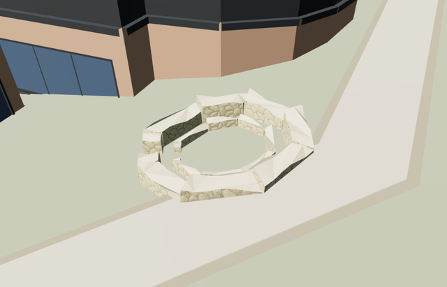

# Eastern octagonal latrine, Villa Romana del Casale

Reviewed 2026-11-14. **Current-world exterior and placement passed.**

The uncovered outer and inner masonry rings, gaps and local grade match the observed layout. Ordinary aerial imagery guided the ruin geometry; standard PMTiles controls its footprint and axes. [Overhead reference](https://www.smarteducationunescosicilia.it/en/piazza-armerina/the-main-nuclei-of-the-domus/)

The viewer places OSM way/304818578 at its retained anchor and baked heading. All four LODs replace its one PMTiles building footprint. Eleven neighboring building records and all nine road and path records stay intact in the local fixture. Eight open approach and interior probes retain native ground. All 18 masonry cap probes stay above the terrain. Failed loading restores the original footprint, and unload restores the ground and releases all model geometry.

Three material roles use the existing stone_drywall and stone_limestone_raw graphs. The six-member site fixture resolves each of its nine graphs once. The model has metric UVs, zero embedded images and no private atlas.

## Source and review

Rebuild with `node packages/worldgen/scripts/generate-additional-landmarks.mjs --ids=casale_east_latrine`. The four runtime levels contain 432, 904, 1652, 3102 triangles. Skyline and district total 143,960 bytes. Six GLBs passed validation and 59 rendered views passed inspection. [Review and hashes](qa.json)

The mapped external footprint controls scale. The low wall heights, opening width, internal ring, fracture pattern and archaeological floor are approximate.
