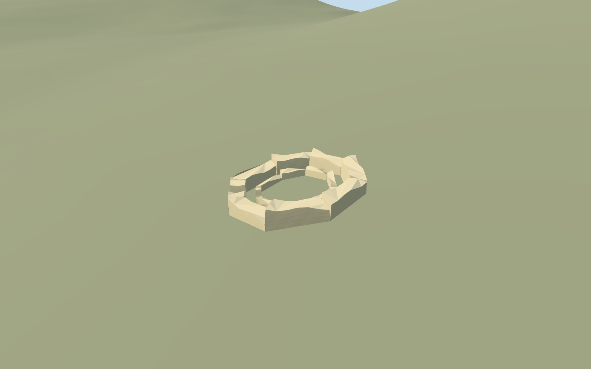

# Eastern latrine masonry remains, Villa Romana del Casale

Surviving uncovered octagonal masonry beside the Villa Romana del Casale basilica. A broad low outer rim and smaller inner rim surround an open center, with an approximate opening toward the villa. Other villa buildings are separate landmarks.

## Evidence and reconstruction

Published dimensions and reconstructed details are separated in spec.json. Primary references:

- [Reference](https://www.villaromanadelcasale.it/)
- [Reference](https://www.sslanzilotti.com/armerina-villa-del-casale)
- [Reference](https://www.smarteducationunescosicilia.it/en/piazza-armerina/the-main-nuclei-of-the-domus/)

Surviving uncovered octagonal masonry beside the Villa Romana del Casale basilica. A broad low outer rim and smaller inner rim surround an open center, with an approximate opening toward the villa. Other villa buildings are separate landmarks.

## Model and axes

3,102 triangles; 9,306 vertices; 3 material groups; 374,780 bytes. Native bounds: -2.730, -1.334, -2.731 to 2.729, 0.551, 2.729. Source hash: `sha256:b93d6a4d1a0335ba4cb72889d31f2babf03e9e3d7b80dd45d351ad10d3f8de9a`.

{"x":"east","y":"up","z":"south"}

The geographic proposal uses exact-QID OpenStreetMap evidence. Map-derived orientation and estimated architectural details require real-site visual review; preview eligibility is distinct from geographic/fidelity approval. Map attribution: © OpenStreetMap contributors, ODbL-1.0.

## Reproduce

Run `node packages/worldgen/scripts/generate-additional-landmarks.mjs --ids=casale_east_latrine` (or add `--check`). The generator preserves manually edited masters by checking their baseline hashes. Import through the standard authored-model workflow with optimization disabled; then capture all QA cameras, including shared-surface views.

## Pending work

- Surviving uncovered octagonal masonry beside the Villa Romana del Casale basilica. A broad low outer rim and smaller inner rim surround an open center, with an approximate opening toward the villa. Other villa buildings are separate landmarks.
- The upper eastern octagon in the aerial lies between the basilica and the perimeter path. Standard PMTiles identifies its outline as the independent feature 35184676907410, mapped as OSM way/304818578. The site has Wikidata ID Q505617. The southern polygonal latrine retains its own identity. East, up and south are baked into the model at heading zero.
- The overhead site photo shows an uncovered broad outer rim, a smaller concentric rim, and a gap on the side toward the villa. The mapped outline controls outer dimensions. The inner rim, gaps, edge breakup and heights are approximated from the picture. Outer courses rise about 0.49–0.73 m and inner courses 0.22–0.36 m above the sampled field. The center retains native ground.
- The unchanged standard terrain provides the existing eastern datum at about 554.96 m. Each closed footing reaches at least 0.16 m below its sampled strip. Ground masks follow both occupied masonry rings and leave the center, the gap between rings, and the villa-facing entrance open.

This bundle follows the medium-fi standard. Medium-fi appearance and geographic fit are reviewed separately. Hash-bound visual acceptance is recorded separately after capture inspection.
