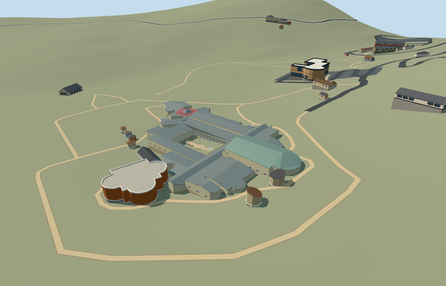

# casale_main — Villa Romana del Casale main complex

Reviewed 2026-10-23. **Completed medium-fi connected conservation exterior; qualified approximate native fit. Collection villa_romana_del_casale is only 1/6 complete.**

## Built and inspected

Main connected villa and bath conservation exterior: mapped apsidal rooms, actual open peristyle and 32 near columns with bases/capitals, timber shelter beams/rafters, generic tiled portico floor, dry shaped courtyard basin, pale infill above stone ruins, grey standing-seam shelters, higher basilica and Great Hunt ranges, stepped western baths and separate red octagonal frigidarium roof/faceted skylight. Closed roof undersides and stepped infill eliminate observed seams. Column bays and court are real voids. Skylight/high window glazing is an opaque exterior proxy; no furnished interior or copied figurative mosaics. Five detached collection members remain separate pending models.

## Shared materials and LODs

Nine roles use seven existing 256px shared graphs: plaster_lime, stone_limestone_raw (including cream columns), metal_standing_seam (grey/copper tint variants), metal_painted, storefront, wood_plain and tile_mosaic. Metric UVs use canonical graph repeat sizes; generic tile is a tonal proxy, not literal villa mosaic art. No embedded image, private atlas or new graph. Seven textured draws/one skyline draw; separate POSITION/NORMAL streams and equal CPU/GPU geometry bytes. Each used graph reads once per native run; unload disposes geometry.

| Level | Triangles | Bytes | Draws |
| --- | ---: | ---: | ---: |
| skyline | 891 | 86452 | 1 |
| district | 3812 | 306100 | 7 |
| street | 7542 | 607428 | 7 |
| closeup | 11126 | 886992 | 7 |

Four authored LODs 891 / 3812 / 7542 / 11126 triangles; initial skyline+district geometry 392552 bytes, closeup 886992 bytes. Six GLBs zero Khronos errors/warnings; 410 actual mesh/contact probes, three actual PMTiles 13/14/15 cases, one detailed owned parent. Inspected 52 current portable/shared/medium-fi/native frames. Every LOD/failure/unload preserves 42 resident / 43 wider independent buildings, original 201x201/6m terrain/roads and empty water layer. Courtyard/approaches remain original ground except the dry basin. Failure keeps all 43 original resident buildings; unload restores ground/water with zero live geometry.

## Geographic fit

Q505617 identifies the archaeological park way304804695; it is not a building footprint. This independent member uses the actual main covered building relation4063362/native52776562196610, including its four-point peristyle hole. Internal X follows the long court axis east-northeast toward the basilica; internal Z points south-southeast. Native east/up/south geometry is baked with heading0. Only the main covered footprint is replaced; all detached site buildings remain independent. Qualified approximate native exterior fit on original Protomaps20261020/Mapzen 201x201/6m terrain. Outside-building provider internal[-20,24] supplies the 544.1027338337185m datum. Main boundary grades -1.330..10.799m require reconstructed working terraces (543.2–551.0m absolute), pale infill and closed foundations at -1.480m relative. Current native views show connected shelters, open peristyle/column bays, clear outside approaches and supported low baths; downhill foundation and partial uphill base burial remain visible. The dry courtyard basin is an approximate raised exterior proxy. Exact excavated floors, paving/stairs, water state, historic room levels and accessible transitions are unverified. Five occupied masks cover only the main building minus its courtyard plus the basin; original courtyard garden and approaches remain. Preserve all 42 resident / 43 wider independent buildings, original ground/roads and empty native water layer. No bespoke terrain or flattening.

## Fidelity and limits

Photo-led medium-fi conservation exterior. No qualified mapped heights. Working absolute floor terraces: western baths543.2m, frigidarium544.2m, peristyle545.5m, north rooms547.4m, Great Hunt548.0m, eastern rooms549.2m and basilica551.0m. These roughly follow the retained standard DEM and photographed stepped roofscape; they are reconstructed working levels, not measured ancient floors. Shelter eaves3.5–6m above their working floor and simple gables/faceted apses/skylight preserve roof forms. Wall and roof subdivisions, room inventories, exact glazing/beam spacing and unseen elevations are approximate. Shared geometric tile flooring is a generic tonal proxy, not a recreation of the villa mosaics. Qualified approximate native exterior fit on original Protomaps20261020/Mapzen 201x201/6m terrain. Outside-building provider internal[-20,24] supplies the 544.1027338337185m datum. Main boundary grades -1.330..10.799m require reconstructed working terraces (543.2–551.0m absolute), pale infill and closed foundations at -1.480m relative. Current native views show connected shelters, open peristyle/column bays, clear outside approaches and supported low baths; downhill foundation and partial uphill base burial remain visible. The dry courtyard basin is an approximate raised exterior proxy. Exact excavated floors, paving/stairs, water state, historic room levels and accessible transitions are unverified. Five occupied masks cover only the main building minus its courtyard plus the basin; original courtyard garden and approaches remain. Preserve all 42 resident / 43 wider independent buildings, original ground/roads and empty native water layer. No bespoke terrain or flattening. Shared materials and reconstructed exterior proportions meet the current medium-fi standard. Roof subdivisions and exact red skylight junction, room/window/column inventories, unseen elevations, mosaic imagery, basin water state, ancient floor levels and accessibility remain approximate or unverified. Procedural detached neighbors are not completed unique models. Physical phone/laptop and dense-city timing measurements remain pending.

## Targeted checks

Selected generation/import/placement, strict medium-fi, scene/sim30 pass. Sim30 sha256:ab1c4cb9338ad41a3439e37ee6ae72c50369b55777297c98c946883bc4d0798a. Current pins: [qa.json](qa.json); [source controls](map-frame.json).

## Viewed references

- https://www.villaromanadelcasale.it/ — Site operator; individual photographer not specified; Photo date unspecified; No reuse license established; viewed only, no pixels copied. Viewed only; no copied pixels.

- https://www.villaromanadelcasale.it/portfolio_category/virtual-tour-aereo/ — Site operator; individual photographer not specified; Unspecified; Viewed only; no pixels copied. Viewed only; no copied pixels.

- https://www.sslanzilotti.com/armerina-villa-del-casale — Unknown; page labels this aerial an internet photo; Unspecified; No reuse license established; viewed only, no copied pixels. Viewed only; no copied pixels.

- https://www.villaromanadelcasale.it/portfolio_category/virtual-tour-aereo/ — Site operator; individual photographer not specified; Unspecified; Viewed only; no pixels copied. Viewed only; no copied pixels.

- https://www.openstreetmap.org/relation/4063362 — main building and open peristyle; ©OpenStreetMap contributors, ODbL-1.0. Park way304804695 is collection identity, not a building footprint. Standard PMTiles/Mapzen only.

## Completion checklist

- [x] Rebuildable master/import, four authored LODs and shared materials.
- [x] Current exterior/context/native renders and geometry inspected.
- [x] Explicit main-building identity/orientation and qualified native exterior fit.
- [x] Court/approaches/independent buildings/roads/terrain retained; failed loading/unload restoration checked.
- [ ] Detached Triclinium, Xystus, entrance piers and two latrines remain five required independent models.
