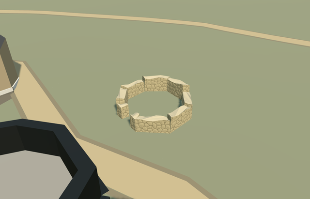

# casale_polygonal_latrine — Casale polygonal latrine remains

Reviewed 2026-10-23. **Completed medium-fi surviving exterior; qualified approximate native fit. Casale is 5/6 complete; east latrine remains draft.**

## Built and inspected

Detached southern polygonal latrine remains, on its own exact eight-sided mapped footprint east of the southern apartments. Low broad rubble walls, irregular broken caps, a reconstructed west-facing entrance gap toward the main villa and a genuinely open center retain original ground. No speculative intact ancient roof, invented conservation canopy, mosaic copy, furnishings, benches or underground plumbing. Main villa, Triclinium, Xystus, entrance and the northern east-latrine draft remain independent. Existing ordinary aerial shows the separate southern polygon with a low rim and open dark center; no roof is reconstructed. Exact mapped outline, low rubble faces/fractured caps and a genuinely open center distinguish this from a generic roofed map building. West gap, thickness, heights and unseen faces are approximate exterior interpretations. This member completes only the southern polygonal latrine; east-latrine draft remains unresolved.

## Materials and LODs

Three material roles share two existing 256px graphs, stone_drywall and stone_limestone_raw. Canonical metric UVs, sRGB-to-linear tint and baked graph means for skyline; three textured draws/one skyline. No embedded images, private atlas or new graph. Separate vertex streams and equal CPU/GPU geometry bytes. All six authored Casale models (five complete plus one east-latrine draft) use nine total existing graphs, each read once. Flat synthetic planes intersect grade-specific bases or expose mask patches; original native terrain establishes ground fit.

| Level | Triangles | Bytes | Draws |
| --- | ---: | ---: | ---: |
| skyline | 216 | 22880 | 1 |
| district | 472 | 53984 | 3 |
| street | 911 | 102964 | 3 |
| closeup | 1924 | 215292 | 3 |

Four authored LODs 216 / 472 / 911 / 1924 triangles; initial skyline+district geometry 76864 bytes, closeup 215292 bytes. Six GLBs have zero Khronos errors/warnings, 138 actual mesh/contact probes and one detailed PMTiles15 owned case; no intersecting level13/14 building in this extract. Inspected 49 current source/shared/medium-fi/native frames. Four LODs/failure/unload retain 42 resident /43 wider independent buildings, original201x201/6m terrain, road inputs, empty water layer, center and west gap. Failure retains all43 originals. Six-model loading test retains34 other resident buildings and nine existing graphs read once; all runs restore ground/water and leave zero live model geometry. The east-latrine draft is forced only into the explicit combined test, not activated in the catalog.

## Geographic fit

Shared park Q505617 identifies the site; independent way412339872/native35184784428704 identifies this separate southern polygonal latrine. Its eight mapped vertices set meter scale and offsets. Internal +X points east-southeast away from the villa and +Z follows the western side south-southwest. Native east/up/south axes are baked with heading 0. Only this one footprint is replaced; the northern eastern latrine and every other building remain independent. Qualified approximate native exterior fit on original Protomaps20261020/Mapzen 201x201 / 6m ground. Open eastern provider [4,0] supplies 554.4101060817029m datum. Boundary grades -0.941..+0.026m; each of nine closed masonry bases extends 0.15m below its own footprint minimum. Current native views show supported low walls with modest grade-related exposure/burial, a clear west gap and original open center/approaches. Only masonry strips mask terrain; all 42 resident / 43 wider independent buildings, original grid/roads and empty water layer remain. Exact archaeological floor/paving, thresholds, wall preservation and accessibility are unverified. No bespoke terrain or flattening.

## Fidelity and limits

Photo-led medium-fi surviving masonry exterior. Existing ordinary aerial shows this southern detached polygon as an open dark center bounded by a low pale rim, beside the southern apartments and inside the path. No roof covers that visible center. Exact mapped outer polygon sets scale; inner face is a reconstructed 0.79 radial inset. Working wall tops vary 0.88–1.12m above local original terrain. Wall heights, west gap position/width, thickness, fracture pattern and unseen faces are unmeasured approximations. No qualified map height; exact excavated floor/paving, benches/drains and accessibility are unverified. No roof, mosaic copy, furnished interior or subterranean reconstruction. Qualified approximate native exterior fit on original Protomaps20261020/Mapzen 201x201 / 6m ground. Open eastern provider [4,0] supplies 554.4101060817029m datum. Boundary grades -0.941..+0.026m; each of nine closed masonry bases extends 0.15m below its own footprint minimum. Current native views show supported low walls with modest grade-related exposure/burial, a clear west gap and original open center/approaches. Only masonry strips mask terrain; all 42 resident / 43 wider independent buildings, original grid/roads and empty water layer remain. Exact archaeological floor/paving, thresholds, wall preservation and accessibility are unverified. No bespoke terrain or flattening. Meets the medium-fi surviving-exterior standard. Actual outer eight-vertex footprint is controlled; small-scale masonry inventory and exact preservation details are approximate. No copied mosaics or figurative artwork, furnished latrine, invented intact ancient roof or underground plumbing. Physical phone/laptop and dense-city measurements remain pending.

## Targeted checks

Selected generation/import/placement, strict medium-fi, scene/sim30 and two-recipe lint pass. Sim30 sha256:b205a5fedf72fde7328adde18d199f2112ad44c83678e89019eb744fac4ada1e. Current pins in [qa.json](qa.json); actual map controls in [map-frame.json](map-frame.json).

## References

- https://www.villaromanadelcasale.it/ — Site operator; individual photographer not specified; Photo date unspecified; No reuse license established; viewed only, no pixels copied. Viewed only; no copied pixels.

- https://www.sslanzilotti.com/armerina-villa-del-casale — Unknown; page labels this aerial an internet photo; Unspecified; No reuse license established; viewed only, no copied pixels. Viewed only; no copied pixels.

- https://www.openstreetmap.org/way/412339872 — independent eight-vertex polygon; ©OpenStreetMap contributors, ODbL-1.0.

## Completion checklist

- [x] Rebuildable master/import, four authored LODs and existing shared textures.
- [x] Current geometry/material/medium-fi/native images inspected and source/runtime/input hashes verified.
- [x] One controlled identity/footprint, baked orientation and qualified original-terrain fit.
- [x] Center/gap/approaches and independent buildings retained; failed load/unload restoration checked.
- [ ] Separate northern east-latrine exterior remains incomplete; this approval does not include it.
