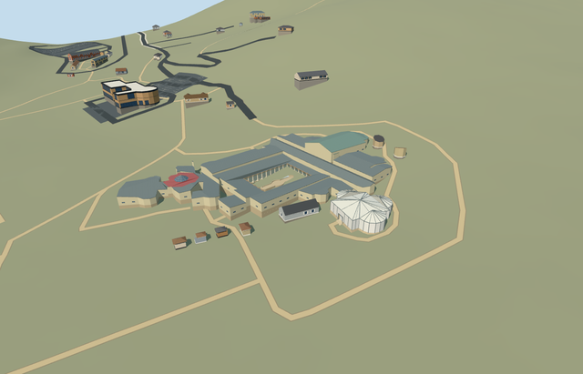

# casale_triclinium — Casale Triclinium conservation shelter

Reviewed 2026-10-23. **Completed medium-fi detached shelter exterior; qualified approximate native fit. Collection villa_romana_del_casale is 2/6 complete.**

## Built and inspected

Detached Triclinium conservation shelter: exact mapped triapsidal footprint, pale central hipped roof/three radial apse caps, raised roof ribs and perimeter frame posts, low stone ruin base and opaque glazing proxies. Real west 0.7m door recess with closed soffit/threshold and three short exterior treads. Two ordinary aerials, one inspected again this round, plus standard PMTiles/Mapzen guide the exterior. Revised the eastern detail camera after the first north view was inside a procedural context neighbor. No copied mosaics or furnished rooms. Combined native view loads this model and the already completed main complex together; Xystus/gate/latrines remain procedural pending unique models.

## Shared materials and LODs

Five material roles share four existing 256px graphs: stone_limestone_raw, glass_frit_triangular (roof/window slots with pale/cool tint variants), metal_painted and tile_mosaic. Canonical metric UV repeats and sRGB-to-linear vertex tint; baked graph means retain skyline tone. Pale opaque glazing/roof is a low-cost proxy for the photographed translucent shelter, without literal refraction or a copied image. No embedded images, private atlas or new graph. Five textured draws/one skyline; separate vertex streams and equal CPU/GPU bytes. Each graph reads once. The two-model native scene shares eight total graphs; each reads once.

| Level | Triangles | Bytes | Draws |
| --- | ---: | ---: | ---: |
| skyline | 235 | 21448 | 1 |
| district | 1641 | 133044 | 5 |
| street | 2085 | 167680 | 5 |
| closeup | 2265 | 181720 | 5 |

Four authored LODs 235 / 1641 / 2085 / 2265 triangles; initial skyline+district geometry 154492 bytes, closeup 181720 bytes. Six GLBs zero Khronos errors/warnings; 132 actual mesh/contact probes; three actual PMTiles 13/14/15 cases, one detailed owned parent. Inspected 49 current portable/shared/medium-fi/native frames including one two-model native overview. Every individual LOD/failure/unload retains 42 resident / 43 wider independent buildings and original 201x201/6m terrain/roads/empty water layer. Failed loading keeps all 43 original resident buildings. Combined main+Triclinium loading preserves all 41 other resident buildings, original map data and one read per shared graph. Both scenes restore ground/water on unload and leave zero live geometry.

## Geographic fit

Shared site Q505617 and unique building way304818579/native35184676907411 identify this detached Triclinium, not the whole archaeological park. Its 31-vertex triapsidal outline sets meter scale. +X follows the west wall normal east/slightly north toward the eastern apse; +Z follows the west wall south/slightly east. Native east/up/south axes are baked, heading0. Only this footprint is replaced; all other site structures remain independent. Qualified approximate native conservation exterior fit on original Protomaps20261020/Mapzen 201x201/6m terrain. South outside-building provider [0,18] supplies 546.7807650290389m datum. Boundary grades -1.108..+1.518m, working floor -0.665m and closed foundation -1.258m relative. The west recessed threshold and three short treads remain exposed and meet the original approach; rising eastern ground partly buries the low stone/cladding base (up to about 2.18m above the floor). The shelter remains seated without native ground holes. Occupied building/stair masks retain original surrounding ground, roads, empty water layer and all 42 resident / 43 wider independent buildings. Excavated floor, doorway/stair reconstruction, exact paving and accessibility are unverified. No bespoke terrain, flattening or invented surrounding structures.

## Fidelity and limits

Photo-led medium-fi conservation exterior. Ordinary aerial shows a pale translucent framed central shelter and three radial apse caps. No qualified mapped heights. Working floor 546.116m absolute follows the native west threshold plus0.36m. Ruin base1.0m, canopy eave5.2m, central peak7.6m and apse peaks7.4m above the floor are reconstructed. Opaque pale glazing/roof proxies retain simple reflections without costly refraction. Frame spacing, doorway/stairs, roof junctions, unseen elevations, actual floor/mosaic state and accessibility are unverified. Qualified approximate native conservation exterior fit on original Protomaps20261020/Mapzen 201x201/6m terrain. South outside-building provider [0,18] supplies 546.7807650290389m datum. Boundary grades -1.108..+1.518m, working floor -0.665m and closed foundation -1.258m relative. The west recessed threshold and three short treads remain exposed and meet the original approach; rising eastern ground partly buries the low stone/cladding base (up to about 2.18m above the floor). The shelter remains seated without native ground holes. Occupied building/stair masks retain original surrounding ground, roads, empty water layer and all 42 resident / 43 wider independent buildings. Excavated floor, doorway/stair reconstruction, exact paving and accessibility are unverified. No bespoke terrain, flattening or invented surrounding structures. Meets the current medium-fi exterior standard. Three roof caps and the frame are modeled; glazing is deliberately opaque. Modern cladding transmission, exact roof junctions/frame spacing, low ruin inventories, entrance/stair form, excavated floors/mosaics and accessibility remain approximate or unverified. Physical phone/laptop and dense-city timings remain pending.

## Targeted checks

Selected generation/import/placement, strict medium-fi, scene/sim30 pass. Sim30 sha256:e4f6a0623cea52d1bd3a7d0540d57d27e98ff415d452c505f8ef6e62a9590cff. Current pins: [qa.json](qa.json); [source controls](map-frame.json).

## Viewed references

- https://www.villaromanadelcasale.it/ — Site operator; individual photographer not specified; Photo date unspecified; No reuse license established; viewed only, no pixels copied. Viewed only; no copied pixels.

- https://www.sslanzilotti.com/armerina-villa-del-casale — Unknown; page labels this aerial an internet photo; Unspecified; No reuse license established; viewed only, no copied pixels. Viewed only; no copied pixels.

- https://www.openstreetmap.org/way/304818579 — detached triapsidal building; ©OpenStreetMap contributors, ODbL-1.0. Park way304804695 is collection identity, not a building footprint. Standard PMTiles/Mapzen only.

## Completion checklist

- [x] Rebuildable master/import, four authored LODs and shared materials.
- [x] Current exterior/context/native renders and geometry inspected.
- [x] Explicit independent-building identity/orientation and qualified native exterior fit.
- [x] Approaches/independent buildings/roads/terrain retained; failed loading/unload restoration checked.
- [ ] Xystus, entrance piers and two latrines remain four required independent models.
