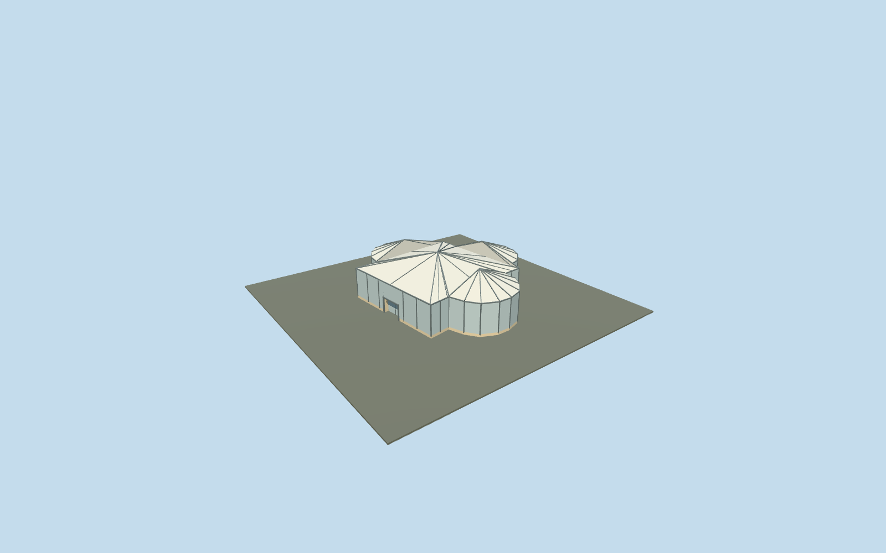

# Triapsidal Triclinium conservation shelter, Villa Romana del Casale

Detached triapsidal Triclinium conservation shelter only. Exact mapped west rectangle and three rounded apses, low stone ruin plinth, glazed exterior proxies between slim frame posts, pale faceted hipped central roof/three radial apse caps, raised roof ribs and diagonal bracing. West entrance has a shallow recess, soffit, threshold and three short reconstructed treads. Main villa/baths, Xystus court, gate piers and two latrines remain independent. Generic interior floor is not a reproduction of figurative mosaics; no copied artwork, furniture or archaeological room inventory.

## Evidence and reconstruction

Published dimensions and reconstructed details are separated in spec.json. Primary references:

- [Reference](https://www.villaromanadelcasale.it/)
- [Reference](https://www.sslanzilotti.com/armerina-villa-del-casale)

Detached triapsidal Triclinium conservation shelter only. Exact mapped west rectangle and three rounded apses, low stone ruin plinth, glazed exterior proxies between slim frame posts, pale faceted hipped central roof/three radial apse caps, raised roof ribs and diagonal bracing. West entrance has a shallow recess, soffit, threshold and three short reconstructed treads. Main villa/baths, Xystus court, gate piers and two latrines remain independent. Generic interior floor is not a reproduction of figurative mosaics; no copied artwork, furniture or archaeological room inventory.

## Model and axes

2,265 triangles; 4,761 vertices; 5 material groups; 202,072 bytes. Native bounds: -9.669, -1.258, -13.177 to 13.949, 7.044, 13.059. Source hash: `sha256:d973727fefcb2eb85e12eb6a0a768859dcf3dc3102bc306993bb3920c312ad51`.

{"x":"east","y":"up","z":"south"}

The geographic proposal uses exact-QID OpenStreetMap evidence. Map-derived orientation and estimated architectural details require real-site visual review; preview eligibility is distinct from geographic/fidelity approval. Map attribution: © OpenStreetMap contributors, ODbL-1.0.

## Reproduce

Run `node packages/worldgen/scripts/generate-additional-landmarks.mjs --ids=casale_triclinium` (or add `--check`). The generator preserves manually edited masters by checking their baseline hashes. Import through the standard authored-model workflow with optimization disabled; then capture all QA cameras, including shared-surface views.

## Pending work

- Detached triapsidal Triclinium conservation shelter only. Exact mapped west rectangle and three rounded apses, low stone ruin plinth, glazed exterior proxies between slim frame posts, pale faceted hipped central roof/three radial apse caps, raised roof ribs and diagonal bracing. West entrance has a shallow recess, soffit, threshold and three short reconstructed treads. Main villa/baths, Xystus court, gate piers and two latrines remain independent. Generic interior floor is not a reproduction of figurative mosaics; no copied artwork, furniture or archaeological room inventory.
- Shared site Q505617 and unique building way304818579/native35184676907411 identify this detached Triclinium, not the whole archaeological park. Its 31-vertex triapsidal outline sets meter scale. +X follows the west wall normal east/slightly north toward the eastern apse; +Z follows the west wall south/slightly east. Native east/up/south axes are baked, heading0. Only this footprint is replaced; all other site structures remain independent.
- Photo-led medium-fi conservation exterior. Ordinary aerial shows a pale translucent framed central shelter and three radial apse caps. No qualified mapped heights. Working floor 546.116m absolute follows the native west threshold plus0.36m. Ruin base1.0m, canopy eave5.2m, central peak7.6m and apse peaks7.4m above the floor are reconstructed. Opaque pale glazing/roof proxies retain simple reflections without costly refraction. Frame spacing, doorway/stairs, roof junctions, unseen elevations, actual floor/mosaic state and accessibility are unverified.
- Qualified approximate native conservation exterior fit on original Protomaps20261020/Mapzen 201x201/6m terrain. South outside-building provider [0,18] supplies 546.7807650290389m datum. Boundary grades -1.108..+1.518m, working floor -0.665m and closed foundation -1.258m relative. The west recessed threshold and three short treads remain exposed and meet the original approach; rising eastern ground partly buries the low stone/cladding base (up to about2.18m above the floor). The shelter remains seated without native ground holes. Occupied building/stair masks retain original surrounding ground, roads, empty water layer and all 42 resident / 43 wider independent buildings. Excavated floor, doorway/stair reconstruction, exact paving and accessibility are unverified. No bespoke terrain, flattening or invented surrounding structures.

This bundle follows the medium-fi standard. Medium-fi appearance and geographic fit are reviewed separately. Hash-bound visual acceptance is recorded separately after capture inspection.
